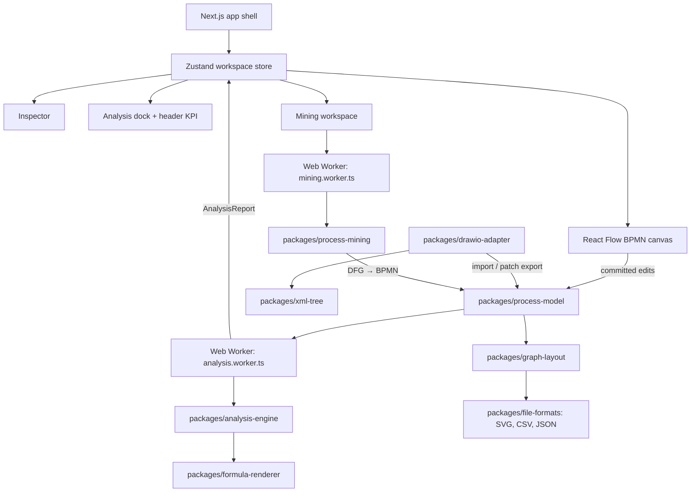
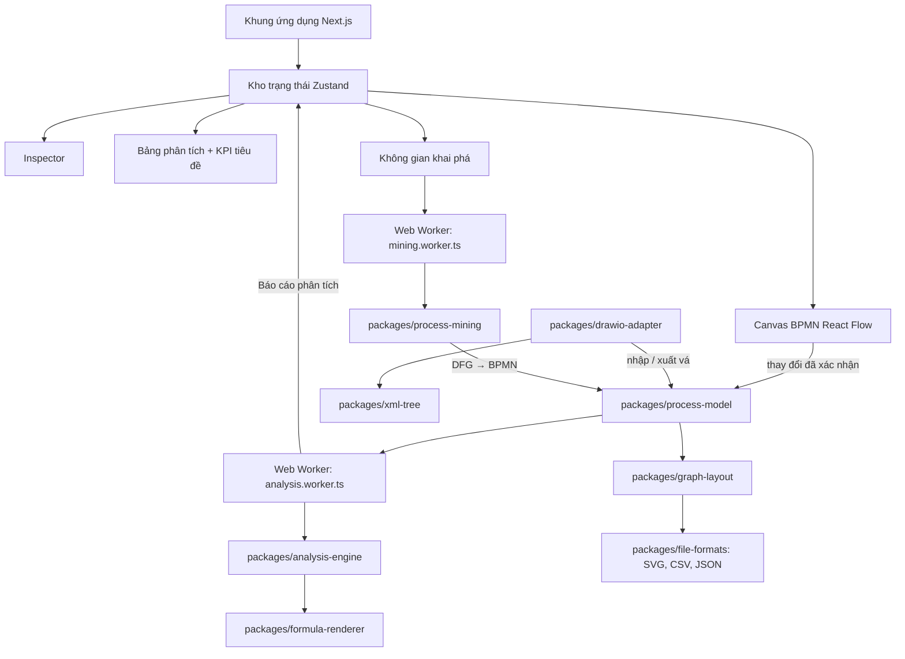

<p align="center">
  
</p>

# ⚡ Flowculus

<p align="center">
  <strong>BPMN process modeling, process mining and quantitative cycle-time analysis in the browser</strong>
</p>

<p align="center">
  <a href="#-table-of-contents"></a>
  
  
  
  
  
</p>

---

## 📑 Table of Contents

- [English Documentation](#-english-documentation)
  - [Overview](#-overview)
  - [Key Features](#-key-features)
  - [Process Mining](#-process-mining)
  - [Mathematical & Theoretical Foundation](#-mathematical--theoretical-foundation)
  - [System Architecture](#-system-architecture)
  - [Project & Monorepo Structure](#-project--monorepo-structure)
  - [Getting Started & Local Development](#-getting-started--local-development)
  - [Available Scripts](#-available-scripts)
  - [Security & Privacy](#-security--privacy)
  - [Acknowledgements & References](#-acknowledgements--references)
  - [License](#-license)
- [Tài Liệu Tiếng Việt](#-t%C3%A0i-li%E1%BB%87u-ti%E1%BA%BFng-vi%E1%BB%87t)
  - [Giới Thiệu Tổng Quan](#-gi%E1%BB%9Bi-thi%E1%BB%87u-t%E1%BB%95ng-quan)
  - [Các Tính Năng Nổi Bật](#-c%C3%A1c-t%C3%ADnh-n%C4%83ng-n%E1%BB%95i-b%E1%BA%ADt)
  - [Khai Phá Quy Trình](#-khai-ph%C3%A1-quy-tr%C3%ACnh)
  - [Cơ Sở Lý Thuyết & Công Thức Toán Học](#-c%C6%A1-s%E1%BB%9F-l%C3%BD-thuy%E1%BA%BFt--c%C3%B4ng-th%E1%BB%A9c-to%C3%A1n-h%E1%BB%8Dc)
  - [Kiến Trúc Hệ Thống](#-ki%E1%BA%BFn-tr%C3%BAc-h%E1%BB%87-th%E1%BB%91ng)
  - [Cấu Trúc Dự Án Monorepo](#-c%E1%BA%A5u-tr%C3%BAc-d%E1%BB%B1-%C3%A1n-monorepo)
  - [Hướng Dẫn Cài Đặt & Chạy Cục Bộ](#-h%C6%B0%E1%BB%9Bng-d%E1%BA%ABn-c%C3%A0i-%C4%91%E1%BA%B7t--ch%E1%BA%A1y-c%E1%BB%A5c-b%E1%BB%99)
  - [Danh Sách Lệnh Thực Thi](#-danh-s%C3%A1ch-l%E1%BB%87nh-th%E1%BB%B1c-thi)
  - [Bảo Mật & Quyền Riêng Tư](#-b%E1%BA%A3o-m%E1%BA%ADt--quy%E1%BB%81n-ri%C3%AAng-t%C6%B0)
  - [Lời Cảm Ơn & Tham Chiếu](#-l%E1%BB%9Di-c%E1%BA%A3m-%C6%A1n--tham-chi%E1%BA%BFu)
  - [Bản Quyền](#-b%E1%BA%A3n-quy%E1%BB%81n)

---

# 🌐 English Documentation

## 🌟 Overview

**Flowculus** is a browser-first, zero-backend workspace for designing business processes, discovering them from event logs and analysing their flow quantitatively.

It has two modes:

- **Model** – a native BPMN 2.0 canvas built on React Flow. Every edit is committed to a semantic process model, and a background Web Worker recalculates the analysis immediately.
- **Mining** – upload an ERP, CRM or service-desk event log (CSV, JSON or XES), explore its directly-follows graph, variants and bottlenecks, then send the discovered process to the canvas for what-if analysis.

The analysis engine calculates:

- **Cycle Time ($CT$)**, **Theoretical Cycle Time ($TCT$)** and **Cycle-Time Efficiency ($CTE$)**
- **Cost per execution** and **resource utilisation**
- **Little's Law forecast** ($WIP = \lambda \times CT$) and **$M/M/c$ queue metrics per resource pool**
- **Critical Path (CPM)** for decision-free graphs and a **critical chain** that follows the dominant branch when the graph contains decisions
- **Path counts** between any two elements

Every result carries an honest quality label: `exact`, `assumption` or `simulation-required`.

---

## 🚀 Key Features

| Feature                          | Description                                                                                                                                                                                 |
| :------------------------------- | :------------------------------------------------------------------------------------------------------------------------------------------------------------------------------------------ |
| **🎨 Native BPMN canvas**        | Drag shapes from the rail – they land exactly under the pointer at any zoom. Large magnetic connection handles, hover quick actions, inline rename, undo/redo, keyboard delete and minimap. |
| **🏷 Data on the diagram**        | Tasks show `T`, `Wq`, hourly rate and rework chips; sequence flows show their branch probability; the critical path is highlighted and animated.                                            |
| **📈 Live KPI badge**            | CT, TCT and CTE in the header update as you edit, with a colour-coded quality dot.                                                                                                          |
| **⚡ Background math engine**    | Analysis runs in a Web Worker with a formula AST for every result, so the canvas never blocks.                                                                                              |
| **📥 draw.io import**            | Opens plain, compressed and multi-page `.drawio` files. BPMN shapes are inferred and marked for confirmation when the file has no Flowculus metadata.                                       |
| **📤 Lossless draw.io export**   | Exports patch the original file: unknown cells, styles and pages are preserved, and only moved, renamed, added or deleted elements change.                                                  |
| **🖼 Exports**                    | `.drawio`, `.flowculus.json`, nodes/edges CSV, vector SVG, PNG/JPEG rendered at 2–3× and a print-ready PDF or image report with the analysis.                                               |
| **⛏ Process mining**             | DFG, variants, bottlenecks, filters and DFG→BPMN conversion with four sample logs.                                                                                                          |
| **🌓 Theme & localisation**      | Light/dark themes and full English/Vietnamese UI.                                                                                                                                           |
| **📱 Responsive**                | Works from 320 px phones to wide desktops; the inspector becomes a bottom sheet on small screens.                                                                                           |
| **🔒 100% private, client-side** | No telemetry and no server storage. Drafts persist in IndexedDB.                                                                                                                            |

---

## ⛏ Process Mining

1. **Load a log** – pick a sample (Order-to-Cash, Procure-to-Pay, IT Service Desk, IS6003 delivery log) or upload CSV, JSON or IEEE XES.
2. **Map columns** – case ID, activity and timestamp are required; start time, lifecycle, resource and cost are optional. English, XES and Vietnamese headers are recognised automatically.
3. **Explore** – switch the directly-follows graph between frequency and mean time, filter by activity share, path share and transition time, and trace any variant on the map.
4. **Find bottlenecks** – the slowest transitions and activities are ranked by mean duration, with their share of total time.
5. **Send to the BPMN canvas** – frequencies become XOR gateways with branch probabilities, repeats become rework, and log durations become `T`/`Wq`. Every inferred gateway is flagged so the analysis is labelled `assumption` until you confirm it.

Parsing and discovery run in a dedicated Web Worker (`workers/mining.worker.ts`), with a synchronous fallback when module workers are blocked.

---

## 🧮 Mathematical & Theoretical Foundation

Flowculus implements the flow-analysis equations from _Fundamentals of Business Process Management_ (2nd ed., Dumas et al., Chapter 7):

### 1. Sequence

$$CT = \sum_{i=1}^n CT_i$$

### 2. Exclusive choice (XOR split / join)

With branch probabilities $p_i$ ($\sum p_i = 1$):
$$CT = \sum_{i=1}^n p_i \times CT_i$$

### 3. Parallel (AND split / join)

$$CT = \max(CT_1, \dots, CT_n), \qquad \text{Cost} = \sum_{i=1}^n \text{Cost}_i$$

### 4. Rework

For a task with rework probability $r$ ($0 \le r < 1$):
$$CT = \frac{T}{1 - r}$$

Loops through gateways are solved as a fixed point of the expected-visit equations.

### 5. Theoretical Cycle Time & efficiency

$TCT$ uses processing time only ($W_q = 0$):
$$CTE = \frac{TCT}{CT} \times 100\%$$

### 6. Critical path and critical chain

- **CPM** is exact for decision-free, acyclic graphs.
- When the graph contains XOR/OR decisions, the **critical chain** follows the dominant (most likely) branch and is labelled as an `assumption`.

### 7. Little's Law & queueing

- **Little's Law**: $L = \lambda \times W$, used to forecast WIP from the arrival rate.
- **Utilisation**: $\rho = \frac{\lambda}{c \mu}$, with $\mu = 60 / \text{unit load}$ per hour.
- **Waiting time**: $W_q$ from the Erlang-C formula for an $M/M/c$ queue per resource pool.

---

## 🏗 System Architecture



See [docs/architecture.md](docs/architecture.md) and [ADR 0002](docs/adr/0002-native-canvas.md) for details.

---

## 📦 Project & Monorepo Structure

```text
Flowculus/
├── apps/
│   └── web/                     # Next.js 16 App Router application
│       ├── app/                 # Layout, metadata, global styles
│       ├── components/          # Workspace shell, analysis panels
│       │   ├── canvas/          # React Flow canvas, BPMN nodes, edges, quick actions
│       │   ├── header/          # Mode switch, live KPI badge
│       │   ├── inspector/       # Node and edge inspectors
│       │   └── mining/          # Event-log workspace: DFG, variants, bottlenecks, mapping
│       ├── lib/                 # Store, editing commands, exports, i18n, worker clients
│       ├── public/              # Logo and favicon
│       └── workers/             # Analysis and mining Web Workers
├── packages/
│   ├── analysis-engine/         # Cycle time, cost, CPM, critical chain, capacity, queues
│   ├── drawio-adapter/          # draw.io import (compressed, multi-page) and patch export
│   ├── file-formats/            # Flowculus JSON, CSV, SVG rendering, auto layout
│   ├── formula-renderer/        # Formula AST and math formatting
│   ├── graph-layout/            # Layered layout and orthogonal edge routing
│   ├── process-mining/          # Event-log parsing, DFG, variants, bottlenecks, DFG→BPMN
│   ├── process-model/           # Domain types, default node sizes, bounds
│   ├── validation/              # Model schemas and graph checks
│   └── xml-tree/                # Dependency-free XML parser/serializer (workers, Node)
├── docs/                        # Architecture notes and ADRs
├── turbo.json                   # Turborepo pipeline
└── package.json                 # Workspace scripts
```

---

## 💻 Getting Started & Local Development

### Prerequisites

- **Node.js** `v20.9.0` or higher
- **pnpm** `v11.x` (via Corepack)

### Installation

```bash
git clone https://github.com/your-username/Flowculus.git
cd Flowculus
corepack enable
pnpm install
pnpm dev
```

Open [http://localhost:3000](http://localhost:3000). No environment variables are required: the canvas is bundled with the app, so there is no external editor to configure.

---

## 🛠 Available Scripts

```bash
pnpm dev            # Development server
pnpm test           # Unit tests for all packages and the web app (Vitest)
pnpm typecheck      # TypeScript across all packages
pnpm lint           # ESLint (web app)
pnpm format         # Prettier write
pnpm format:check   # Prettier check
pnpm build          # Production build
pnpm start          # Serve the production build
pnpm check          # test + format:check + lint + typecheck + build
```

The `:dev` and `:pro` variants (`pnpm dev:pro`, `pnpm build:pro`, …) load an optional `.env.dev` or `.env.pro` file through `dotenv-cli` if you add one for your deployment.

---

## 🔒 Security & Privacy

- **No remote telemetry** – process models, event logs and results never leave the browser.
- **No third-party iframe** – the canvas, importers and exporters run inside the app bundle.
- **Local persistence** – drafts are stored in IndexedDB, with localStorage only as a fallback.
- **Bounded parsing** – event logs are capped at 500,000 events and parsed in a worker.

---

## 🙏 Acknowledgements & References

- **React Flow** (`@xyflow/react`, MIT) by xyflow powers the canvas: [https://reactflow.dev](https://reactflow.dev)
- **draw.io** (diagrams.net) by JGraph defines the file format Flowculus imports and exports: [https://github.com/jgraph/drawio](https://github.com/jgraph/drawio)
- **IEEE 1849-2016 XES** is the event-log standard supported by the mining importer.
- Dumas, La Rosa, Mendling & Reijers, _Fundamentals of Business Process Management_, 2nd ed., Springer.

---

## 📄 License

Distributed under the **MIT License**.

---

# 🇻🇳 Tài Liệu Tiếng Việt

## 🌟 Giới Thiệu Tổng Quan

**Flowculus** là không gian làm việc chạy hoàn toàn trên trình duyệt, không cần backend, dùng để thiết kế quy trình kinh doanh, khai phá quy trình từ nhật ký sự kiện và phân tích định lượng luồng công việc.

Ứng dụng có hai chế độ:

- **Mô hình (Model)** – canvas BPMN 2.0 gốc xây dựng trên React Flow. Mỗi thao tác được ghi vào mô hình quy trình ngữ nghĩa và Web Worker chạy ngầm tính lại kết quả ngay lập tức.
- **Khai phá (Mining)** – tải lên nhật ký sự kiện từ ERP, CRM hoặc service desk (CSV, JSON hoặc XES), xem đồ thị directly-follows, các biến thể và điểm nghẽn, rồi gửi quy trình tìm được sang canvas để phân tích kịch bản.

Bộ máy phân tích tính:

- **Thời gian chu trình ($CT$)**, **thời gian lý thuyết ($TCT$)** và **hiệu suất chu trình ($CTE$)**
- **Chi phí mỗi lượt thực thi** và **mức sử dụng nguồn lực**
- **Dự báo theo Định luật Little** ($WIP = \lambda \times CT$) và **chỉ số hàng đợi $M/M/c$ cho từng nhóm nguồn lực**
- **Đường găng (CPM)** cho đồ thị không có quyết định và **chuỗi găng** đi theo nhánh chiếm ưu thế khi đồ thị có quyết định
- **Đếm số đường đi** giữa hai phần tử bất kỳ

Mỗi kết quả đều có nhãn chất lượng trung thực: `exact` (chính xác), `assumption` (dựa trên giả định) hoặc `simulation-required` (cần mô phỏng).

---

## 🚀 Các Tính Năng Nổi Bật

| Tính năng                             | Mô tả                                                                                                                                                                                                 |
| :------------------------------------ | :---------------------------------------------------------------------------------------------------------------------------------------------------------------------------------------------------- |
| **🎨 Canvas BPMN gốc**                | Kéo hình từ thanh công cụ – hình rơi đúng dưới con trỏ ở mọi mức thu phóng. Điểm nối lớn có hút nam châm, thao tác nhanh khi rê chuột, đổi tên tại chỗ, hoàn tác/làm lại, phím xoá và bản đồ thu nhỏ. |
| **🏷 Dữ liệu ngay trên sơ đồ**         | Công việc hiển thị chip `T`, `Wq`, đơn giá giờ và tỉ lệ làm lại; luồng tuần tự hiển thị xác suất nhánh; đường găng được tô sáng và chuyển động.                                                       |
| **📈 Huy hiệu KPI trực tiếp**         | CT, TCT và CTE trên thanh tiêu đề cập nhật ngay khi chỉnh sửa, kèm chấm màu cho chất lượng kết quả.                                                                                                   |
| **⚡ Tính toán chạy ngầm**            | Phân tích chạy trong Web Worker và sinh cây công thức cho mọi kết quả, canvas không bao giờ bị đứng.                                                                                                  |
| **📥 Nhập tệp draw.io**               | Mở tệp `.drawio` thường, nén và nhiều trang. Hình BPMN được suy luận và đánh dấu để xác nhận khi tệp chưa có metadata Flowculus.                                                                      |
| **📤 Xuất draw.io không mất dữ liệu** | Khi xuất, tệp gốc được vá: các ô, kiểu và trang lạ được giữ nguyên, chỉ phần tử bị di chuyển, đổi tên, thêm hoặc xoá mới thay đổi.                                                                    |
| **🖼 Xuất tệp**                        | `.drawio`, `.flowculus.json`, CSV nút/cạnh, SVG vector, PNG/JPEG độ phân giải 2–3× và báo cáo PDF hoặc ảnh kèm phân tích.                                                                             |
| **⛏ Khai phá quy trình**              | DFG, biến thể, điểm nghẽn, bộ lọc và chuyển DFG→BPMN, kèm bốn nhật ký mẫu.                                                                                                                            |
| **🌓 Giao diện & song ngữ**           | Chế độ sáng/tối và giao diện Tiếng Anh/Tiếng Việt đầy đủ.                                                                                                                                             |
| **📱 Đáp ứng mọi màn hình**           | Dùng tốt từ điện thoại 320 px đến màn hình rộng; inspector chuyển thành bảng trượt trên màn hình nhỏ.                                                                                                 |
| **🔒 Riêng tư 100% phía client**      | Không thu thập dữ liệu, không lưu trên máy chủ. Bản nháp lưu trong IndexedDB.                                                                                                                         |

---

## ⛏ Khai Phá Quy Trình

1. **Tải nhật ký** – chọn mẫu (Order-to-Cash, Procure-to-Pay, IT Service Desk, nhật ký giao hàng IS6003) hoặc tải lên CSV, JSON hay IEEE XES.
2. **Ánh xạ cột** – bắt buộc có mã ca (case ID), hoạt động và thời điểm; thời điểm bắt đầu, lifecycle, nguồn lực và chi phí là tuỳ chọn. Tiêu đề cột tiếng Anh, XES và tiếng Việt được nhận diện tự động.
3. **Khám phá** – chuyển đồ thị directly-follows giữa tần suất và thời gian trung bình, lọc theo tỉ lệ hoạt động, tỉ lệ đường đi và thời gian chuyển tiếp, và lần theo bất kỳ biến thể nào trên bản đồ.
4. **Tìm điểm nghẽn** – các bước chuyển và hoạt động chậm nhất được xếp hạng theo thời lượng trung bình, kèm tỉ trọng trên tổng thời gian.
5. **Gửi sang canvas BPMN** – tần suất trở thành cổng XOR có xác suất nhánh, lặp lại trở thành làm lại (rework), thời lượng trong nhật ký trở thành `T`/`Wq`. Mỗi cổng suy luận đều được đánh dấu nên kết quả mang nhãn `assumption` cho đến khi bạn xác nhận.

Việc đọc tệp và khai phá chạy trong Web Worker riêng (`workers/mining.worker.ts`), có phương án chạy đồng bộ khi trình duyệt chặn module worker.

---

## 🧮 Cơ Sở Lý Thuyết & Công Thức Toán Học

Flowculus áp dụng các công thức phân tích luồng trong _Fundamentals of Business Process Management_ (tái bản lần 2, Dumas và cộng sự, Chương 7):

### 1. Tuần tự

$$CT = \sum_{i=1}^n CT_i$$

### 2. Lựa chọn loại trừ (XOR)

Với xác suất nhánh $p_i$ ($\sum p_i = 1$):
$$CT = \sum_{i=1}^n p_i \times CT_i$$

### 3. Song song (AND)

$$CT = \max(CT_1, \dots, CT_n), \qquad \text{Chi phí} = \sum_{i=1}^n \text{Chi phí}_i$$

### 4. Làm lại

Với công việc có xác suất làm lại $r$ ($0 \le r < 1$):
$$CT = \frac{T}{1 - r}$$

Các vòng lặp qua cổng được giải bằng điểm bất động của hệ phương trình số lượt ghé kỳ vọng.

### 5. Thời gian lý thuyết & hiệu suất

$TCT$ chỉ tính thời gian xử lý ($W_q = 0$):
$$CTE = \frac{TCT}{CT} \times 100\%$$

### 6. Đường găng và chuỗi găng

- **CPM** chính xác với đồ thị không có quyết định và không có chu trình.
- Khi đồ thị có quyết định XOR/OR, **chuỗi găng** đi theo nhánh chiếm ưu thế (xác suất cao nhất) và mang nhãn `assumption`.

### 7. Định luật Little & hàng đợi

- **Định luật Little**: $L = \lambda \times W$, dùng để dự báo WIP từ tốc độ đến.
- **Hệ số sử dụng**: $\rho = \frac{\lambda}{c \mu}$, với $\mu = 60 / \text{tải đơn vị}$ mỗi giờ.
- **Thời gian chờ**: $W_q$ theo công thức Erlang-C cho hàng đợi $M/M/c$ của từng nhóm nguồn lực.

---

## 🏗 Kiến Trúc Hệ Thống



Chi tiết xem tại [docs/architecture.md](docs/architecture.md) và [ADR 0002](docs/adr/0002-native-canvas.md).

---

## 📦 Cấu Trúc Dự Án Monorepo

```text
Flowculus/
├── apps/
│   └── web/                     # Ứng dụng Next.js 16 App Router
│       ├── app/                 # Bố cục, metadata, style toàn cục
│       ├── components/          # Khung workspace, bảng phân tích
│       │   ├── canvas/          # Canvas React Flow, nút BPMN, cạnh, thao tác nhanh
│       │   ├── header/          # Chuyển chế độ, huy hiệu KPI trực tiếp
│       │   ├── inspector/       # Inspector cho nút và cạnh
│       │   └── mining/          # Khai phá: DFG, biến thể, điểm nghẽn, ánh xạ cột
│       ├── lib/                 # Store, lệnh chỉnh sửa, xuất tệp, i18n, client worker
│       ├── public/              # Logo và favicon
│       └── workers/             # Web Worker phân tích và khai phá
├── packages/
│   ├── analysis-engine/         # Thời gian chu trình, chi phí, CPM, chuỗi găng, năng lực, hàng đợi
│   ├── drawio-adapter/          # Nhập draw.io (nén, nhiều trang) và xuất bằng cách vá tệp gốc
│   ├── file-formats/            # Flowculus JSON, CSV, vẽ SVG, tự động bố cục
│   ├── formula-renderer/        # Cây công thức và định dạng toán học
│   ├── graph-layout/            # Bố cục phân tầng và định tuyến cạnh vuông góc
│   ├── process-mining/          # Đọc nhật ký, DFG, biến thể, điểm nghẽn, DFG→BPMN
│   ├── process-model/           # Kiểu miền, kích thước nút mặc định, bounds
│   ├── validation/              # Lược đồ mô hình và kiểm tra đồ thị
│   └── xml-tree/                # Bộ đọc/ghi XML không phụ thuộc (worker, Node)
├── docs/                        # Ghi chú kiến trúc và ADR
├── turbo.json                   # Pipeline Turborepo
└── package.json                 # Kịch bản workspace
```

---

## 💻 Hướng Dẫn Cài Đặt & Chạy Cục Bộ

### Yêu cầu

- **Node.js** `>= 20.9.0`
- **pnpm** `11.x` (qua Corepack)

### Cài đặt

```bash
git clone https://github.com/your-username/Flowculus.git
cd Flowculus
corepack enable
pnpm install
pnpm dev
```

Mở [http://localhost:3000](http://localhost:3000). Không cần biến môi trường: canvas được đóng gói cùng ứng dụng nên không có trình vẽ bên ngoài nào phải cấu hình.

---

## 🛠 Danh Sách Lệnh Thực Thi

```bash
pnpm dev            # Máy chủ phát triển
pnpm test           # Kiểm thử đơn vị cho mọi package và ứng dụng web (Vitest)
pnpm typecheck      # Kiểm tra kiểu TypeScript
pnpm lint           # ESLint (ứng dụng web)
pnpm format         # Định dạng bằng Prettier
pnpm format:check   # Kiểm tra định dạng
pnpm build          # Đóng gói production
pnpm start          # Chạy bản production
pnpm check          # test + format:check + lint + typecheck + build
```

Các biến thể `:dev` và `:pro` (`pnpm dev:pro`, `pnpm build:pro`, …) nạp tệp `.env.dev` hoặc `.env.pro` tuỳ chọn qua `dotenv-cli` nếu bạn thêm cho môi trường triển khai.

---

## 🔒 Bảo Mật & Quyền Riêng Tư

- **Không gửi dữ liệu ra ngoài** – mô hình, nhật ký sự kiện và kết quả không rời khỏi trình duyệt.
- **Không dùng iframe bên thứ ba** – canvas, bộ nhập và bộ xuất chạy trong chính gói ứng dụng.
- **Lưu cục bộ** – bản nháp lưu trong IndexedDB, chỉ dùng localStorage khi không có IndexedDB.
- **Giới hạn khi đọc tệp** – nhật ký sự kiện tối đa 500.000 sự kiện và được đọc trong worker.

---

## 🙏 Lời Cảm Ơn & Tham Chiếu

- **React Flow** (`@xyflow/react`, MIT) của xyflow là nền tảng của canvas: [https://reactflow.dev](https://reactflow.dev)
- **draw.io** (diagrams.net) của JGraph định nghĩa định dạng tệp mà Flowculus nhập và xuất: [https://github.com/jgraph/drawio](https://github.com/jgraph/drawio)
- **IEEE 1849-2016 XES** là chuẩn nhật ký sự kiện được bộ nhập khai phá hỗ trợ.
- Dumas, La Rosa, Mendling & Reijers, _Fundamentals of Business Process Management_, tái bản lần 2, Springer.

---

## 📄 Bản Quyền

Phát hành theo giấy phép **MIT License**.
