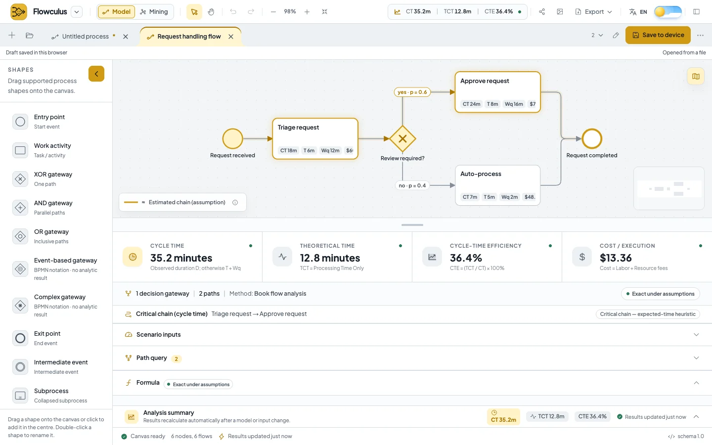
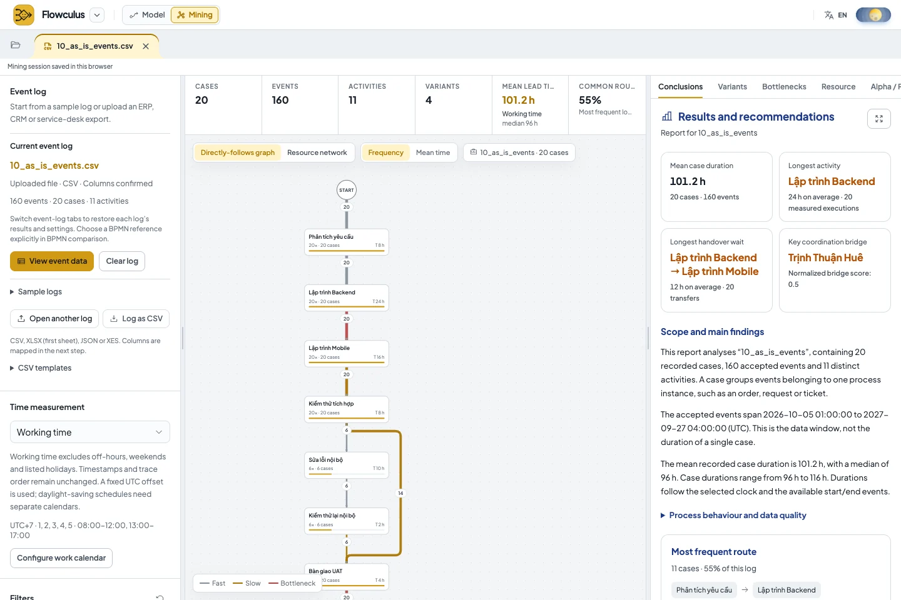
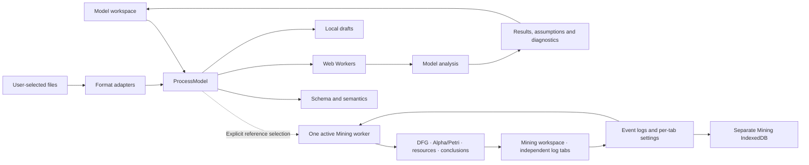
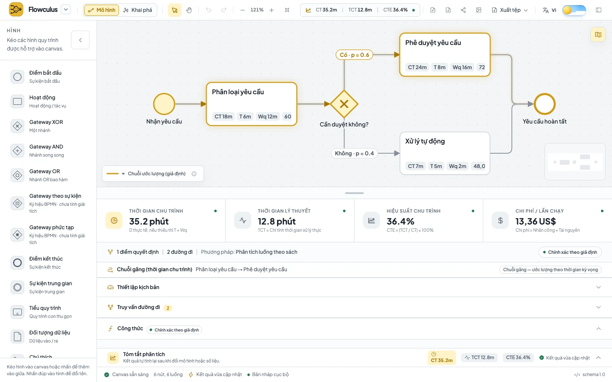
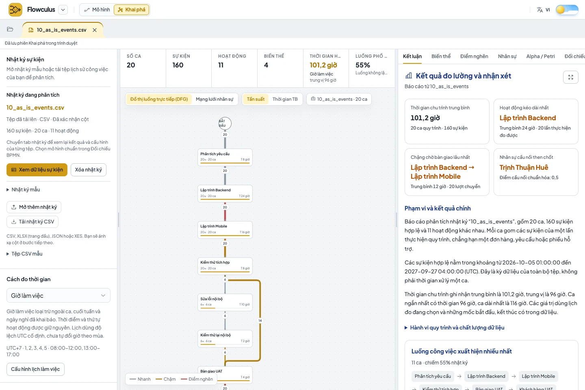
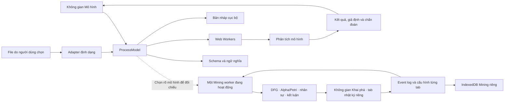

<p align="center">
  
</p>

<h1 align="center">Flowculus</h1>

<p align="center">
  BPMN modelling · Process mining · Explainable analysis
</p>

<p align="center">
  <a href="#english">English</a> · <a href="#tieng-viet">Tiếng Việt</a> ·
  <a href="https://flowculus.vercel.app">Website</a> ·
  <a href="https://flowculus.vercel.app/knowledge">Knowledge</a> ·
  <a href="https://github.com/thang-uit/Flowculus/issues/new/choose">Issues</a>
</p>

<p align="center">
  <a href="https://github.com/thang-uit/Flowculus/actions/workflows/ci.yml"></a>
  <a href="package.json"></a>
  <a href="LICENSE"></a>
  <a href="https://github.com/thang-uit/Flowculus/issues"></a>
  <a href="https://github.com/thang-uit/Flowculus/pulls"></a>
</p>

<p align="center">
  <a href="apps/web/package.json"></a>
  <a href="apps/web/package.json"></a>
  <a href="package.json"></a>
  <a href=".nvmrc"></a>
  <a href="package.json"></a>
</p>

---

<a id="english"></a>

## English

Flowculus is an open-source browser workspace for BPMN-subset modelling,
cycle-time analysis and process mining. Models, event logs and results are
processed in the browser. No backend or service account is required to run it.

This README is for developers. Usage instructions, terminology, formulas and
examples live in [Knowledge](https://flowculus.vercel.app/knowledge). The version
badge reflects the repository package version, not a published npm package.

### English contents

- [Technical overview](#en-overview)
- [Local development](#en-setup)
- [Architecture and repository layout](#en-architecture)
- [Verification](#en-verification)
- [Contributing and review](#en-contributing)
- [Build and deployment](#en-deployment)
- [Security and data](#en-security)
- [Scope and limitations](#en-scope)
- [Documentation and references](#en-documentation)
- [Maintainers](#en-maintainers)
- [License](#en-license)

<a id="en-overview"></a>

### Technical overview

| Technology                               | Responsibility                                                 |
| ---------------------------------------- | -------------------------------------------------------------- |
| Next.js App Router, React, TypeScript    | Web application and reading pages                              |
| React Flow                               | BPMN canvas, shape and connector editing                       |
| Zustand                                  | Workspace, document state and edit history                     |
| Tailwind CSS, Radix UI                   | Theme tokens and shared UI primitives                          |
| Web Workers                              | Analysis, Mining, XLSX extraction, Image Trace and comparisons |
| OpenCV.js                                | On-demand recognition of diagram shapes and connections        |
| IndexedDB, localStorage fallback         | Browser drafts, not cloud storage                              |
| Vitest, ESLint, Prettier, GitHub Actions | Tests, static checks and CI                                    |

The main feature areas are the BPMN editor with Pool/Lane, independent process
documents, file exchange, CT/TCT/CTE and related analysis, process mining and
conformance against a reference model. The interface supports English, Vietnamese,
light/dark themes and keyboard interaction.

<picture>
  <source media="(prefers-color-scheme: dark)" srcset="apps/web/public/demo/workspace-dark.webp" />
  
</picture>

_Actual browser capture with synthetic illustrative data. Fresh workspaces start empty._

<picture>
  <source media="(max-width: 640px)" srcset="docs/images/mining-report-en-mobile.webp" />
  <source media="(prefers-color-scheme: dark)" srcset="docs/images/mining-report-en-dark.webp" />
  
</picture>

_Mining report capture from the As-Is study log: 20 cases, 160 events and 101.2 working hours mean cycle time. The values are synthetic study data._

<a id="en-setup"></a>

### Local development

Requirements: Git, **Node.js 22.23+ within 22.x**, and **pnpm 11.22.0**. The runtime
is declared in `.nvmrc` and the package manager in `package.json`. No `.env` file is needed.

```bash
git clone https://github.com/thang-uit/Flowculus.git
cd Flowculus
corepack enable
pnpm install --frozen-lockfile
pnpm dev
```

Open <http://localhost:3000>. Run commands from the monorepo root. If Corepack is
unavailable, follow the [pnpm installation guide](https://pnpm.io/installation).
Contributors should clone their own fork as described in [CONTRIBUTING.md](CONTRIBUTING.md).

<a id="en-architecture"></a>

### Architecture and repository layout



BPMN documents and event-log tabs have separate state, storage and lifecycles.
Each log retains its source, mapping, calendar, filters and evidence. Tab switches
rebuild the active worker from its saved source and invalidate stale requests.
There are at most 10 logs with a combined 30-million-character source budget,
and inactive tabs do not create workers. Mining drafts persist source/settings,
not conclusions or alignment evidence. An independent Web Lock prevents competing
browser windows from overwriting Mining sessions. Knowledge documents user workflows.

```text
apps/web/
  app/                 Next.js routes, layouts and styles
  components/          Feature UI, shared primitives in ui/
  lib/                 State, browser adapters, hooks, i18n and Knowledge content
  workers/             Analysis, Mining, XLSX, Image Trace, scenario comparison
packages/
  process-model/       Domain model, metadata and contracts
  validation/          Schema, graph checks and semantic confirmation
  analysis-engine/     Formulas, structural proofs and result quality
  process-mining/      Logs, DFG, Alpha, Petri, conformance and metrics
  file-formats/        Native JSON, CSV, SVG and automatic layout
  bpmn-adapter/        Supported BPMN 2.0 XML and diagram interchange
  drawio-adapter/      draw.io import/export and semantic preservation
  graph-layout/        Geometry and routing
  formula-renderer/    Formula expressions
  xml-tree/            Bounded XML processing
.github/               CI, CODEOWNERS, Dependabot and Issue/PR templates
docs/                  Architecture, decisions and maintainer documentation
scripts/               Synthetic demo exports and scoped cache cleanup
```

Mining imports separate layout inspection, column mapping and a worker-owned review before analysis. `packages/process-mining/src/event-import-*` owns validation and normalization. The dialog composes focused settings, preview and review components. Source interpretation (header, date order, UTC offset and event/status mode) persists per log. Runtime-generated CSV templates use synthetic examples. Jira changelogs never infer performers from editors or task durations from status changes. XLSX continues to read its first worksheet.

Mining result presentation is separated from worker evidence. Focused report components
render summary metrics, observed routes, personnel tables and findings with an
observation, interpretation and recommended action. Conformance summaries and missing-step
examples are shared between the report and BPMN comparison. Calculation details use
progressive disclosure. The report checks the selected model and mapping before showing
reference evidence. Localized copy lives in `lib/i18n/mining-report-copy.ts`, with scoped
styles and reading rules documented in [Mining results](docs/surfaces/mining-results.md).
Mining can export the same evidence as a readable HTML report or browser print/PDF preview.
The export includes the source name, observed period, clock, quality counts, routes,
findings, personnel interpretation and current BPMN comparison. Technical JSON remains
available for machine-readable review.

The interface uses one locally hosted variable font family, Plus Jakarta Sans. Portable
Mining reports embed the same font and open without a remote font service. HTML report
content is bounded to 500 KB before font embedding, with up to 10 routes and 100 steps
per route. Imported names are escaped as text.

Domain packages are pure TypeScript. They do not depend on React/DOM or import
from `apps/web`. The engine owns calculations. UI and exporters render its results
rather than recomputing them. Model edits use history and external data crosses
validation boundaries. Manual saves commit active inputs and stop at invalid fields.
File auto-save has a lifecycle independent of language changes and their handlers. See [architecture.md](docs/architecture.md) and [AGENTS.md](AGENTS.md).

<a id="en-verification"></a>

### Verification

```bash
# Generate Next.js route types on a fresh checkout before typechecking.
pnpm --filter @flowculus/web exec next typegen
pnpm check
```

`pnpm check` runs tests, formatting, lint, typecheck and production build
sequentially. The build also verifies worker bundling. Do not run typecheck
concurrently with a build that recreates generated `.next` types.

| Command             | Purpose                                        |
| ------------------- | ---------------------------------------------- |
| `pnpm test`         | Vitest tests for packages and browser adapters |
| `pnpm format:check` | Read-only formatting check                     |
| `pnpm lint`         | ESLint with zero warnings                      |
| `pnpm typecheck`    | Monorepo TypeScript checks                     |
| `pnpm build`        | Production build and worker verification       |
| `pnpm start`        | Serve the production build                     |
| `pnpm format`       | Write formatting changes, then review the diff |

[CI](.github/workflows/ci.yml) runs on PRs and pushes to `main`/`dev` with the stable
job name **Quality gates**. Browser E2E is not automated in CI. UI changes still
require desktop/mobile, keyboard, locale/theme and console checks.

GitNexus is optional local review tooling, excluded from the web bundle:

```bash
npm install -g gitnexus@1.6.9
pnpm graph:index
pnpm graph:check
```

Reindex after code changes and verify graph findings against source, tests and
the browser. Never commit `.gitnexus/`. Contributors do not need GitNexus to send a PR.

<a id="en-contributing"></a>

### Contributing and review

Read [CONTRIBUTING.md](CONTRIBUTING.md), the [Code of Conduct](CODE_OF_CONDUCT.md)
and [AGENTS.md](AGENTS.md). Use [Issue Forms](https://github.com/thang-uit/Flowculus/issues/new/choose)
for bugs, feature requests, documentation and usage questions. Look for
[good first issue](https://github.com/thang-uit/Flowculus/labels/good%20first%20issue)
or [help wanted](https://github.com/thang-uit/Flowculus/labels/help%20wanted).

Changes to `main` require a PR, at least one Code Owner approval, resolved
conversations and passing CI against the updated branch. CODEOWNERS names
`thang-uit` and `hue-trinh`. Server-side GitHub settings are maintained according
to the [community runbook](docs/community-maintenance.md).

<a id="en-deployment"></a>

### Build and deployment

```bash
pnpm build
pnpm start
```

Vercel uses **`apps/web`** as its Root Directory, Node.js 22 and the declared pnpm
version. Configuration lives in [apps/web/vercel.json](apps/web/vercel.json).
No environment variables or database are required. CI does not deploy or use a
Vercel token. The existing Vercel integration is separate. Verify the build and
behaviour of the intended revision before release.

<a id="en-security"></a>

### Security and data

Models, logs and results are processed locally rather than sent to a Flowculus
backend. Browser drafts are not portable backups. Native files opened in a supported
browser can save directly to the original file. Connections are stored separately
in IndexedDB, file auto-save stops on reload, and external changes block overwrites. Imports are untrusted. Parsers,
workers and image processing have size, time and memory bounds. Saving, exporting
and sharing retain semantic-confirmation checks for inferred content. Report images
have an 8-megapixel and 200,000-character content budget. Oversized reports suggest
PDF rather than silently omitting diagnostics. Mining clears worker-dependent
results after session loss, binds reference evidence to its request and paginates
standards tables to bound mounted DOM rows. Event browsing reads at most 50 events
per page from the worker, which owns search, sorting and a single-query cache.
Source replacement and session clearing invalidate pending results. Filter and
calendar edits wait for the active source operation, then apply the latest controls
without rereading the file. Logs are not embedded in process files or sent to a server.
Image Trace bounds its visited-pixel buffer to each task region. Hour recognition
accepts complete integer labels ending in `h`, preserving punctuation so decimals
cannot be silently concatenated or overlong numbers truncated. Every value remains
subject to user review.

Follow [SECURITY.md](SECURITY.md) for undisclosed vulnerabilities. Do not publish
sensitive data in issues or commit credentials, production logs or `.env` files.
Reporting an issue does not grant repository write access. Dependabot proposes
updates through reviewed PRs.

<a id="en-scope"></a>

### Scope and limitations

Flowculus implements a **BPMN subset**, not a workflow execution engine or a
simulator. Metrics carry `exact`, `assumption` or `simulation-required` quality.
When a trustworthy analytic value is unavailable, the metric is withheld.

- Pool/Lane does not add processing time. Analysis uses one process scope and does
  not sum participant CTs. Message flow is not control flow.
- Event-based/complex execution, typed intermediate events and nested subprocess
  execution are not fully supported by the engine.
- Alpha Miner discovers a candidate model. Bottlenecks use timestamps and deviations
  require a reference model. Petri verification and replay have explicit budgets.
- Cloud sync, user accounts and realtime collaboration are not implemented. PDF
  export uses the browser print flow.

Algorithm budgets and data contracts are documented in
[architecture](docs/architecture.md) and [Knowledge](https://flowculus.vercel.app/knowledge).

<a id="en-documentation"></a>

### Documentation and references

- [Knowledge](https://flowculus.vercel.app/knowledge): concepts, formulas and usage.
- [Architecture](docs/architecture.md) and [ADRs](docs/adr/): module boundaries and technical decisions.
- [Study-kit guide](docs/report-study-guide.md): synthetic inputs generated with `pnpm demo:export`, including BPMN, Flowculus, reference logs, focused deviation logs, printed hour samples and four simulated pen drawings. Hand-drawn samples exercise geometry and manual time review, not general handwriting recognition.
  Default output is `output/demo/report-study/`. It is not production evidence or part of the web bundle.
- [Demo image provenance](docs/images/README.md): actual browser captures and source details.
- Dumas et al., _Fundamentals of Business Process Management_, 2nd edition.
- [OMG BPMN 2.0.2](https://www.omg.org/spec/BPMN/2.0.2/) and IEEE 1849-2016 XES.

<a id="en-maintainers"></a>

### Maintainers

[Chu Nam Thắng](https://github.com/thang-uit) and [Trịnh Thuận Huê](https://github.com/hue-trinh).
Contributions are proposed through issues and PRs. Preserve authorship in Git
history and the required attribution for reused work.

<a id="en-license"></a>

### License

Flowculus is licensed under the **[MIT License](LICENSE)**.
Copyright © 2026 Chu Nam Thắng, Trịnh Thuận Huê and Flowculus contributors.
Dependencies, fonts and reused material retain their own terms. See
[THIRD_PARTY_NOTICES.md](THIRD_PARTY_NOTICES.md).

[Tiếng Việt ↓](#tieng-viet) · [Back to English contents](#english)

---

<a id="tieng-viet"></a>

## Tiếng Việt

Flowculus là ứng dụng web mã nguồn mở để mô hình hóa một tập con BPMN, phân tích
thời gian chu trình và khai phá quy trình từ event log. Mô hình, nhật ký và kết quả
được xử lý trong trình duyệt. Dự án không cần backend hay tài khoản dịch vụ để chạy.

README này dành cho developer. Hướng dẫn sử dụng, thuật ngữ, công thức và ví dụ
nằm trong [Knowledge](https://flowculus.vercel.app/knowledge). Badge version phản
ánh phiên bản package trong repo, không phải một gói npm đã được phát hành.

### Mục lục tiếng Việt

- [Tổng quan kỹ thuật](#vi-overview)
- [Chạy dự án](#vi-setup)
- [Kiến trúc và cấu trúc mã nguồn](#vi-architecture)
- [Kiểm tra chất lượng](#vi-verification)
- [Đóng góp và review](#vi-contributing)
- [Build và triển khai](#vi-deployment)
- [Bảo mật và dữ liệu](#vi-security)
- [Phạm vi và giới hạn](#vi-scope)
- [Tài liệu và nguồn tham khảo](#vi-documentation)
- [Nhà phát triển](#vi-maintainers)
- [Giấy phép](#vi-license)

<a id="vi-overview"></a>

### Tổng quan kỹ thuật

| Thành phần                               | Vai trò                                                        |
| ---------------------------------------- | -------------------------------------------------------------- |
| Next.js App Router, React, TypeScript    | Ứng dụng web và các trang tài liệu                             |
| React Flow                               | Canvas BPMN, chỉnh sửa hình và đường nối                       |
| Zustand                                  | Trạng thái workspace, tài liệu và lịch sử chỉnh sửa            |
| Tailwind CSS, Radix UI                   | Token giao diện và các primitive dùng chung                    |
| Web Workers                              | Phân tích, Mining, đọc XLSX, nhận dạng ảnh và so sánh kịch bản |
| OpenCV.js                                | Nhận dạng hình và đường nối từ ảnh, nạp khi cần                |
| IndexedDB, localStorage dự phòng         | Bản nháp trong trình duyệt, không phải lưu trữ đám mây         |
| Vitest, ESLint, Prettier, GitHub Actions | Kiểm thử, phân tích tĩnh và CI                                 |

Các nhóm tính năng chính gồm editor BPMN với Pool/Lane, quản lý nhiều tài liệu,
nhập/xuất file, CT/TCT/CTE và các chỉ số phân tích, Mining và đối chiếu log với mô
hình tham chiếu. Giao diện hỗ trợ tiếng Việt, tiếng Anh, sáng/tối và bàn phím.

<picture>
  <source media="(prefers-color-scheme: dark)" srcset="apps/web/public/demo/workspace-vi-dark.webp" />
  
</picture>

_Ảnh chụp ứng dụng với dữ liệu minh họa tổng hợp. Workspace mới bắt đầu trống._

<picture>
  <source media="(max-width: 640px)" srcset="docs/images/mining-report-mobile.webp" />
  <source media="(prefers-color-scheme: dark)" srcset="docs/images/mining-report-vi-dark.webp" />
  
</picture>

_Ảnh chụp báo cáo từ nhật ký As-Is: 20 ca, 160 sự kiện và thời gian chu trình trung bình 101,2 giờ làm việc. Đây là dữ liệu tổng hợp dùng cho bộ demo._

<a id="vi-setup"></a>

### Chạy dự án

**Yêu cầu:** Git, Node.js **22.23+ trong nhánh 22.x** và pnpm **11.22.0**.
Phiên bản runtime theo `.nvmrc`, package manager theo `package.json`.
Không cần tạo `.env`.

```bash
git clone https://github.com/thang-uit/Flowculus.git
cd Flowculus
corepack enable
pnpm install --frozen-lockfile
pnpm dev
```

Mở <http://localhost:3000>. Chạy các lệnh từ gốc monorepo. Nếu chưa có Corepack,
làm theo [hướng dẫn cài pnpm](https://pnpm.io/installation). Khi đóng góp, clone
fork của bạn theo [CONTRIBUTING.md](CONTRIBUTING.md).

<a id="vi-architecture"></a>

### Kiến trúc và cấu trúc mã nguồn



Luồng nhập Mining tách kiểm tra bố cục, ánh xạ cột và rà dữ liệu trong worker trước khi phân tích. Các module `event-import-*` trong `process-mining` xử lý kiểm tra và chuẩn hóa. Mỗi log lưu dòng tiêu đề, thứ tự ngày, độ lệch UTC và chế độ sự kiện/trạng thái. Bản nháp cũ giữ cách diễn giải trước đó. CSV mẫu được tạo khi tải xuống từ dữ liệu giả lập. Changelog Jira không suy người thực hiện từ người sửa trạng thái hay thời gian tác vụ từ lần đổi trạng thái. XLSX tiếp tục đọc trang tính đầu.

Giao diện báo cáo khai phá tách riêng khỏi kết quả tính trong tiến trình nền. Các
component chuyên trách hiển thị số liệu nổi bật, luồng quan sát, bảng nhân sự và nhận xét
theo ba phần: số liệu, ý nghĩa và việc nên cải tiến. Báo cáo và Đối chiếu BPMN dùng chung
phần kết quả đối chiếu cùng ví dụ về bước chưa được ghi nhận. Chi tiết cách tính nằm
trong các mục mở rộng. Kết quả tham chiếu chỉ được hiển thị khi mô hình và cách ghép
hoạt động vẫn khớp lựa chọn hiện tại. Nội dung ngôn ngữ nằm trong
`lib/i18n/mining-report-copy.ts`, quy tắc trình bày tại
[báo cáo khai phá](docs/surfaces/mining-results.md).
Có thể tải báo cáo HTML dễ đọc hoặc mở bản in để lưu PDF với cùng nguồn bằng chứng. Báo cáo
ghi tên nhật ký, kỳ dữ liệu, lịch đo, chất lượng nhập, các luồng, nhận xét, diễn giải mạng
nhân sự và kết quả đối chiếu BPMN hiện hành. JSON kỹ thuật vẫn được giữ riêng để đối soát.

Giao diện dùng một họ font biến thiên được lưu cùng ứng dụng là Plus Jakarta Sans.
Báo cáo Mining nhúng cùng font này để mở độc lập, không gọi dịch vụ font bên ngoài.
Nội dung HTML được giới hạn 500 KB trước khi nhúng font, tối đa 10 luồng và 100 bước
mỗi luồng. Tên nhập từ tệp được mã hóa an toàn dưới dạng văn bản.

Tab BPMN và tab nhật ký có trạng thái, lưu trữ và vòng đời riêng. Mỗi log giữ nguồn,
mapping, lịch, bộ lọc và kết quả riêng. Chuyển tab dựng lại phiên worker từ nguồn
đã lưu, vô hiệu hóa tác vụ cũ bằng mã phiên. Tối đa 10 log và tổng 30 triệu ký tự
nguồn, không thêm worker cho các tab ẩn. Bản nháp Mining chỉ lưu nguồn và cấu hình,
không lưu kết luận hoặc bằng chứng đối chiếu. Web Lock độc lập ngăn hai cửa sổ ghi
đè phiên Mining. Quy trình thao tác và giới hạn được giải thích trong Knowledge.

```text
apps/web/
  app/                 Next.js routes, layout và style
  components/          UI theo tính năng, shared primitives trong ui/
  lib/                 State, browser adapters, hooks, i18n và nội dung Knowledge
  workers/             Analysis, Mining, XLSX, Image Trace, scenario comparison
packages/
  process-model/       Domain model, metadata và các hợp đồng dữ liệu
  validation/          Schema, graph validation và semantic confirmation
  analysis-engine/     Công thức, chứng minh cấu trúc và chất lượng kết quả
  process-mining/      Event log, DFG, Alpha, Petri, conformance và độ đo
  file-formats/        Native JSON, CSV, SVG và bố trí đồ thị
  bpmn-adapter/        Tập con BPMN 2.0 XML và diagram interchange
  drawio-adapter/      Nhập/xuất và bảo toàn ngữ nghĩa draw.io
  graph-layout/        Geometry và routing
  formula-renderer/    Biểu thức công thức
  xml-tree/            Xử lý XML có giới hạn
.github/               CI, CODEOWNERS, Dependabot và mẫu Issue/PR
docs/                  Kiến trúc, quyết định thiết kế và tài liệu maintainer
scripts/               Xuất dữ liệu demo và dọn cache có phạm vi
```

Package domain là TypeScript thuần, không phụ thuộc React/DOM và không nhập code
ngược từ `apps/web`. Công thức thuộc engine. UI và exporter hiển thị kết quả engine,
không tính lại. Chỉnh sửa mô hình đi qua history, dữ liệu bên ngoài qua validation. Lưu thủ công
chốt ô đang nhập và chặn ô báo lỗi. Tự lưu tệp có vòng đời riêng với các thay đổi
ngôn ngữ, để giữ các lượt ghi đang chờ.
Chi tiết tại [architecture.md](docs/architecture.md) và [AGENTS.md](AGENTS.md).

<a id="vi-verification"></a>

### Kiểm tra chất lượng

```bash
# Checkout mới cần tạo kiểu route trước khi typecheck.
pnpm --filter @flowculus/web exec next typegen
pnpm check
```

`pnpm check` chạy lần lượt test, format, lint, typecheck và production build.
Build còn kiểm tra worker bundle. Không chạy typecheck song song với build vì
Next.js tạo lại các file kiểu trong `.next`.

| Lệnh                | Mục đích                                        |
| ------------------- | ----------------------------------------------- |
| `pnpm test`         | Test các package và browser adapter bằng Vitest |
| `pnpm format:check` | Kiểm tra định dạng, không sửa file              |
| `pnpm lint`         | ESLint, yêu cầu không có cảnh báo               |
| `pnpm typecheck`    | TypeScript cho monorepo                         |
| `pnpm build`        | Build production và xác minh worker             |
| `pnpm start`        | Chạy bản production đã build                    |
| `pnpm format`       | Ghi định dạng, cần xem lại diff                 |

[CI](.github/workflows/ci.yml) chạy trên PR và push vào `main`/`dev`, với job
**Quality gates**. Kiểm tra trình duyệt chưa được tự động hóa trong CI. Thay đổi UI
vẫn cần kiểm tra desktop/mobile, bàn phím, hai locale, hai theme và console.

GitNexus là công cụ review cục bộ tùy chọn, không có trong web bundle:

```bash
npm install -g gitnexus@1.6.9
pnpm graph:index
pnpm graph:check
```

Lập lại chỉ mục sau khi sửa code. Đối chiếu kết quả graph với mã nguồn, test và
trình duyệt. Không commit `.gitnexus/`. Không bắt contributor cài GitNexus để gửi PR.

<a id="vi-contributing"></a>

### Đóng góp và review

Đọc [CONTRIBUTING.md](CONTRIBUTING.md), [quy tắc ứng xử](CODE_OF_CONDUCT.md) và
[AGENTS.md](AGENTS.md). Dùng [Issue Forms](https://github.com/thang-uit/Flowculus/issues/new/choose)
để báo lỗi, đề xuất tính năng, sửa tài liệu hoặc hỏi cách dùng. Công việc phù hợp
cho người mới có nhãn [good first issue](https://github.com/thang-uit/Flowculus/labels/good%20first%20issue)
và [help wanted](https://github.com/thang-uit/Flowculus/labels/help%20wanted).

Thay đổi vào `main` đi qua PR, ít nhất một approval của Code Owner, giải quyết
thảo luận và đạt CI trên nhánh cập nhật. `CODEOWNERS` chỉ định `thang-uit` và
`hue-trinh`. Các rule GitHub là thiết lập phía server, được quản lý theo
[hướng dẫn maintainer](docs/community-maintenance.md).

<a id="vi-deployment"></a>

### Build và triển khai

```bash
pnpm build
pnpm start
```

Vercel dùng Root Directory **`apps/web`**, Node.js 22 và pnpm theo `packageManager`.
Cấu hình tại [apps/web/vercel.json](apps/web/vercel.json). Không cần biến môi trường
hoặc database. CI không tự deploy, không dùng Vercel token. Tích hợp Vercel hiện có
là luồng riêng. Trước phát hành cần xác minh build và chức năng trên đúng revision.

<a id="vi-security"></a>

### Bảo mật và dữ liệu

Mô hình, event log và kết quả được xử lý cục bộ, không gửi lên backend của Flowculus.
Bản nháp trình duyệt không thay cho bản sao lưu file. File native mở trên trình duyệt
hỗ trợ có thể lưu trực tiếp vào file gốc. Liên kết được giữ riêng trong IndexedDB,
tự lưu tệp dừng sau reload và thay đổi bên ngoài sẽ chặn ghi đè. File nhập được xem là không
tin cậy. Parser, worker và xử lý ảnh có giới hạn kích thước, thời gian và bộ nhớ.
Lưu/xuất/chia sẻ phải qua kiểm tra xác nhận ngữ nghĩa suy luận. Ảnh báo cáo có giới hạn
8 megapixel và 200.000 ký tự nội dung. Báo cáo vượt giới hạn được hướng dẫn xuất PDF,
không cắt bớt chẩn đoán. Mining xóa kết quả phụ thuộc khi mất worker, ràng buộc
bằng chứng theo phiên đối chiếu và phân trang bảng định mức để giới hạn số hàng DOM.
Bảng sự kiện đọc tối đa 50 sự kiện mỗi trang từ worker, tìm kiếm và sắp xếp phía
worker với bộ nhớ đệm một truy vấn. Đổi nguồn hoặc xóa phiên vô hiệu hóa kết quả
đang chờ. Thay đổi bộ lọc và lịch đợi thao tác nguồn hoàn tất rồi áp dụng lựa chọn
mới nhất, không đọc lại tệp. Log không được ghi vào file mô hình hay gửi lên máy chủ.
Image Trace giới hạn bộ nhớ đánh dấu pixel theo từng vùng tác vụ. Nhận dạng giờ
chỉ nhận nhãn nguyên hoàn chỉnh có hậu tố `h`, giữ dấu câu để tránh đổi số thập phân
thành số nguyên hoặc cắt lấy đuôi của số vượt giới hạn. Người dùng rà lại mọi giá trị.

Gửi lỗ hổng chưa công bố theo [SECURITY.md](SECURITY.md), không mở Issue công khai
kèm dữ liệu nhạy cảm. Không commit credential, log thật hay file `.env`. Quyền báo
lỗi không cấp quyền ghi vào repo. Dependabot đề xuất cập nhật qua PR cần review.

<a id="vi-scope"></a>

### Phạm vi và giới hạn

Flowculus hỗ trợ **một tập con BPMN**, không phải workflow execution engine hay bộ
mô phỏng. Kết quả có mức chất lượng `exact`, `assumption` hoặc `simulation-required`.
Khi chưa có giá trị giải tích đáng tin cậy, chỉ số được giữ trống.

- Pool/Lane không cộng thời gian. Phân tích một process scope, không tự cộng CT của
  các bên tham gia. Message flow không phải luồng thực thi.
- Gateway theo sự kiện/phức tạp, typed intermediate event và thực thi subprocess
  lồng chưa được engine hỗ trợ đầy đủ.
- Alpha Miner khám phá mô hình ứng viên. Điểm nghẽn dùng timestamp, sai lệch cần mô
  hình tham chiếu. Petri verification và replay có giới hạn tính toán công bố.
- Chưa có đồng bộ cloud, tài khoản hoặc cộng tác realtime. PDF dùng luồng in trình duyệt.

Giới hạn thuật toán và hợp đồng dữ liệu nằm trong
[kiến trúc](docs/architecture.md) và [Knowledge](https://flowculus.vercel.app/knowledge).

<a id="vi-documentation"></a>

### Tài liệu và nguồn tham khảo

- [Knowledge](https://flowculus.vercel.app/knowledge): khái niệm, công thức và hướng dẫn sử dụng.
- [Kiến trúc](docs/architecture.md) và [ADR](docs/adr/): ranh giới module và quyết định kỹ thuật.
- [Hướng dẫn bộ demo](docs/report-study-guide.md): tạo input tổng hợp bằng `pnpm demo:export`, gồm BPMN, Flowculus, event log chuẩn, hai log sai lệch tập trung, ảnh in rõ và bốn ảnh mô phỏng nét vẽ tay. Mẫu vẽ tay kiểm tra hình học và bước nhập giờ thủ công, không chứng minh khả năng đọc chữ viết tay tổng quát.
  Output mặc định `output/demo/report-study/`, không phải dữ liệu sản xuất và không nằm trong web bundle.
- [Nguồn ảnh demo](docs/images/README.md): ảnh trình duyệt thật và thông tin xuất xứ.
- Dumas và cộng sự, _Fundamentals of Business Process Management_, ấn bản 2.
- [OMG BPMN 2.0.2](https://www.omg.org/spec/BPMN/2.0.2/) và IEEE 1849-2016 XES.

<a id="vi-maintainers"></a>

### Nhà phát triển

[Chu Nam Thắng](https://github.com/thang-uit) và [Trịnh Thuận Huê](https://github.com/hue-trinh).
Mọi người có thể đề xuất thay đổi qua Issue và PR. Tác giả đóng góp được ghi nhận
qua lịch sử Git, giữ đúng attribution và giấy phép của phần tái sử dụng.

<a id="vi-license"></a>

### Giấy phép

Flowculus được cấp phép theo **[MIT License](LICENSE)**.
Copyright © 2026 Chu Nam Thắng, Trịnh Thuận Huê và các contributor của Flowculus.
Dependency, font và phần tái sử dụng giữ giấy phép riêng, xem
[THIRD_PARTY_NOTICES.md](THIRD_PARTY_NOTICES.md).

[English ↑](#english) · [Về mục lục tiếng Việt](#tieng-viet)
