<p align="center">
  
</p>

<h1 align="center">Flowculus</h1>

<p align="center">
  <strong>Mô hình hoá quy trình (tập con BPMN), khai phá quy trình và phân tích thời gian chu trình ngay trong trình duyệt.</strong><br />
  <em>BPMN-subset process modelling, process mining and cycle-time analysis in the browser.</em>
</p>

<p align="center">
  Tiếng Việt trước, English ngay bên dưới mỗi phần · Vietnamese first, English follows each section.
</p>

---

## Mục lục · Contents

1. [Giới thiệu và phạm vi · Product and scope](#1-giới-thiệu-và-phạm-vi--product-and-scope)
2. [Tính năng và tập con BPMN · Features and BPMN subset](#2-tính-năng-và-tập-con-bpmn--features-and-bpmn-subset)
3. [Hình ảnh và sơ đồ · Screenshots and diagrams](#3-hình-ảnh-và-sơ-đồ--screenshots-and-diagrams)
4. [Kiến trúc và luồng dữ liệu · Architecture and data flow](#4-kiến-trúc-và-luồng-dữ-liệu--architecture-and-data-flow)
5. [Công thức, giả định, chất lượng và giới hạn · Formulas, assumptions, quality and limits](#5-công-thức-giả-định-chất-lượng-và-giới-hạn--formulas-assumptions-quality-and-limits)
6. [draw.io và xác nhận ngữ nghĩa · draw.io and semantic confirmation](#6-drawio-và-xác-nhận-ngữ-nghĩa--drawio-and-semantic-confirmation)
7. [Cấu trúc repository · Repository structure](#7-cấu-trúc-repository--repository-structure)
8. [Yêu cầu · Prerequisites](#8-yêu-cầu--prerequisites)
9. [Lệnh · Commands](#9-lệnh--commands)
10. [Biến môi trường · Environment variables](#10-biến-môi-trường--environment-variables)
11. [Worker, bản nháp cục bộ và hiệu năng · Workers, local draft and performance](#11-worker-bản-nháp-cục-bộ-và-hiệu-năng--workers-local-draft-and-performance)
12. [Responsive và trợ năng · Responsive and accessibility](#12-responsive-và-trợ-năng--responsive-and-accessibility)
13. [Triển khai Vercel · Vercel deployment](#13-triển-khai-vercel--vercel-deployment)
14. [Xử lý sự cố · Troubleshooting](#14-xử-lý-sự-cố--troubleshooting)
15. [Ma trận kiểm thử và giới hạn đã biết · Testing matrix and known limitations](#15-ma-trận-kiểm-thử-và-giới-hạn-đã-biết--testing-matrix-and-known-limitations)
16. [Bảo mật và quyền riêng tư · Security and privacy](#16-bảo-mật-và-quyền-riêng-tư--security-and-privacy)
17. [Changelog và ghi chú chuyển đổi · Changelog and migration notes](#17-changelog-và-ghi-chú-chuyển-đổi--changelog-and-migration-notes)
18. [Lịch làm việc và bộ demo báo cáo · Work calendars and report study](#18-lịch-làm-việc-và-bộ-demo-báo-cáo--work-calendars-and-report-study)
19. [Đóng góp cộng đồng · Community contributions](#19-đóng-góp-cộng-đồng--community-contributions)

---

## Pool/Lane, BPMN XML và bộ demo bằng file · File-based demonstration

**Tiếng Việt.** Nút Pool/Lane trên canvas mở quản lý các bên tham gia và trách nhiệm. Pool đầu tiên bao mô hình hiện có; thêm lane, đổi tên, đổi hướng, sắp thứ tự và gán các bước đang chọn. Pool/lane hỗ trợ đổi kích thước và sao chép; phím mũi tên dịch các bước hoặc cả pool; di chuyển pool giữ nội dung; bỏ khung giữ các công việc. Sequence flow không qua pool; message flow không trở thành đường thực thi. Nếu có nhiều pool nội bộ, chọn pool cần phân tích. Pool BPMN khác với nhóm nguồn lực dùng tính công suất.

**English.** The canvas Pool/Lane control manages participants and responsibility. The first pool wraps the existing model; add, rename, orient and reorder lanes or assign selected steps. Resize and copy frames; keyboard-nudge steps or entire pools; moving a pool carries its contents; removing a frame preserves steps. Sequence flow stays within a process and message flow is not control flow. Choose a pool for analysis when several internal processes exist. BPMN pools are distinct from capacity resource pools.

- **Mở/xuất `.bpmn` · Import/export:** BPMN 2.0 XML với namespace chuẩn, task, none events, XOR/AND/OR theo phạm vi, lane/participant, sequence/message và BPMN DI. XML không có DI được bố trí xác định. Construct thực thi chưa hỗ trợ bị từ chối có thông báo, không bị làm phẳng. Boundary/timer, nested subprocess và message tới pool hộp đen chưa được adapter thực thi/chuyển đổi. · Standard BPMN namespaces and DI, supported tasks/events/gateways and responsibility frames. Unsupported execution semantics are rejected rather than flattened; this is not full BPMN 2.0 support.
- **Lưu thiết bị · Device file:** `.flowculus.json` v2 khi có container; v1 tiếp tục mở được. Metadata thời gian/xác suất riêng trong BPMN dùng namespace Flowculus, các công cụ khác có thể bỏ qua. · Native JSON retains analysis settings; namespaced BPMN extensions are optional to other tools.
- **Mining:** chọn tài liệu chuẩn/process và ánh xạ hoạt động; xem footprint, Petri, firing token và xuất PNML. Kiểm chứng tách riêng với conformance; đồ thị từ chính log không tự là quy trình chuẩn. · Choose a reference document/process and activity mapping; explore footprint, Petri firing and PNML export. Verification and log conformance are separate claims.
- **Độ đo · Metrics:** In-degree = nguồn gửi khác nhau; incoming handoffs = tổng lượt đến. Betweenness dùng đường có hướng không trọng số; Closeness theo khoảng cách đi ra; Eigenvector dùng chiếu vô hướng; PageRank có trọng số bàn giao. Các quan hệ được suy ra từ sự kiện kế tiếp có resource khác nhau, không tự chứng minh trách nhiệm hoặc quan hệ nhân quả. · These are structural/observed measures, not productivity ratings.
- **Định mức · Standards:** tab Điểm nghẽn nhận CSV `activity,max_service_minutes`, đo thời lượng trên sự kiện có start/end bằng cơ sở thời gian đang chọn. Không tự chứng minh giờ công hay SLA chờ. · Service standards use the selected elapsed/working clock, exclude missing starts, and do not prove hands-on labour or waiting-time SLA.
- **So sánh · Scenarios:** nút so sánh chọn hai tài liệu, chạy engine trong worker và xuất JSON. Đây là so sánh giải tích, không tự chứng minh mức cải thiện thực nghiệm. · Analytical comparisons do not establish deployed improvements.

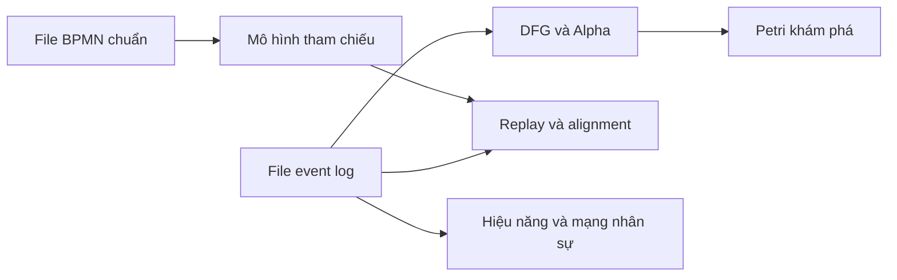

**Bộ demo đồ án được xuất ra ngoài web · Demo assets stay outside the app.** Không còn preset IS6003 trong bundle. Các ví dụ chung chỉ nạp khi được chọn; người dùng tự vẽ/import/upload dữ liệu riêng. · Project-specific data is not bundled as an app preset.

```bash
# Từ repository root, Node 22.23+; không đổi phiên bản sản phẩm.
# From the repository root; does not change product versions.
pnpm demo:export
# Mặc định: output/demo/report-study/
# Hoặc chọn thư mục xuất / or choose an output directory:
pnpm demo:export /absolute/path/to/demo-kit
```

Bộ báo cáo gồm mô hình As-Is/To-Be (`10_as_is`, `11_to_be`) ở dạng BPMN và JSON, hai log 20 ca, log 4 ca thử sai lệch, định mức, lịch, kết quả mong đợi và checksum. As-Is có 160 sự kiện, To-Be có 166. CT theo giờ làm việc là 101,2 và 49,6 giờ. Upload mô hình rồi upload log tương ứng. Kết quả mong đợi chỉ phục vụ đối soát, không upload để ép điểm số. Dữ liệu được tạo theo kịch bản, chưa phải số đo của doanh nghiệp. Xem [hướng dẫn demo](docs/report-study-guide.md) và [lịch làm việc](#18-lịch-làm-việc-và-bộ-demo-báo-cáo--work-calendars-and-report-study).

**English.** The report kit includes As-Is/To-Be models, twenty synthetic cases per scenario (160/166 events), a separate four-case deviation log, standards, calendar, expected evidence and checksums. Mean working CT is 101.2/49.6 hours. Expected evidence is produced by the same engine, checked against scenario assertions and independent timestamp arithmetic, and has not been validated by PM4Py. It is not an input to the app or a measured company outcome.

Bộ kiểm thử nhỏ độc lập dùng `pnpm demo:export:small-fixture`, xuất vào `output/demo/small-fixture/`. Bộ này có 8 ca, 48 sự kiện, 4 ca khớp, fitness 93,75%, phục vụ kiểm thử ứng dụng và ảnh minh họa bên dưới. Không dùng bộ nhỏ để giải thích số liệu của báo cáo. · The separate eight-case regression fixture is for app verification and the screenshots below. It is not the report study dataset.

**Các chỉ số chất lượng · Quality definitions.** Fitness alignment = `1 − Σcost / Σ(trace length + shortest model completion cost)` với model/log move hữu hình = 1, synchronous/silent = 0. Precision prefix đếm nhãn enabled ngoài các nhãn kế tiếp quan sát, có trọng số và xét kết thúc; generalization theo `1 − mean(1/√transition frequency)` (chưa thấy: phạt 1), chỉ trên ca khớp hoàn toàn với coverage được hiển thị. Simplicity = `1/(1 + max(mean arc degree − 2, 0))`. Đây là các biến thể đã công bố, không gọi là mọi chỉ số conformance chuẩn duy nhất. · The methods and compatible-case subset are explicit; they are not interchangeable with every evaluation algorithm. Formula references: [PM4Py generalization](https://github.com/process-intelligence-solutions/pm4py/blob/master/pm4py/algo/evaluation/generalization/variants/token_based.py), [arc-degree simplicity](https://github.com/process-intelligence-solutions/pm4py/blob/master/pm4py/algo/evaluation/simplicity/variants/arc_degree.py), [OMG BPMN 2.0.2](https://www.omg.org/spec/BPMN/2.0.2/).

## 1. Giới thiệu và phạm vi · Product and scope

**Flowculus** là không gian làm việc chạy hoàn toàn trên trình duyệt, không có backend, để vẽ quy trình nghiệp vụ, khai phá quy trình từ nhật ký sự kiện và phân tích định lượng thời gian chu trình theo chương 7 của _Fundamentals of Business Process Management_ (Dumas và cộng sự, ấn bản 2). Có hai chế độ:

- **Model**: canvas BPMN gốc (React Flow). Mỗi chỉnh sửa được ghi vào mô hình ngữ nghĩa, rồi Web Worker tính lại phân tích.
- **Mining** (`/mining`): nạp nhật ký sự kiện (CSV, TSV, XLSX, JSON, XES), xem đồ thị directly-follows, mạng bàn giao nhân sự, biến thể, điểm nghẽn, Alpha Miner/Petri và đối chiếu log với BPMN hiện có, rồi chuyển mô hình đã khai phá sang canvas.
- **Kiến thức** (`/knowledge`): 27 chủ đề Anh/Việt về BPMN, công thức, Mining và cách sử dụng; tìm kiếm không dấu, mục lục, sơ đồ, công thức sao chép được và ví dụ làm lại chạy bằng engine thật.
- **Dự án** (`/about`): giới thiệu sản phẩm, hai nhà phát triển và liên kết GitHub đã xác minh.

**Nhà phát triển · Developers**: [Chu Nam Thắng](https://github.com/thang-uit) (`thang-uit`) và [Trịnh Thuận Huê](https://github.com/hue-trinh) (tên hiển thị · display handle: `hue.trinh`). Kho mã · repository: [thang-uit/Flowculus](https://github.com/thang-uit/Flowculus).

Mọi kết quả đều kèm mức chất lượng (`exact`, `assumption`, `simulation-required`) và các phát hiện giải thích lý do. Khi không thể tính giải tích, Flowculus **không đưa ra con số** thay vì đoán. Flowculus không phải công cụ mô phỏng và không hỗ trợ toàn bộ BPMN 2.0.

**English.** Flowculus is a browser-only, zero-backend workspace for drawing business processes, mining them from event logs and analysing cycle time quantitatively, following chapter 7 of _Fundamentals of Business Process Management_ (Dumas et al., 2nd ed.). **Model** mode is a native React Flow BPMN canvas whose edits update a semantic model that a Web Worker re-analyses; **Mining** (`/mining`) loads CSV/TSV/XLSX/JSON/XES event logs, shows the directly-follows graph, resource handoff network, variants, bottlenecks, Alpha Miner/Petri candidates and conformance against the current BPMN model. Every result carries a quality (`exact`, `assumption`, `simulation-required`) plus the findings behind it; when no analytic value exists, the number is withheld rather than guessed. Flowculus is not a simulator and does not implement full BPMN 2.0.

The **Knowledge** page (`/knowledge`) provides 27 bilingual topics, accent-insensitive search, contents navigation, diagrams, copyable formulas and an isolated rework example using the actual engine. **About** (`/about`) introduces the product, its two developers and the verified repository links. Click the Flowculus brand to open project navigation from either workspace; the reading pages have their own navigation, language and theme controls.

**Điều hướng · Navigation.** Chuyển **Mô hình / Khai phá** bằng thanh chọn trên header; menu logo chỉ chứa **Kiến thức, Dự án và GitHub**, không lặp lại hai chế độ. Các liên kết tới không gian vẽ trên trang đọc dùng cùng tên **Mô hình**. · Use the header switch for **Model / Mining**. The brand menu contains only **Knowledge, About and GitHub**. Reading pages use the same **Model** label when linking back to the editor.

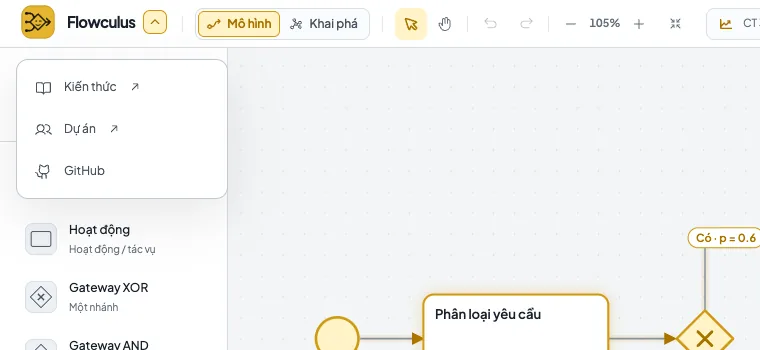

**Quản lý ảnh · Image controls.** Khi có ảnh trên canvas, thanh công cụ ngay trên canvas luôn có **Tùy chỉnh ảnh** và **Xóa ảnh**, kể cả trên điện thoại và khi ảnh bị khóa. Mở tùy chỉnh để **Thay ảnh**. Xóa ảnh chỉ xóa lớp tham chiếu, giữ các shape đã vẽ; lựa chọn xóa được checkpoint trước khi ghi IndexedDB để ảnh cũ không quay lại khi reload nhanh. Thay ảnh/crop hủy kết quả nhận dạng cũ. Đặt góc xoay về 0° khi chạy nhận dạng; xoay ảnh vẫn dùng được khi vẽ tay.

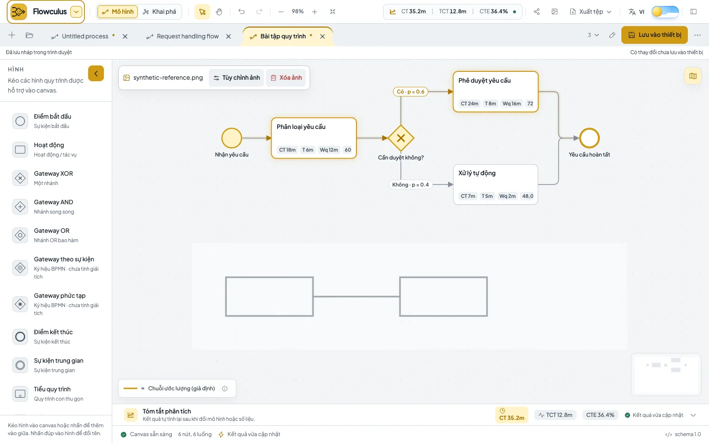

**English.** A visible canvas toolbar exposes **Image settings** and **Remove image** at every supported width, including locked images. Settings includes **Replace image**. Removing a photo preserves model shapes and synchronously records the removal before IndexedDB cleanup. Replacing the source or crop invalidates old detection results. Detection requires 0° rotation; manual reference drawing supports rotation. Fresh canvases contain no central onboarding text.

**Lần mở đầu · First visit.** Canvas bắt đầu trống, không tự nạp sơ đồ minh họa. Mining cũng đợi bạn tải log hoặc chủ động chọn mẫu. Bản nháp đã chỉnh sửa tiếp tục được phục hồi; bản nháp khớp hoàn toàn sơ đồ mẫu tự nạp cũ được bỏ qua để không xuất hiện lại sau cập nhật. Cache trình duyệt/CDN không phải nguồn của sơ đồ mặc định này.

**English.** Fresh workspaces start empty. Mining waits for an upload or an explicit sample selection. Edited drafts remain recoverable; only an exact untouched copy of the retired automatic starter is skipped. The old diagram came from application initialization, not a CDN cache.

**Nhiều quy trình · Multiple processes.** Bấm **+** trên thanh tab để tạo quy trình mới; nhấp đúp tên tab hoặc chọn nút bút để đổi tên. Mở/import mô hình và đưa kết quả Mining sang canvas tạo tab mới, không ghi đè bản đang vẽ. Mỗi tab giữ mô hình, cấu hình phân tích, undo/redo và khung nhìn riêng; ảnh tham chiếu được lưu tách theo tab. Tối đa 20 quy trình mở cùng lúc. · Use **+** for a blank process and double-click its tab or use the pencil to rename. Imports and Mining conversions create separate tabs, each with its own model, settings, undo/redo, viewport and separately stored photo. Up to 20 tabs can be open.

**Sắp xếp tab · Tab ordering.** Kéo tên tab để đổi vị trí; trên cảm ứng giữ khoảng 280 ms rồi kéo, vuốt ngay để cuộn thanh tab. Kéo sát mép tự cuộn, Escape hủy. **Alt+Shift+←/→** di chuyển tab đang focus. Chuột phải hoặc **Shift+F10** mở menu đổi tên/di chuyển/đóng; chuột giữa vẫn hỏi xác nhận trước khi đóng. Nút số liệt kê các quy trình đang mở. Thứ tự được tự lưu trong trình duyệt, giữ nguyên mô hình, undo/redo, khung nhìn, ảnh và trạng thái file. · Drag to reorder, hold before dragging on touch, or use **Alt+Shift+Left/Right**. Edge scrolling and Escape cancellation are supported. Right-click/**Shift+F10** opens tab actions; middle-click keeps the close confirmation. The count menu lists open processes. Browser drafts retain order without changing document contents or device save state.

**Giao diện dùng chung · Shared UI.** Menu điều hướng, xuất tệp và menu chuột phải dùng `AppMenu`/`AppContextMenu` + `MenuSurface`; lựa chọn biểu mẫu dùng Radix `AppSelect` với cùng token giao diện. `AppDialog` quản lý focus, lớp phủ và trạng thái bận; `AppButton`/`IconButton` dùng chung các biến thể nút. Toast import/export/clipboard có một viewport, tối đa ba thông báo, tạm dừng khi hover/focus; lỗi cần đóng chủ động. · Shared menu navigation, collision handling, rounded yellow interaction states, modal shells and button variants replace separate implementations. Form selects keep listbox semantics. A bounded toast viewport handles workspace notices; errors remain dismissible until closed.

**Đặt tên từ Mining · Name a mined process.** Khi chọn chuyển sang canvas, nhập tên quy trình trong hộp thoại trống rồi bấm **Tạo quy trình**. Tên log mẫu (ví dụ IT Service Desk) chỉ nhận diện nguồn dữ liệu, không tự đặt tên tab hay báo cáo. Hủy giữ nguyên công việc; log/bộ lọc đổi khi đang chuyển sẽ không tạo tab từ kết quả cũ. Các quy trình đã lưu giữ nguyên tên và có thể đổi bằng nút bút. · Sending a Mining map to the canvas asks for your own process name. Sample names describe the log, not the new process. Cancel preserves existing work; stale conversions never open a tab. Existing saved names remain editable.

**Lưu vào thiết bị · Save to device.** **Ctrl/Cmd+S** mở hộp thoại tên quy trình và tên file `.flowculus.json` ở lần lưu đầu; nếu đã kết nối file trong phiên hiện tại thì ghi tiếp vào file đó. **Lưu thành… / Ctrl/Cmd+Shift+S** chọn bản lưu khác; **Ctrl/Cmd+O** mở file. Trình duyệt hỗ trợ File System Access có thể tự ghi vào tệp đã chọn sau lần cấp quyền đầu tiên nếu bật tùy chọn tương ứng. Quyền ghi không được lưu qua reload. Safari/Firefox hoặc trình duyệt không hỗ trợ sẽ tải một bản mới mỗi lần lưu. Hủy hoặc ghi thất bại không xóa dấu `*` thay đổi. Tên quy trình được kiểm tra trước mọi export và được dùng trong báo cáo, không cố định tên mẫu Mining. · **Ctrl/Cmd+S** names and saves a portable `.flowculus.json` model on first save, then updates the connected file directly during the session. **Save as / Ctrl/Cmd+Shift+S** chooses another copy; **Ctrl/Cmd+O** opens a file. Supporting browsers can auto-update the chosen file after an explicit grant; other browsers download each explicit save. Device access must be reconnected after reload. Cancelled/failed writes retain the dirty indicator. Every export lets the user review its process name.

**Hai trạng thái lưu · Two save states.** “Đã lưu nháp trong trình duyệt” không có nghĩa đã có file sao lưu trên thiết bị. Dấu `*` cho biết file đã lưu chưa khớp nội dung mới nhất. Đóng tab luôn hỏi xác nhận: tab có thay đổi cho chọn **Lưu và đóng / Đóng không lưu / Hủy**; tab đã lưu cho chọn **Đóng quy trình / Hủy**. Đóng không lưu xóa tab cùng bản nháp; tab có ảnh luôn hỏi trước khi đóng vì ảnh không nhúng vào file. Nội dung suy luận chưa xác nhận vẫn được giữ trong bản nháp, nhưng bị chặn lưu file/xuất/chia sẻ theo cùng semantic gate. · Browser draft recovery is separate from a portable device backup. Every tab close asks for confirmation: dirty tabs offer **Save and close / Close without saving / Cancel**, and unchanged tabs offer **Close process / Cancel**. Closing without saving removes the tab and its draft. Tabs with reference photos always confirm before closing because photos are excluded from model files. Inferred semantics remain gated on every device save, export and share path.

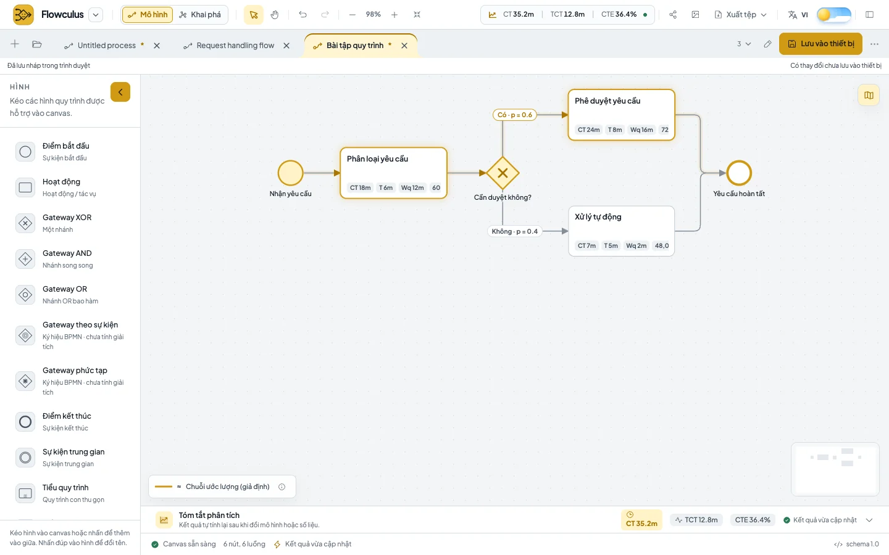

<details>
<summary>Hộp thoại lưu thiết bị · Device save dialog</summary>

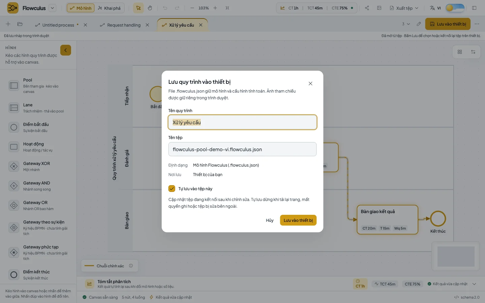

</details>

**Tab và bảng hình · Tabs and palette.** Tab đang chọn có nền vàng dịu, viền trên và góc nối bo mềm theo kiểu trình duyệt; hover/focus nút X hiện vòng màu rõ, không đổi màu nhận diện tab. Nút thu/mở bảng Hình gọn 32 px, màu vàng và có trạng thái bàn phím; trên màn hình nhỏ nút vẫn có trên thanh công cụ dưới canvas. Phản hồi ngắn bằng opacity/transform tôn trọng reduced motion. · The active process tab uses a yellow tint, top accent and rounded browser-style shoulders. Hover/focus gives the close button its own highlight while retaining the active tab color. The yellow palette toggle is 32 px with keyboard state and remains reachable in the small-screen canvas toolbar; brief opacity/transform feedback respects reduced motion.

## 2. Tính năng và tập con BPMN · Features and BPMN subset

| Nhóm · Area                              | Tính năng · Feature                                                                                                                                                                                                                                                                                                                                                                 |
| :--------------------------------------- | :---------------------------------------------------------------------------------------------------------------------------------------------------------------------------------------------------------------------------------------------------------------------------------------------------------------------------------------------------------------------------------- |
| Canvas                                   | Kéo/thả hoặc bấm để thêm hình, nối luồng, đổi tên tại chỗ, undo/redo (100 bước), thao tác nhanh, minimap, phím tắt; hình “Hoạt động có làm lại” đặt xác suất 10%, không tự vẽ vòng lặp · drag or click to add shapes, connect flows, inline rename, undo/redo (100 steps), quick actions, minimap, shortcuts; “Task with rework” sets 10% rework without drawing a loop connector   |
| Dữ liệu trên sơ đồ · Data on the diagram | Chip `CT`/`T`/`Wq` kèm nguồn thời gian (tooltip), xác suất nhánh, rework, huy hiệu "cần xác nhận", chuỗi găng (giữ nét BPMN liền, ghi rõ chính xác/ước lượng bằng chú giải) · time chips with their source, branch probabilities, rework, "needs confirmation" badges, critical chain (solid BPMN lines, explicit exact/estimate legend)                                            |
| Phân tích · Analysis                     | CT, TCT, CTE (tỉ lệ), chi phí, CPM, chuỗi găng, đếm đường đi, công suất theo nhóm nguồn lực, hàng đợi M/M/c, định luật Little, chất lượng theo từng chỉ số · CT, TCT, CTE (ratio), cost, CPM, critical chain, path count, capacity per pool, M/M/c queues, Little's Law, per-metric quality                                                                                         |
| Chẩn đoán · Diagnostics                  | Mã ổn định có mức độ, ảnh hưởng chất lượng và đường dẫn; bấm để nhảy tới phần tử · stable codes with severity, quality impact and path; click to focus the element                                                                                                                                                                                                                  |
| draw.io                                  | Nhập file thường, nén, nhiều trang; xuất bằng cách vá XML gốc (giữ ngữ nghĩa, không cam kết giống từng byte) · import plain, compressed and multi-page files; export patches the original XML (semantic-preserving, not byte-for-byte)                                                                                                                                              |
| Xuất · Export                            | `.bpmn`, `.drawio`, `.flowculus.json`, CSV nút/cạnh, SVG, PNG, JPEG, báo cáo PDF và báo cáo ảnh; tệp mô hình/ảnh sơ đồ không cần chờ worker, báo cáo phân tích cần kết quả hiện tại · `.bpmn`, `.drawio`, `.flowculus.json`, nodes/edges CSV, SVG, PNG, JPEG, PDF and image reports; model/diagram files do not wait for analysis, generated reports require a current result       |
| Khai phá · Mining                        | URL `/mining`, 3 log mẫu, CSV/XLSX/JSON/XES, ánh xạ cột, DFG, biến thể, điểm nghẽn, mạng Resource và các độ đo trung tâm, Alpha Miner/Petri ứng viên, replay với BPMN hiện có, DFG → BPMN có đánh dấu suy luận · direct route, sample/uploaded logs, mapping, DFG, variants, bottlenecks, resource centrality, Alpha/Petri candidates, BPMN conformance and inferred DFG conversion |
| Giao diện · UI                           | Sáng/tối, Anh/Việt, 320 px → màn hình rộng, bàn phím, giảm chuyển động · light/dark, English/Vietnamese, 320 px to wide screens, keyboard, reduced motion                                                                                                                                                                                                                           |

**Thao tác Mining · Mining workflow.** Mở `/mining`, chọn log mẫu hoặc tải CSV/TSV/XLSX/JSON/XES, rồi xác nhận ánh xạ mã ca, hoạt động và thời điểm hoàn thành. Với CSV, ba cột tối thiểu là `caseId`, `activity`, `timestamp`; `startTimestamp` và `resource` là tuỳ chọn. Mỗi trường ánh xạ phải dùng một cột riêng; dòng thiếu dữ liệu bắt buộc bị bỏ qua, thời điểm bắt đầu sai được thống kê và không dùng để tính thời gian. Trên desktop có thể kéo hai vạch giữa ba vùng để đổi độ rộng; dùng phím ←/→ (giữ Shift để tăng bước), Home/End khi vạch được focus. Trên màn hình nhỏ, ba vùng xếp dọc. Tab **Điểm nghẽn** xếp hạng thời gian trung bình theo chặng bàn giao và hoạt động; thiếu thời điểm bắt đầu thì thời gian chặng có thể gồm cả thời gian xử lý bước sau. Tab **Đối chiếu BPMN** cho chọn tài liệu chuẩn đã xác nhận và process/pool, rồi ánh xạ hoạt động từ log sang task. Tìm kiếm xét toàn bộ tên hoạt động, mỗi lần hiển thị tối đa 100 hàng ánh xạ. Alignment hiển thị một cách giải thích tối ưu có chi phí thấp nhất; có thể tồn tại cách giải thích tối ưu khác nên không tự xác định chắc chắn bước nào đã bị bỏ.

**English.** Open `/mining`, choose a sample or upload CSV/TSV/XLSX/JSON/XES, then map case ID, activity and completion timestamp. The minimum CSV columns are `caseId`, `activity`, `timestamp`; `startTimestamp` and `resource` are optional. Each mapping must use a distinct column; rows missing required data are skipped, while invalid start times are counted and excluded from timing. On desktop, drag either divider to resize the three regions; focused dividers support Left/Right (Shift for larger steps) and Home/End. Smaller screens stack the regions. **Bottlenecks** ranks mean hand-over and service times; without a start timestamp, a hand-over may also include the next step's service time. **BPMN conformance** selects a confirmed open reference document and process/pool, with explicit log-activity to task mapping. Search covers the full activity vocabulary while mounting at most 100 mapping rows at a time. Alignment shows one minimum-cost explanation; other optimal explanations may exist, so it does not prove which business step was omitted.

**Tập con BPMN được hỗ trợ · Supported BPMN subset**

| Phần tử · Element                                                                                               | Trạng thái · Status                                                                                                  |
| :-------------------------------------------------------------------------------------------------------------- | :------------------------------------------------------------------------------------------------------------------- |
| Start/end event, task, collapsed subprocess (xem như một hoạt động · treated as one activity)                   | Hỗ trợ · supported                                                                                                   |
| Intermediate event có thời gian · timed intermediate event                                                      | Hỗ trợ như độ trễ · supported as a delay                                                                             |
| XOR, AND, OR gateway dạng khối (single-entry/single-exit)                                                       | Hỗ trợ; điểm hội tụ phải được chứng minh hoặc ghép rõ · supported; joins must be proven or explicitly paired         |
| Vòng lặp/rework qua gateway · loops and rework                                                                  | Hỗ trợ qua điểm bất động kỳ vọng · supported via expected-visit fixed point                                          |
| Event-based, complex gateway khi tách nhánh · as splits                                                         | `simulation-required`                                                                                                |
| Nhiều start event, khối không cấu trúc, join không khớp · multiple starts, unstructured blocks, unmatched joins | `simulation-required` + chẩn đoán · diagnostic                                                                       |
| Boundary event, terminate end event                                                                             | Giữ trong file, không mô hình hoá (`assumption`) · kept in the file, not modelled                                    |
| Pool/lane (membership)                                                                                          | Giữ trách nhiệm và phạm vi process; không cộng thời gian khung · responsibility and process scope, no frame duration |
| Data object, annotation, message flow, association                                                              | Giữ khi xuất, không là control flow · preserved on export, excluded from control flow                                |

## 3. Hình ảnh và sơ đồ · Screenshots and diagrams

Ảnh bên dưới chụp từ bản production cục bộ sau khi chủ động nhập mô hình minh họa, được nén WebP; đây không phải trạng thái mở đầu. Sơ đồ bài học dùng SVG theo theme; ví dụ làm lại phản hồi ngay khi đổi xác suất và chính sách. Các hiệu ứng phản hồi ngắn tôn trọng chế độ giảm chuyển động. README trên GitHub là tài liệu tĩnh; tương tác đầy đủ nằm ở `/knowledge`.

**English.** These are real screenshots after explicitly importing illustrative data into the local production app, compressed as WebP; a fresh workspace is empty. Theme-aware lesson diagrams use SVG; the rework playground responds to policy and probability changes. Short feedback effects respect reduced motion. GitHub renders a static README; full interaction is available at `/knowledge`.

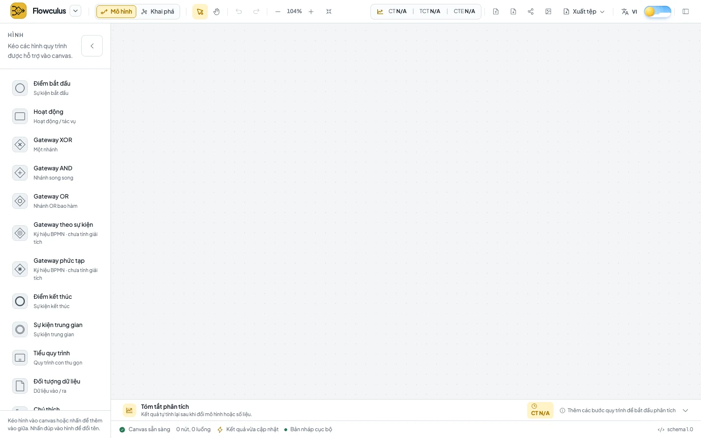

Ô chọn tên hình giữ bố cục khi nhãn hoặc ID dài; mở danh sách để đọc toàn bộ lựa chọn. · Shape selectors keep long labels and IDs inside their controls; open the dropdown to read the full options.


Ví dụ bên dưới là mô hình được chủ động nhập vào canvas. · The following example was explicitly imported into the canvas.


<details>
<summary>Giao diện tối · Dark theme</summary>

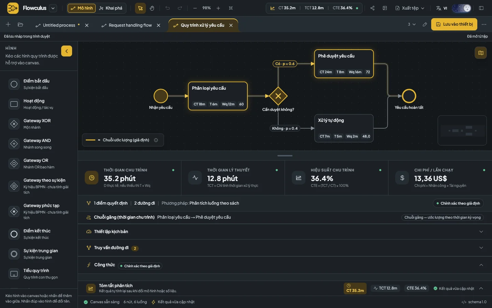

</details>

Pool/Lane dùng hộp thoại và ô chọn dùng chung; chọn rõ process trước khi phân tích. · Pool/Lane uses the shared dialog and select controls with explicit process scope.

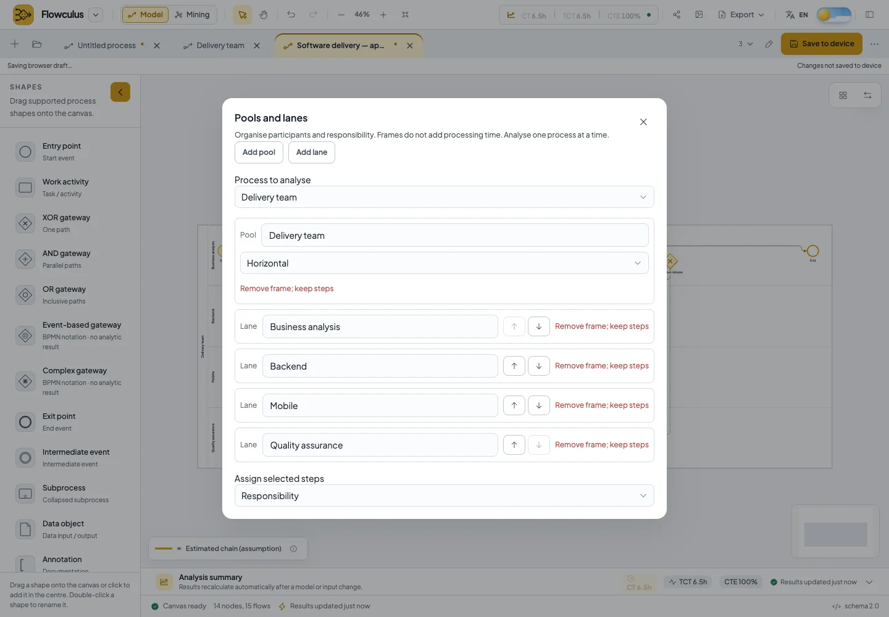

Ví dụ Mining dưới đây dùng bộ demo tổng hợp bên ngoài: fitness alignment 93,75%, 4/8 ca khớp hoàn toàn. Đây là kết quả của đầu vào minh họa, không phải số đo triển khai thực tế. · This external synthetic example yields 93.75% alignment fitness with 4/8 exactly compatible cases; it is not a measured production outcome.

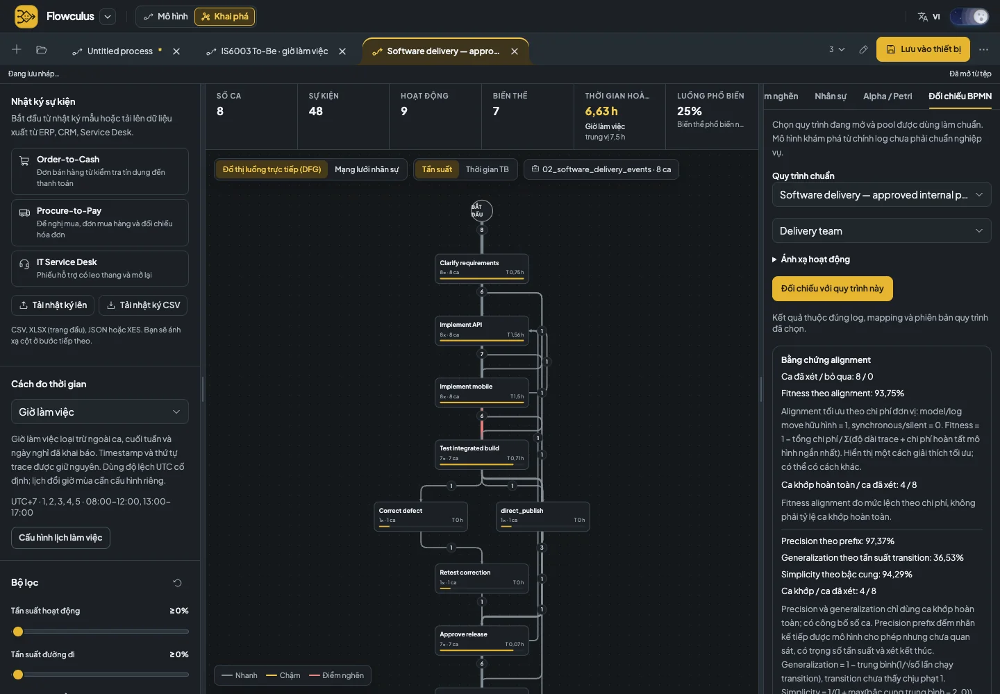

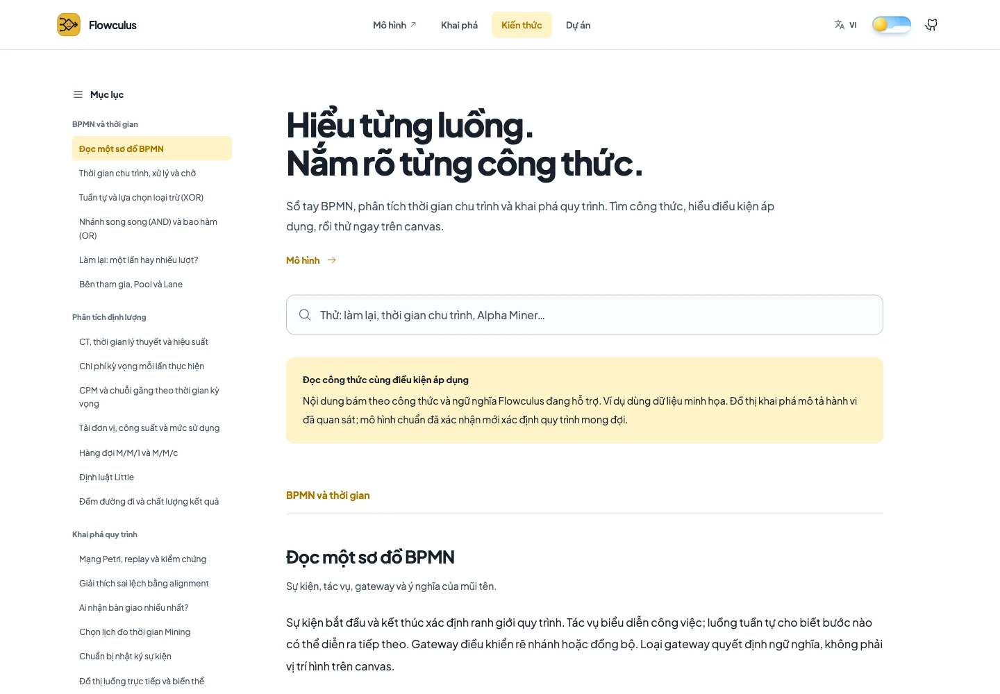

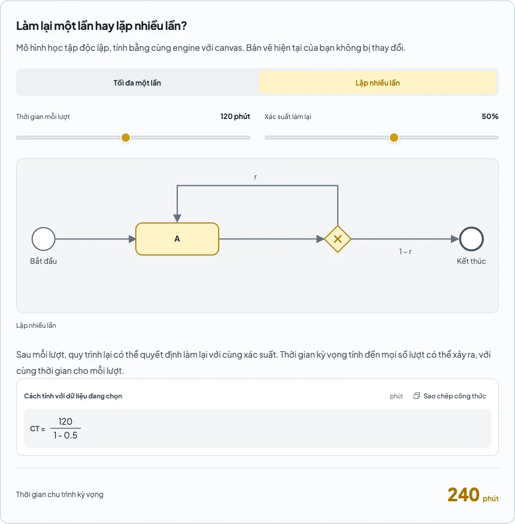

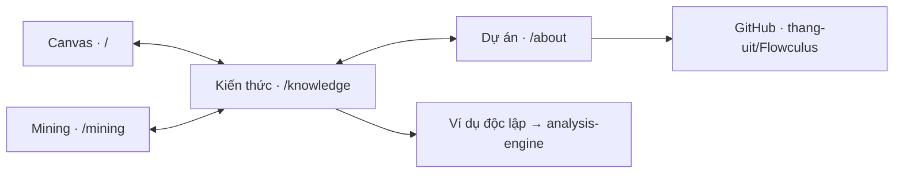

### Ký hiệu BPMN và công cụ canvas · BPMN notation and canvas tools

Các ký hiệu được đối chiếu với [OMG BPMN 2.0.2](https://www.omg.org/spec/BPMN/2.0.2/PDF): sự kiện đầu một vòng mảnh, cuối một vòng đậm, trung gian hai vòng mảnh; gateway XOR/AND/OR lần lượt dùng X/+/vòng tròn; gateway theo sự kiện dùng hai vòng và ngũ giác rỗng; tiểu quy trình thu gọn có dấu + trong ô vuông. Luồng tuần tự luôn nét liền với mũi tên đặc. Luồng thông điệp có nét đứt, vòng tròn nguồn và mũi tên rỗng; association dùng đường chấm. Phần tô sáng phân tích không đổi nét ngữ nghĩa. Kiến thức có bảng 16 ký hiệu/preset kèm phạm vi hỗ trợ.

**English.** Notation is based on OMG BPMN 2.0.2. Start/end/intermediate events retain their thin/thick/double solid outlines; gateways share one marker definition across palette, canvas, lessons and SVG. Collapsed subprocesses use a boxed plus, including new draw.io exports. Sequence flows stay solid; message flows use a dashed line with an open source circle and arrowhead. Analysis highlights do not replace semantic strokes. Knowledge lists 16 symbols/presets with explicit support limits.

**Chọn / Bàn tay.** Chọn cho phép kéo hình và kéo vùng trống để chọn nhiều phần tử trên desktop. Bàn tay kéo nền hoặc hình để di chuyển khung nhìn, không dịch mô hình; tay nắm chỉnh hình/đường tạm ẩn. Trên màn hình cảm ứng, kéo nền ưu tiên di chuyển khung nhìn. Cả desktop và thanh công cụ di động dùng cùng nút chuyển chế độ, có tooltip hướng dẫn. · Select moves shapes and provides desktop marquee selection. Hand pans the view without moving model geometry and hides editing handles. Touch background drags pan the view. Both layouts share the same tool switch and explanatory tooltips.

**Giới hạn.** Gateway theo sự kiện/phức tạp có ký hiệu và giữ dữ liệu nhưng chưa được engine giải tích thực thi; intermediate event không có trigger cụ thể; subprocess được tính như một hoạt động tổng hợp. Mục làm lại là preset tham số `r` riêng của Flowculus, không phải loại phần tử BPMN mới. Pool/lane có cấu trúc riêng và validation ranh giới; chưa tính thời gian phối hợp thông điệp giữa nhiều pool. Flowculus hỗ trợ một tập con và không tuyên bố tuân thủ toàn bộ BPMN. · Event-based/complex execution, typed intermediate-event triggers, nested subprocess execution and message-collaboration execution are outside the supported subset. Rework is a Flowculus task preset. This is not a claim of full BPMN conformance.

### Công thức, đường nối và tên tệp · Equations, connectors and file names

Công thức trong Kiến thức dùng MathML gốc: phân số, chỉ số, tổng/tích và điều kiện chọn nhánh được trình bày riêng với phần giải thích. Bài làm lại phân biệt thời gian trôi qua `τ` với thời gian xử lý `T`, có ví dụ hai lượt khác thời gian. Nút sao chép giữ biểu thức dạng văn bản để dán vào ghi chú. Tiêu đề tab theo cùng cấu trúc `<Tên trang> | Flowculus` và ngôn ngữ đang chọn; thay đổi ngôn ngữ đồng bộ giữa các tab cùng trình duyệt.

**English.** Knowledge equations use native MathML for fractions, indices, sums and products, with separate explanations and assumptions. Rework distinguishes elapsed attempt time `τ` from processing time `T`, including unequal-attempt examples. Copy provides a text expression. Browser tabs use `<Page name> | Flowculus` in the chosen language, synchronized between open tabs.

- Chọn đường nối: kéo tay nắm giữa đoạn để dịch đoạn, kéo điểm tròn để chỉnh điểm uốn; nhấp đúp lên đường để thêm điểm. Phím mũi tên dịch điểm/tay nắm, `Shift` dịch 10 đơn vị; `Delete` hoặc `Alt`-nhấp xóa điểm, `Escape` hủy lượt kéo. Mỗi lượt kéo tạo một bước Undo. Trong Thuộc tính, đổi kiểu gấp khúc/thẳng/cong hoặc xóa điểm để trở về định tuyến tự động. · Select a connector to drag its segment or bend handles. Double-click adds a bend. Arrows move handles, Shift increases the step, Delete/Alt-click removes bends, Escape cancels dragging. Each completed drag is one undo step; route styles and automatic reset remain in Inspector.
- Đổi góc đặt mũi tên: chọn đường nối rồi kéo tay nắm tròn ở đầu/cuối đến một trong bốn điểm Trên/Phải/Dưới/Trái; trên gateway, đó là bốn đỉnh nhọn. Có xem trước và bắt dính theo điểm gần nhất ở mọi mức zoom. Thả vào chỗ trống, nối trùng, nối vào Start hoặc nối về chính hình sẽ giữ đường cũ. `Escape`, mất focus hoặc trình duyệt hủy con trỏ sẽ hủy kéo. Tay nắm đang focus hỗ trợ phím mũi tên để chọn hướng, `Home` trở về Tự động; bảng Thuộc tính có các mục chọn tương đương. Mỗi lượt kéo hợp lệ là một bước Undo, giữ xác suất và điểm uốn khi chỉ đổi góc trên cùng hình. Đổi sang hình khác sẽ xóa điểm uốn cũ. · To move an arrow to another gateway tip, select the connector and drag its round endpoint handle to a cardinal port. Nearest-port snapping uses a screen-space radius at every zoom. Invalid/empty drops preserve the old connection; Escape, blur and pointer cancellation cancel the gesture. Focused handles support arrow keys and Home (Automatic), with equivalent Inspector menus. Each valid drop is one undo step. Geometry-only changes preserve probabilities and manual bends; reconnecting to another shape clears old bends.
- Điểm nối được giữ trong JSON, CSV, bản nháp, sao chép/dán và draw.io (`entryX/Y`, `exitX/Y`). SVG/PNG/JPEG dùng cùng bộ định tuyến với canvas. File cũ thiếu điểm nối vẫn tự định tuyến như trước; các port draw.io tùy ý chưa biểu diễn được vẫn được giữ trong XML gốc khi không chỉnh sửa. Đường gấp khúc/cong có đoạn tiếp cận theo hướng đã chọn; đường thẳng đi trực tiếp giữa hai điểm. Bộ định tuyến dùng tập đường tránh hữu hạn, không bảo đảm tránh mọi vật cản trong sơ đồ chồng lấn hoặc điểm uốn tự vẽ. · JSON, CSV, local drafts, clipboard and draw.io retain explicit endpoint sides; SVG/raster diagrams share canvas geometry. Legacy files keep automatic routing. Unsupported arbitrary draw.io ports remain in untouched source XML. Orthogonal/curved routes approach the selected side; straight routes connect the selected points directly. Bounded routing cannot guarantee clearance in overlapping diagrams or user-defined bends.

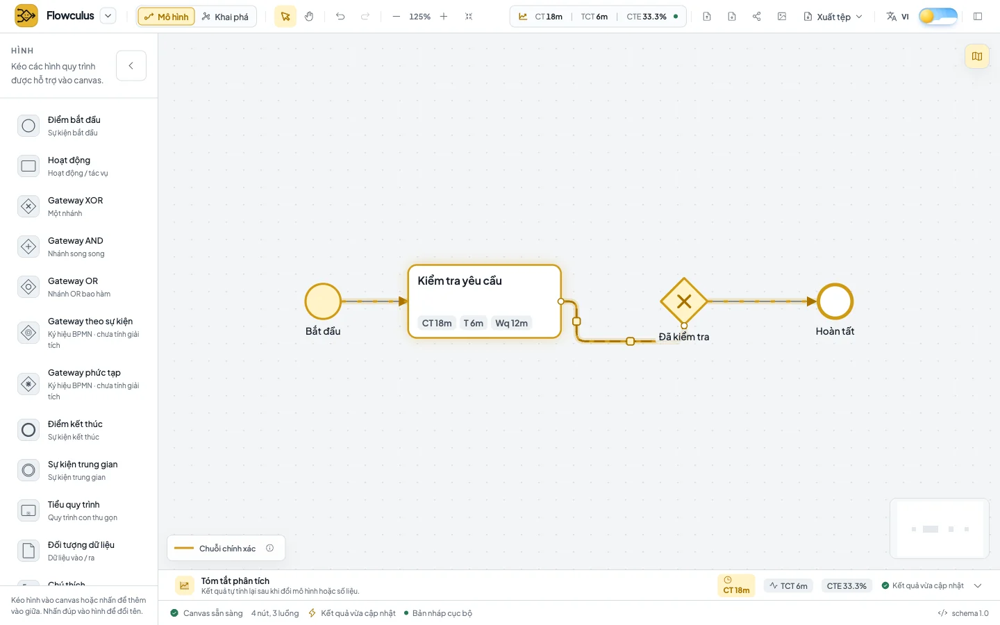

- Bản đồ tổng quan 144 × 88 px có nút bật/tắt ở góc phải canvas và nhớ lựa chọn cục bộ. · The compact overview map has a top-right toggle and remembers its visibility locally.
- Tên tệp thống nhất, không phụ thuộc ngôn ngữ: `flowculus_<ten-quy-trinh>_<loai-noi-dung>_<YYYYMMDD-HHmmssZ>.<dinh-dang>`. `Z` là UTC; loại nội dung gồm `model`, `diagram`, `analysis`, `nodes`, `edges`, `event-log`. Cặp CSV dùng cùng dấu thời gian. · Portable ASCII slugs, explicit artifact roles and sortable UTC timestamps are shared by Save, Share and exports; paired CSV files share one timestamp.

```text
flowculus_quy-trinh-duyet-don_model_20261025-101649Z.flowculus.json
flowculus_quy-trinh-duyet-don_diagram_20261025-101649Z.drawio
flowculus_quy-trinh-duyet-don_analysis_20261025-101649Z.png
flowculus_quy-trinh-duyet-don_nodes_20261025-101649Z.csv
flowculus_quy-trinh-duyet-don_edges_20261025-101649Z.csv
```

PDF dùng hộp thoại in: tiêu đề báo cáo gợi ý tên theo quy tắc trên; trình duyệt và người dùng quyết định tên PDF cuối cùng. · PDF uses the browser print dialog: the report title suggests the same filename pattern; the browser and user control the final saved name.

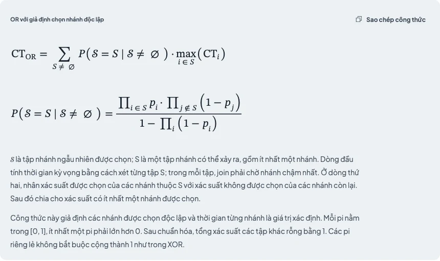

## 4. Kiến trúc và luồng dữ liệu · Architecture and data flow

Ứng dụng Next.js chỉ điều phối và hiển thị. Mọi công thức nằm trong `packages/analysis-engine`, mọi kiểm tra trong `packages/validation`, giao thức draw.io trong `packages/drawio-adapter`. Các package là TypeScript thuần nên chạy được trong Worker và Vitest.

**English.** The Next.js app only composes and presents. Formulas live in `packages/analysis-engine`, validation in `packages/validation`, the draw.io protocol in `packages/drawio-adapter`. Packages are pure TypeScript, so they run in Workers and in Vitest.

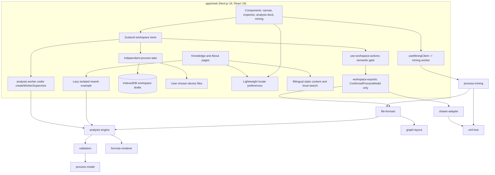

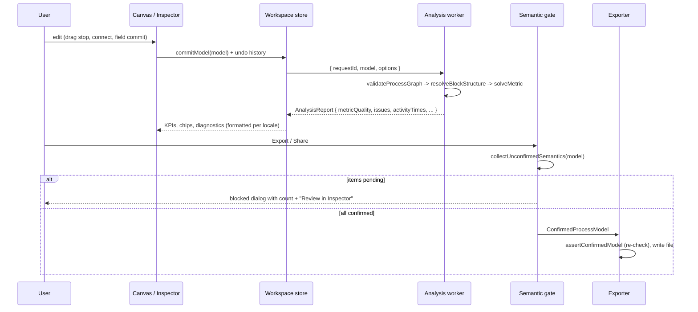

Chi tiết: [docs/architecture.md](docs/architecture.md), [ADR 0002](docs/adr/0002-native-canvas.md), [ADR 0003](docs/adr/0003-honest-analysis-and-semantic-gate.md), [ADR 0004](docs/adr/0004-webpack-for-module-workers.md).

## 5. Công thức, giả định, chất lượng và giới hạn · Formulas, assumptions, quality and limits

**Hợp đồng thời gian của hoạt động · Activity time contract** (một hàm duy nhất · one helper: `resolveActivityTime`)

| Dữ liệu nhập · Inputs               | CT của hoạt động · Activity CT | Nguồn · `cycleTimeSource` | Chất lượng · Quality                                                         |
| :---------------------------------- | :----------------------------- | :------------------------ | :--------------------------------------------------------------------------- |
| `D` (thời gian quan sát · observed) | `D`                            | `observed`                | exact; nếu `T + Wq < D` → cảnh báo `unexplained-wait` (assumption) · warning |
| `T` và/hoặc `Wq`, không có `D`      | `T + Wq`                       | `derived`                 | exact                                                                        |
| `T + Wq > D`                        | —                              | —                         | lỗi `time-components-exceed-cycle-time` · error                              |
| không có gì · nothing               | 0                              | `missing`                 | assumption (`missing-activity-time`)                                         |

Nguồn thời gian xử lý `T` (`processingSource`): `explicit`, `derived` (`D − Wq`), `cycle-time-estimate` (lấy `D` làm `T`, là giả định) hoặc `missing`. Cả hai nguồn được hiển thị trong Inspector, tooltip của chip, CSV (`cycle_time_source`, `effective_cycle_time_minutes`), báo cáo PDF và báo cáo ảnh.

**English.** Observed cycle time `D` wins; otherwise `CT = T + Wq`; `T + Wq > D` is an error and `T + Wq < D` raises an `unexplained-wait` assumption. Processing time `T` is `explicit`, `derived` (`D − Wq`), a `cycle-time-estimate` (an assumption) or `missing`. Both sources are shown in the Inspector, chip tooltips, CSV, PDF and image reports.

**Quy tắc khối · Block rules** (Dumas et al., ch. 7)

$$\text{Sequence: } CT=\sum_i CT_i \qquad \text{XOR: } CT=\sum_i p_i\,CT_i \qquad \text{AND: } CT=\max_i CT_i,\ \text{Cost}=\sum_i \text{Cost}_i$$

$$\text{Rework on one task: } CT=\frac{CT_{task}}{1-r}\ (0\le r<1) \qquad \text{Loops: expected visits as an absorbing Markov-chain fixed point}$$

- **OR**: trung bình kỳ vọng của `max` trên mọi tổ hợp nhánh khác rỗng, giả định các nhánh **độc lập** (luôn là `assumption`); quá 12 nhánh → `simulation-required` · expected `max` over every non-empty branch combination, assuming **independent** branches (always `assumption`); more than 12 branches → `simulation-required`.
- **Ghép split/join · Split/join pairing**: dùng `flowculus-join-id` nếu có (chọn trong Inspector), nếu không thì chứng minh bằng post-dominator + kiểm tra SESE + cùng loại gateway. Không chứng minh được → `simulation-required`, không bao giờ "chọn cái đầu tiên" · explicit `flowculus-join-id` first, otherwise post-dominators + SESE + matching kind; unproven → `simulation-required`, never "the first one".
- **TCT** dùng `T` thay cho CT của hoạt động · uses `T` instead of activity CT. **CTE = TCT / CT** là tỉ lệ trong `[0, 1]`; chỉ bộ định dạng mới nhân 100. `CT = 0` hoặc đầu vào không hợp lệ → `null` + chẩn đoán; `TCT > CT` → `cte-out-of-range` · CTE is a ratio in `[0, 1]`, only formatters multiply by 100; `CT = 0` or invalid inputs give `null` plus a diagnostic.
- **Cost** = Σ lượt thăm kỳ vọng × (`T`/60 × đơn giá giờ + chi phí khác) · expected visits × (`T`/60 × hourly rate + other cost).
- **CPM** (đường găng theo `T`): chỉ cho đồ thị không có quyết định và không có chu trình. Thiếu `T` thì dùng `D` như **giả định** và cảnh báo nêu tên các hoạt động (`cpm-duration-estimate`) · only for decision-free acyclic graphs; missing `T` falls back to `D` as an **assumption** that names the tasks.
- **Chuỗi găng · Critical chain** (theo CT kỳ vọng): `exact` khi không có quyết định; nếu có, đây là **heuristic thời gian kỳ vọng** (nhánh có xác suất × thời gian còn lại lớn nhất), không phải "nhánh khả dĩ nhất". Canvas giữ nét BPMN liền và dùng ký hiệu ≈ cùng chú giải khi là ước lượng · `exact` when decision-free, otherwise an **expected-time heuristic** (largest probability × remaining expected time), not "the most likely branch"; solid BPMN strokes with an approximation symbol and legend on the canvas.

**Vẽ rework tối đa một lần · Modelling at most one redo.** Sau hoạt động `F`, dùng XOR để quyết định bỏ qua hoặc đi qua **một hoạt động khác** `F (làm lại lần 1)`, rồi ghép về luồng chính. Không nối mũi tên từ gateway về cùng nút `F`: cách đó tạo chu trình và cho phép lặp không giới hạn. Gọi `τ₀` là thời gian trôi qua của lượt đầu, `τᵣ` là thời gian lượt làm lại và `r` là xác suất làm lại: kỳ vọng là `τ₀ + rτᵣ`; nếu hai lượt đều mất `τ`, kết quả là `τ(1+r)`. `τ` có thể gồm thời gian chờ, khác thời gian xử lý `T`. Công thức `τ/(1-r)` chỉ áp dụng cho mô hình lặp nhiều lần với cùng xác suất `r` mỗi lượt và `0 ≤ r < 1`. Với các nhánh song song, cần tính kỳ vọng theo các tổ hợp nhánh phù hợp trước khi dùng `max`; `max` giữa các kỳ vọng có thể cho số khác.

**English.** For an at-most-once redo, use an XOR split after `F`: either skip or execute a distinct `F redo once` activity, then merge. A return arrow to the original `F` creates an unbounded loop. With elapsed first-attempt time `τ₀` and redo time `τᵣ`, one optional redo contributes `τ₀ + rτᵣ`; equal attempt times `τ` give `τ(1+r)`. Elapsed `τ` may include waiting and differs from active processing `T`. Repeated rework uses `τ/(1-r)` with the same probability per attempt and `0 ≤ r < 1`. For parallel paths, compute the expectation over the applicable branch outcomes before applying the parallel-time rule.

Mở `examples/rework-at-most-once.flowculus.json` trong Flowculus để xem sơ đồ mẫu đã chạy kiểm tra: `F = 2 giờ`, `r = 0,5`, `F′ = 2 giờ`, nên CT kỳ vọng của khối là `2 + 0,5 × 2 = 3 giờ`. Không nhập `reworkProbability` trên `F` trong trường hợp này. · Open the example file to inspect a verified one-time redo: 2 hours + 50% × 2 hours = 3 hours; leave `reworkProbability` unset on `F`.

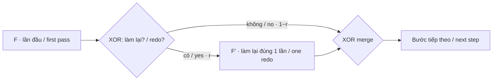

- **Công suất · Capacity**: `ρ = λ × tải đơn vị / (60 × c)` (λ theo giờ, tải đơn vị = phút xử lý của nhóm trên mỗi ca · λ per hour, unit load = pool processing minutes per case); hàng đợi M/M/c bằng Erlang C với `μ = 60 / tải đơn vị`; `ρ ≥ 1` → không ổn định · Erlang C per pool, unstable when `ρ ≥ 1`. **Little's Law**: `WIP = λ × CT`.

**Mức chất lượng · Quality levels**

| Mức · Level           | Ý nghĩa · Meaning                                                                                                                                                |
| :-------------------- | :--------------------------------------------------------------------------------------------------------------------------------------------------------------- |
| `exact`               | Đúng theo công thức sách với dữ liệu đã cho · exact under the book's equations for the given inputs                                                              |
| `assumption`          | Có số, nhưng dựa trên giả định được liệt kê (thời gian ước lượng, OR độc lập, ngữ nghĩa suy luận, phần tử bỏ qua…) · a number that depends on listed assumptions |
| `simulation-required` | Không có giá trị giải tích; số bị ẩn (`null`) · no analytic value; the number is withheld                                                                        |

Mỗi chẩn đoán có `impact` và `scope` (`model`, `processing`, `efficiency`, `cost`, `capacity`, `queue`, `critical-path`); chất lượng từng chỉ số (`metricQuality`) là mức xấu nhất của các chẩn đoán liên quan. Mức tiêu đề = xấu nhất của CT và TCT.

**English.** Each diagnostic has an `impact` and a `scope`; each metric's quality (`metricQuality`) is the worst impact in its scope, and the headline is the worse of CT and TCT.

Mô hình trống có trạng thái `empty`: CT/TCT/CTE/chi phí là `null` và giao diện không hiển thị huy hiệu `exact` · An empty model has status `empty`, null metrics and no `exact` badge in the UI.

**Giới hạn · Limits**: không mô phỏng; không có phân phối thời gian (chỉ kỳ vọng); OR giả định độc lập; tài nguyên dùng chung giữa các nhánh song song không được mô hình hoá; hàng đợi là xấp xỉ theo từng nhóm nguồn lực (`pool-queue-approximation`). · No simulation, expected values only, independent-OR assumption, no shared-resource contention across parallel branches, per-pool queue approximation.

## 6. draw.io và xác nhận ngữ nghĩa · draw.io and semantic confirmation

**Image Trace · Vẽ từ ảnh.** Nút ảnh và lệnh Open file trong header nhận PNG/JPEG/WebP tối đa 20 MB. **Visual Trace** đặt ảnh cục bộ lên canvas để vẽ thủ công; chỉnh opacity, rotation, khóa/mở khóa kéo ảnh. Ảnh được lưu riêng trong IndexedDB, không nhúng vào ProcessModel hay file export; giao diện báo lỗi nếu trình duyệt không lưu được ảnh. **Assisted Trace** chỉ tải OpenCV.js khi bấm nhận dạng; worker cho cắt bốn mép rồi giảm vùng xử lý xuống tối đa 1600 px, khép khe hở ngắn ở nhiều mức, kiểm tra contour/bao lồi và phân loại hình chữ nhật/hình thoi/ellipse. Đường nối được lần theo nét ảnh qua góc rẽ sau khi che hình và chữ bên trong; giao điểm chạm hơn hai hình không được tự ghép. Giữ vị trí tâm và góc nối, tăng kích thước tác vụ quá nhỏ để đọc nhãn. Chiều trái→phải/trên→dưới và vai trò sự kiện đầu/cuối vẫn là đề xuất cần rà, chưa đọc đầu mũi tên. Màn review cho sửa loại hình, nhãn, xóa/thêm đường nối và loại luồng, đồng thời hiển thị lỗi/cảnh báo kiểm tra đồ thị trước khi nhập; thao tác tạo draft là một bước Undo. Mọi loại hình và luồng suy ra đều gắn `flowculus-inferred-*` và phải được xác nhận trước khi export/share. Không tự đọc thời gian, xác suất, chi phí hay chữ viết tay.

**English.** Header image upload accepts PNG/JPEG/WebP up to 20 MB. Visual Trace places a local, adjustable image on the canvas; the asset is stored separately in IndexedDB and excluded from model exports. Assisted Trace lazy-loads OpenCV.js in a worker, downsamples to 1600 px, repairs short pen gaps and follows connected ink through bends while masking node outlines/interior text. Multi-shape crossings stay for review. Attachment sides are retained and small tasks receive readable minimum dimensions. Left-to-right/top-to-bottom direction and terminal event roles remain inferred; arrowheads are not verified. Review can edit types and labels, remove shapes, add/remove connectors and choose flow kinds. Creating the draft is one Undo entry. Every inferred semantic stays gated before export/share. No handwritten OCR or automatic numeric extraction is performed.

**Giới hạn · Limits.** Hiện chỉ có crop theo bốn mép; chưa có perspective correction, nhận dạng mũi tên chính xác, OCR chữ viết tay, tô lại điểm uốn từ ảnh hoặc xuất kèm ảnh tham chiếu. Đường nối suy ra từ vị trí/hướng ưu tiên trái sang phải có confidence thấp; ảnh bảng, ảnh lóa, nét mờ hoặc ký hiệu chồng nhau có thể nhận thiếu/sai. Người dùng cần kiểm tra sơ đồ trên canvas và chỉnh trong Inspector trước khi dùng kết quả tính. · Four-edge cropping is available; perspective correction, reliable arrow direction, handwritten OCR, image-derived bend points and including the reference image in exports are not implemented. Low-confidence connectors need manual review, especially with glare or overlapping symbols.

**Thao tác canvas · Canvas editing.** Chọn các shape rồi `Cmd/Ctrl+C`, `X`, `V` hoặc `D` để sao chép/cắt/dán/nhân bản; `Cmd/Ctrl+A` chọn tất cả, phím mũi tên dịch 1 px (`Shift` = 10 px), Delete xóa, `Cmd/Ctrl+Z`/`Shift+Z` hoàn tác/làm lại. Clipboard nội bộ được kiểm tra cấu trúc, tạo ID mới, chỉ giữ edge có đủ hai đầu và ánh xạ lại join. Menu chuột phải trên hình hỗ trợ copy/cut/paste, duplicate, align, distribute, snap-to-grid, zoom tới vùng chọn và xóa. Chọn edge để đổi kiểu gấp khúc/thẳng/cong, đổi shape và chọn điểm đầu/cuối Trên/Phải/Dưới/Trái hoặc Tự động trong Inspector; đổi sang shape khác sẽ xóa điểm uốn cũ để tránh đường chạy lệch. Kéo tay nắm giữa đoạn để chỉnh đường; nhấp đúp lên edge để thêm điểm uốn, kéo điểm để chỉnh, Alt-nhấp hoặc Delete để xóa. SVG, CSV, JSON và draw.io giữ thông tin đường nối theo khả năng của từng định dạng. Công thức trong bảng kết quả có nút sao chép. · Canvas shortcuts, validated clipboard cloning, draggable connector bend points, endpoint reconnection, route styles, export round-trip and copyable formulas are supported.

- **Nhập · Import**: file thường, nén (deflate-raw + base64 + URI) và nhiều trang. Hình không có metadata `flowculus-*` được phân loại từ style và **gắn cờ suy luận** (`flowculus-inferred-*`): loại phần tử, loại gateway, loại luồng, xác suất đọc từ nhãn. Ảnh/chữ là phần trình bày; Pool/Lane có metadata Flowculus được khôi phục thành container có membership. Container draw.io khác vẫn được bảo toàn trong XML. Nhập CSV và mô hình khai phá cũng gắn cờ tương tự · plain, compressed and multi-page files; shapes without Flowculus metadata are classified from their style and flagged as inferred; CSV import and mined models are flagged the same way.
- **Cổng xác nhận · Semantic gate**: còn mục chưa xác nhận thì mọi lệnh **Export** và **Share** bị chặn bởi một hộp thoại song ngữ có số lượng và nút "Review in Inspector". Inspector cho xác nhận từng mục, hoặc "Confirm all remaining…" qua bước xác nhận thứ hai. Xác nhận ghi `flowculus-confirmed`. Lớp xuất cấp thấp chỉ nhận `ConfirmedProcessModel` và kiểm tra lại. Chỉnh sửa, phân tích và bản nháp cục bộ vẫn hoạt động khi bị chặn · while anything is pending, Export and Share open a bilingual blocked dialog with the count and "Review in Inspector"; confirm per item or "Confirm all remaining…" behind a second step; confirmation records `flowculus-confirmed`; the low-level exporter accepts only a `ConfirmedProcessModel` and re-checks it; editing, analysis and the local draft keep working.
- **Xuất · Export (round-trip)**: vá XML gốc. Giữ nguyên ô không xác định, `UserObject`, style, nhãn HTML, waypoint của luồng không đổi và các trang khác (trang nén vẫn nén). Trang đang sửa được ghi **không nén**. Phỏng đoán chưa xác nhận **không** bao giờ được ghi lại như thuộc tính tường minh; ngữ nghĩa đã xác nhận và ghép join thì được ghi để lần nhập sau không cần xác nhận lại. Đây là **bảo toàn ngữ nghĩa**, không phải "lossless từng byte" · patches the original XML; keeps unknown cells, styles, HTML labels, waypoints of unchanged flows and other pages (still compressed); the edited page is written uncompressed; unconfirmed guesses are never written back as explicit attributes, confirmed ones are. This is **semantic preservation**, not byte-for-byte.

Thư mục `apps/web/app/(reading)` là **route group của Next.js**: dấu ngoặc gom các trang dùng chung layout đọc tài liệu, không xuất hiện trong URL. Hai trang bên trong vẫn là `/knowledge` và `/about`.

**English.** `apps/web/app/(reading)` is a Next.js route group sharing the reading layout; parentheses do not enter the URL. Its pages remain `/knowledge` and `/about`.

## 7. Cấu trúc repository · Repository structure

```text
Flowculus/
├── apps/web/                    Next.js 16 App Router app
│   ├── app/                     layout, error/loading pages, styles/ (canvas, dock, formula, mining CSS)
│   │   └── (reading)/           /knowledge and /about, reading-only styles
│   ├── components/
│   │   ├── analysis/            FormulaCard, IssueList, CriticalPathPanel
│   │   ├── canvas/              React Flow canvas, BPMN node views, legend
│   │   ├── inspector/           node/edge inspectors, time summary, join pairing
│   │   ├── knowledge/           contents, search, articles, SVG diagrams, isolated playground
│   │   ├── about/               project introduction and verified developer profiles
│   │   ├── site/                shared reading-page navigation and footer
│   │   ├── ui/                  shared buttons, menus, selects, dialogs and toasts
│   │   ├── documents/           process tabs, reorder controls and file dialogs
│   │   ├── image-trace/         review panel for local OpenCV candidates
│   │   ├── mining/              source, filters, map, insights, column mapping
│   │   ├── scenario/            scenario fields, capacity table, queue summary
│   │   └── semantics/           gate dialog, review panel, confirmed chip
│   ├── lib/                     store, hooks, exports, report content, i18n/, worker supervisor
│   │   ├── knowledge/           typed catalog, search, project facts and example fixtures
│   │   └── i18n/knowledge/      English/Vietnamese articles and reading UI copy
│   ├── scripts/                 verify-worker-bundle.mjs (build guard)
│   └── workers/                 analysis, mining, image-trace, XLSX, comparison
├── packages/
│   ├── analysis-engine/         formulas, structure proofs, quality, CPM, chain, capacity, queues
│   ├── validation/              schema, diagnostics, graph checks, semantic confirmation
│   ├── process-model/           domain types and metadata keys
│   ├── bpmn-adapter/            bounded standard BPMN XML/DI import/export
│   ├── drawio-adapter/          draw.io decode/classify/patch export
│   ├── file-formats/            .flowculus.json, CSV, SVG, auto layout
│   ├── process-mining/          logs, DFG, Alpha/Petri, reachability, alignment, quality, standards
│   ├── formula-renderer/        formula AST
│   ├── graph-layout/            layered layout, orthogonal routing
│   └── xml-tree/                dependency-free XML
├── docs/                        architecture.md, adr/
├── AGENTS.md                    contributor and agent rules (English)
├── CONTRIBUTING.md              contribution workflow (Vietnamese/English)
├── LICENSE                      MIT terms
├── SECURITY.md, CODE_OF_CONDUCT.md
├── THIRD_PARTY_NOTICES.md        attribution for reused material
├── .github/                     CI, owners, dependency updates, Issue/PR forms
├── scripts/                     scoped cache cleanup, external synthetic demo export
└── .nvmrc, turbo.json, vitest.config.mts
```

## 8. Yêu cầu · Prerequisites

- Node.js **22.23+ trong nhánh 22.x** thống nhất trong `.nvmrc`, package gốc, ứng dụng web và bộ kiểu Node · consistent runtime and Node types across the workspace and Vercel.
- pnpm **11.22.0** qua Corepack (`corepack enable`) · via Corepack.
- Trình duyệt hỗ trợ module Web Worker và IndexedDB (Chrome, Edge, Firefox, Safari bản hiện hành) · a browser with module workers and IndexedDB.

## 9. Lệnh · Commands

```bash
corepack enable
pnpm install --frozen-lockfile # cài đúng lockfile · reproducible install
pnpm dev                # máy chủ phát triển · dev server (http://localhost:3000)
pnpm test               # Vitest cho mọi package và app · all packages and the app
pnpm lint               # ESLint (0 cảnh báo · 0 warnings)
pnpm --filter @flowculus/web exec next typegen # tạo kiểu route cho checkout mới · fresh-checkout route types
pnpm typecheck          # TypeScript cho mọi package · all packages
pnpm graph:index        # lập chỉ mục GitNexus cục bộ · local code graph
pnpm graph:check        # kiểm tra vòng import · circular-import check
pnpm format             # Prettier ghi · write
pnpm format:check       # Prettier kiểm tra · check
pnpm build              # next build --webpack + kiểm tra worker · worker bundle check
pnpm start              # chạy bản build · serve the build
pnpm check              # test + format:check + lint + typecheck + build
pnpm clean:cache        # dừng server trước, dọn cache · stop servers first, clear caches
```

`pnpm clean:cache` xoá cache Turbo, Next/Webpack, bản dev Next, TypeScript incremental, Vitest và ảnh/snapshot Playwright cục bộ. Lệnh chỉ tác động các đường dẫn sinh tự động trong repo, giữ dependency `node_modules`, bản build production, mã nguồn và bản nháp trên trình duyệt. Cache được tạo lại ở lần chạy sau; hãy dừng server dev trước khi dọn. · Stop local servers before cleaning. This command removes only generated repository caches and local Playwright captures; it preserves installed dependencies, the production build, source files and browser drafts. Subsequent commands regenerate caches.

### Rà mã nguồn bằng GitNexus · Code review with GitNexus

GitNexus là công cụ phát triển tùy chọn, không phải dependency của web. Cài CLI một lần (`npm install -g gitnexus@1.6.9`), rồi chạy `pnpm graph:index` và `pnpm graph:check` từ gốc repository. Lệnh index dùng `--index-only --pdg --workers 2`: không ghi đè AGENTS.md, không tạo CLAUDE.md và không thêm skill vào dự án. `.gitnexus/` được gitignore; `.gitnexusignore` loại cache, build, ảnh và lockfile khỏi đồ thị. Sau khi sửa mã nguồn, lập lại chỉ mục trước khi đọc kết quả. Kiểm tra thêm bằng `query`, `context`, `impact`, `pdg_query` và đối chiếu với mã nguồn/test; đồ thị tĩnh không chứng minh UI hoặc nghiệp vụ luôn đúng.

**English.** GitNexus is an optional developer CLI, excluded from the shipped application. Install `gitnexus@1.6.9` globally, run `pnpm graph:index`, then `pnpm graph:check`. Index-only mode preserves contributor instructions; the ignored local graph includes the PDG layer. Reindex after changes, inspect callers/impact and verify findings against source, tests and the browser. Static analysis is supporting evidence, not a correctness guarantee.

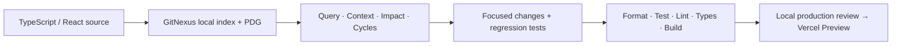

Kết quả mới nhất: [rà soát số liệu, bộ demo và bản phát hành](docs/review-2026-10-28.md). Tham khảo thêm [đợt GitNexus và chuẩn bị Vercel trước đó](docs/review-gitnexus-2026-10-25.md). · Latest findings and limits: [report, demo and release review](docs/review-2026-10-28.md), with the earlier Vercel preparation review retained for context.

## 10. Biến môi trường · Environment variables

Flowculus **không cần file env hay biến môi trường ứng dụng**. Cấu hình `NEXT_PUBLIC_DRAWIO_EMBED_URL` thuộc iframe draw.io cũ đã được bỏ, cùng `.env.dev`, `.env.pro`, `.env.example`, `dotenv-cli` và các script `:dev`/`:pro`. Dùng `pnpm dev`, `pnpm build` và `pnpm start` thay các lệnh cũ. Git tiếp tục bỏ qua `.env`/`.env.*` để tránh commit nhầm bí mật. Trên Vercel không cần cấu hình biến nào; `ENABLE_EXPERIMENTAL_COREPACK=1` vẫn là tuỳ chọn của nền tảng để dùng pnpm trong `packageManager`.

**English.** No application environment files or variables are required. The obsolete draw.io iframe variable `NEXT_PUBLIC_DRAWIO_EMBED_URL`, `.env.dev`, `.env.pro`, `.env.example`, `dotenv-cli` and `:dev`/`:pro` script variants have been removed. Use `pnpm dev`, `pnpm build` and `pnpm start`. Git continues to ignore `.env`/`.env.*` to prevent accidental secret commits. Vercel requires no application variables; its optional `ENABLE_EXPERIMENTAL_COREPACK=1` setting selects the declared pnpm version.

## 11. Worker, bản nháp cục bộ và hiệu năng · Workers, local draft and performance

- **Analysis worker** (`createWorkerSupervisor`): yêu cầu mới nhất thắng; yêu cầu cũ chạy quá 750 ms bị huỷ bằng cách khởi động lại worker; quá 20 s thì dừng và báo; worker lỗi được khởi động lại tối đa 2 lần liên tiếp rồi mới chuyển sang tính trên luồng chính · latest request wins, stale runs over 750 ms are cancelled by restarting the worker, 20 s timeout, at most 2 consecutive restarts before the main-thread fallback.
- **Mining worker** (`useMiningClient`): timeout 90 s, nút **Cancel** khi đang tải, khởi động lại có giới hạn. Worker giữ nhật ký nên khi huỷ/lỗi, phiên khai phá được xoá và cần nạp lại · 90 s timeout, a Cancel button while loading, bounded restart; aborts clear the session because the worker holds the log.
- Mining chuẩn bị trace, biến thể, số liệu và DFG gốc một lần cho mỗi log; kéo bộ lọc chỉ dựng lại bản đồ đã lọc. Nạp log mới xoá kết quả đã chuẩn bị của log cũ; bảng nhập thô được giải phóng sau khi ánh xạ thành công. · Mining prepares traces, variants, statistics and the original DFG once per log; filters reuse them. Loading another log invalidates the prepared result and successful mapping releases the raw table.
- Build kiểm tra đủ năm worker (analysis, mining, Image Trace, XLSX, comparison) đã được đóng gói thành JavaScript; Image Trace worker chỉ tải khi nhận dạng, giới hạn 45 s và hủy bằng cách terminate. Gói OpenCV.js khoảng 25 MB chưa nén nằm ngoài đường tải ban đầu. · Workers are separately bundled; image detection loads lazily, has a 45 s timeout and terminates on cancel. Its OpenCV chunk is about 25 MB uncompressed and outside the initial load.
- **Comparison worker**: chạy hai mô hình giải tích đã xác nhận trong worker riêng, giới hạn 20 s; đổi lựa chọn hoặc đóng hộp thoại sẽ dừng worker. Thay mô hình/cấu hình làm kết quả cũ không còn hợp lệ. · Runs two confirmed model scenarios in a separate worker with a 20 s timeout; changing the selection or closing cancels it, and model/settings changes invalidate stale results.
- **Bản nháp · Drafts**: lưu tất cả tab và tab đang chọn trong IndexedDB (dự phòng localStorage), debounce 650 ms và checkpoint khi rời trang. Bản nháp đơn cũ được chuyển đổi, giữ mô hình và nguồn draw.io. Undo/redo giữ tối đa 100 bước riêng mỗi tab trong bộ nhớ. Khi Web Locks khả dụng, chỉ một cửa sổ editor ghi bản nháp; cửa sổ khác báo xung đột và vẫn lưu file được. · All open tabs and the active tab are persisted with a 650 ms debounce and a page-exit checkpoint. Existing single drafts migrate without discarding user content. Each tab has a bounded, memory-only undo history. Web Locks prevents concurrent browser editor windows from silently overwriting the shared session; secondary windows display a conflict and retain device saving.
- **Trang đọc · Reading pages**: ngôn ngữ dùng store nhẹ và lưu tùy chọn cục bộ; đổi theme dùng provider chung. Nội dung không gọi API tìm kiếm và không tải OpenCV/XLSX. Ví dụ tính toán chỉ tải khi cuộn gần chương tương ứng, chạy độc lập với bản vẽ. Mở Kiến thức/Dự án từ workspace sẽ mở tab mới, giữ nguyên mô hình và phiên Mining (log, bộ lọc, kết quả) ở tab gốc. Khi rời editor, bản nháp vẫn được checkpoint. · Reading preferences are lightweight and shared, search is local, and the isolated calculation example loads near its chapter. Knowledge/About links from the workspace open a separate tab, keeping the live model and Mining session (log, filters, results) in the original tab. Leaving the editor also checkpoints the latest draft.
- **CSV mô hình · Model CSV**: chọn cặp nút/cạnh theo thứ tự bất kỳ; ô số sai được báo theo bảng/dòng/cột. CSV giữ các trường số, tiền tệ, metadata ngữ nghĩa và điểm uốn; dùng `.flowculus.json` để sao lưu hợp đồng mô hình đầy đủ · select nodes/edges in either order; invalid numbers report table/row/column. CSV preserves supported numeric fields, currency, semantic metadata and bend points; use `.flowculus.json` for a complete model backup.
- **Ảnh bitmap · Bitmap export**: giới hạn 8 triệu pixel và 8192 px mỗi chiều; sơ đồ quá lớn cần xuất SVG · capped at 8 million pixels and 8192 px per side; use SVG for very large diagrams.
- Kéo thả nằm trong React Flow; store chỉ nhận thay đổi đã commit. Nhật ký giới hạn 500.000 dòng; OR giới hạn 12 nhánh; đếm đường đi có giới hạn · drag frames stay inside React Flow; logs are capped at 500,000 rows, OR at 12 branches, path counting is bounded.
- Mỗi vùng chính (canvas, mining, phân tích, Inspector) có error boundary với nút thử lại; trạng thái offline hiện ở thanh trạng thái · each main region has an error boundary with retry; offline state shows in the status bar.

## 12. Responsive và trợ năng · Responsive and accessibility

- Đã kiểm tra ở 320, 390, 430, 768, 1024, 1440 và 1920 px: không tràn ngang, Export luôn truy cập được, hộp thoại vừa màn hình. Trên điện thoại Inspector là bottom sheet và thanh công cụ thu gọn · checked at 320–1920 px: no horizontal overflow, Export reachable, dialogs fit; on phones the Inspector is a bottom sheet with a compact toolbar.
- Menu Export hỗ trợ phím mũi tên, Home/End, Enter, Escape và trả focus; hộp thoại giữ focus; mọi nút có tên truy cập; chất lượng hiển thị bằng chấm + chữ + tooltip, không chỉ bằng màu · keyboard menus, focus-trapped dialogs, accessible names, quality shown by dot + text + tooltip, never colour alone.
- Sáng/tối, dùng token tương phản và tôn trọng `prefers-reduced-motion`, chỉ animate `transform`/`opacity` · light/dark, contrast-oriented tokens and reduced motion respected; this is not a full WCAG certification.
- Giao diện dùng Plus Jakarta Sans Variable tự host, gồm các ký tự tiếng Việt; công tắc sáng/tối dùng Lucian UX/UI Prompt #021, được thu gọn để vừa header và vẫn hỗ trợ bàn phím · the UI self-hosts Plus Jakarta Sans Variable with Vietnamese glyphs; the theme switch adapts Lucian UX/UI Prompt #021 to the header and remains keyboard accessible.

## 13. Triển khai Vercel · Vercel deployment

1. Import repository vào Vercel, đặt **Root Directory = `apps/web`** (giữ bật "Include files outside the root directory"). Vercel đọc `apps/web/vercel.json`: framework `nextjs`, cài đặt `pnpm install --frozen-lockfile` (cài cả workspace), build `pnpm run build` · set **Root Directory = `apps/web`**; Vercel reads `apps/web/vercel.json`.
2. Node.js **22.x** (từ `engines` của `apps/web/package.json`) · Node 22.x from `engines`.
3. Không cần biến môi trường cho ứng dụng. Dùng đúng pnpm 11.22.0 trong `packageManager`; nếu nền tảng cần Corepack, bật tùy chọn tương ứng ở build settings · no application environment variables; use the pinned pnpm version.
4. **Preview**: mỗi pull request/nhánh tạo một Preview Deployment; kiểm tra lại các luồng ở mục 15 trên URL preview · every branch/PR gets a preview; re-run the section 15 flows there.
5. **Production**: merge vào nhánh production, hoặc "Promote to Production" một preview đã kiểm tra · merge to the production branch or promote a verified preview.
6. **Rollback**: Vercel → Deployments → chọn bản trước → "Instant Rollback" (hoặc `vercel rollback`) · Instant Rollback to the previous deployment.

Lý do sửa cấu hình: `vercel.json` cũ ở thư mục gốc đặt `framework: nextjs` trong khi `package.json` gốc không có `next`, nên Vercel không nhận diện được Next.js nếu Root Directory là gốc, và bị bỏ qua nếu Root Directory là `apps/web`. Cấu hình nay nằm cạnh ứng dụng. Các header bảo mật được đặt trong `next.config.ts` để chạy ở mọi môi trường. Trang là static (`○`), không có API route.

**English.** The old root `vercel.json` declared `framework: nextjs` while the root `package.json` has no `next` dependency, so Next.js detection fails with Root Directory at the repo root and the file is ignored with Root Directory `apps/web`; the config now lives next to the app. Security headers are set in `next.config.ts` so they apply everywhere. All routes are static; there are no API routes. The local production build is verified. No Vercel Preview or production deployment has been created in this session; validate the first hosted Preview before promoting it.

## 14. Xử lý sự cố · Troubleshooting

| Triệu chứng · Symptom                                                   | Cách xử lý · Fix                                                                                                                                                 |
| :---------------------------------------------------------------------- | :--------------------------------------------------------------------------------------------------------------------------------------------------------------- |
| Vercel: "No Next.js version detected"                                   | Root Directory phải là `apps/web` · must be `apps/web`                                                                                                           |
| Build báo "Worker bundling check failed" · build fails the worker check | Đừng build bằng Turbopack; dùng `pnpm build` (webpack) · build with webpack via `pnpm build` (ADR 0004)                                                          |
| Thanh trạng thái: "calculating on the main thread"                      | Trình duyệt chặn module worker (CSP, extension); kết quả vẫn đúng nhưng chậm hơn · workers are blocked; results stay correct but slower                          |
| Export/Share mở hộp thoại "Confirm inferred semantics first"            | Bấm "Review in Inspector" và xác nhận hoặc sửa từng mục · review and confirm in the Inspector                                                                    |
| KPI hiện N/A với chấm đỏ · N/A with a red dot                           | Mô hình cần mô phỏng (nhiều start, khối không cấu trúc, join không khớp…); xem danh sách phát hiện · see the findings list                                       |
| Khai phá bị dừng/huỷ · mining stopped                                   | Log quá lớn hoặc bị huỷ; lọc bớt hoặc nạp lại · reload or filter the log                                                                                         |
| OpenCV không tải/chạy được · OpenCV fails                               | Kiểm tra worker/CDN nội bộ của bản build; dùng Visual Trace để vẽ thủ công, hoặc giảm độ phân giải ảnh · use Visual Trace or a smaller image                     |
| Ảnh tham chiếu biến mất sau reload · reference disappears               | Trình duyệt có thể chặn IndexedDB hoặc xóa dữ liệu site; tải ảnh lại · the browser may block or clear IndexedDB; upload again                                    |
| Dán shape không được · paste fails                                      | Chọn canvas, dùng `Cmd/Ctrl+V`; nếu quyền clipboard bị chặn, copy/duplicate trong cùng tab vẫn dùng bộ nhớ cục bộ · focus canvas or use same-tab memory fallback |
| `pnpm install` lỗi phiên bản pnpm · pnpm version error                  | `corepack enable` rồi cài lại · then reinstall                                                                                                                   |

## 15. Ma trận kiểm thử và giới hạn đã biết · Testing matrix and known limitations

| Tầng · Layer                                          | Nội dung · Coverage                                                                                                                                                                                                                                                                              |
| :---------------------------------------------------- | :----------------------------------------------------------------------------------------------------------------------------------------------------------------------------------------------------------------------------------------------------------------------------------------------- |
| `analysis-engine`                                     | mọi nhóm công thức (sequence, XOR, AND, OR, rework, loop, TCT, CTE 0/1/giữa/không hợp lệ, cost, CPM, chain, capacity, M/M/c, Little) và cấu trúc (XOR/AND/OR lồng, join dùng chung, không cấu trúc, thiếu join, vòng lặp); số liệu ghim · every formula group and structure case; pinned numbers |
| `validation`                                          | chẩn đoán đồ thị, nhiều start, chính sách xác nhận · graph diagnostics, multiple starts, confirmation policy                                                                                                                                                                                     |
| `drawio-adapter`                                      | round-trip bảo toàn ngữ nghĩa (file gốc không metadata, trang nén, waypoint, UserObject, join-id) · semantic-preserving round trip                                                                                                                                                               |
| `file-formats`, `process-mining`                      | hợp đồng CSV/JSON, số liệu preset ghim · CSV/JSON contracts, pinned preset numbers                                                                                                                                                                                                               |
| `apps/web`                                            | lệnh chỉnh sửa, worker supervisor, nội dung báo cáo, chất lượng đi qua worker → store → UI → export, đủ bản dịch chẩn đoán · editing commands, worker supervisor, report content, quality pipeline, diagnostic translations                                                                      |
| Trình duyệt · Browser (Playwright, thủ công · manual) | palette, nhập draw.io gốc, bị chặn export/share, xác nhận, export thành công, chẩn đoán không cấu trúc, offline, mining, 320–1920 px · the main flows at 320–1920 px                                                                                                                             |

**Dependency.** Đã cập nhật bản vá Zustand, PostCSS và Prettier; bộ kiểu Node khớp Node 22. ESLint 9.39.5 (chỉ công cụ phát triển) đã hết hỗ trợ, nhưng các plugin `react`, `jsx-a11y` và `import` của cấu hình Next hiện chưa khai báo hỗ trợ ESLint 10. Giữ phiên bản tương thích, không ép peer dependency. React 19.2/TypeScript 5/Vitest 4 vẫn giữ các phiên bản đang kiểm chứng; nâng major cần đợt chuyển đổi riêng. · Patch updates are applied; Node types match production. ESLint 9 remains a development-only compatibility exception pending plugin support for ESLint 10. Runtime and major toolchain upgrades require a separate migration.

**Giới hạn đã biết · Known limitations**: chưa có CSP (cần nonce cho script của Next.js); chưa có test e2e tự động trong CI (kịch bản Playwright chạy thủ công); không có mô phỏng; pool/lane có editor, không thực thi phối hợp thông điệp; boundary event không được mô hình hoá; xuất PDF dùng hộp thoại in của trình duyệt. · No CSP yet, no automated e2e in CI, no simulation, pool/lane editor with no message-collaboration execution, boundary events not modelled, PDF uses the browser print dialog.

**Image Trace và draw.io-like editing.** OpenCV là bộ nhận dạng hình học gần đúng, không chứng minh BPMN đúng; review/validation vẫn bắt buộc. Chưa đọc đầu mũi tên, chữ hay ký hiệu XOR/AND/OR; sơ đồ đi ngược có thể bị đảo chiều. Nét hở có thể làm thiếu hình hoặc nối sai; giao điểm nhiều nhánh có thể bị bỏ qua. Canvas có clipboard, nudge, route thủ công và đổi đầu nối bằng cách kéo hoặc chọn trong Inspector. Sao chép riêng màu/kiểu dáng shape chưa có vì model hiện chưa lưu style riêng cho từng shape. · OpenCV is approximate; review remains required. Arrowheads, text and gateway markers are not read; reversed drawings can get the wrong direction, broken strokes can miss shapes or create wrong connectors, and ambiguous crossings can be omitted. Shape style copying is unsupported because the model has no per-shape visual style yet.

**Giới hạn Mining · Mining limits.** XLSX đọc trang đầu tối đa 10 MB, log tối đa 500.000 dòng. Alpha cổ điển giới hạn 16 hoạt động/2.000 ứng viên; self/short loop có thể làm Petri/replay không khả dụng. Petri verification duyệt tối đa 2.000 marking với giới hạn tăng token; chạm trần trả chưa kết luận. Alignment tối ưu chi phí đơn vị tối đa 200 ca, 10.000 sự kiện, 4.000 trạng thái xét mỗi trace; fitness bị giữ lại nếu không phân tích đủ. UI ghi phương pháp, coverage và một cách giải thích tối ưu, không khẳng định duy nhất bước bị bỏ. Quy trình chuẩn được chọn độc lập với mô hình khám phá. Gửi tới canvas vẫn là DFG → BPMN dự thảo, không phải Petri → BPMN bảo toàn hành vi.

BPMN → Petri/conformance hẹp hơn phân tích CT: tối đa 120 flow node/220 sequence flow, hỗ trợ routing XOR/AND, không nhận OR, rework dạng tham số hay thực thi message flow. Chưa có nhập PNML, chuyển Petri tùy ý sang BPMN, kiểm chứng liveness/invariant tổng quát, so sánh log với log hoặc gắn thẻ BPR. · BPMN → Petri/conformance has a narrower subset than CT analysis: at most 120 flow nodes/220 sequence flows, XOR/AND routing, no OR, parameter-based rework or message execution. PNML import, arbitrary Petri → BPMN conversion, general liveness/invariants, log-vs-log comparison and BPR tagging are not implemented.

**English.** XLSX reads the first sheet up to 10 MB; logs are capped at 500,000 rows. Classical Alpha is bounded to 16 activities/2,000 candidates and may withhold Petri/replay for self/short loops. Verification explores at most 2,000 markings with token-growth bounds; cut-offs are inconclusive. Unit-cost optimal alignment examines at most 200 cases, 10,000 events and 4,000 states per trace; incomplete analysis withholds fitness. The view declares the method, coverage and one optimal explanation. The chosen approved reference is separate from discovery. Send to canvas remains inferred DFG → BPMN, not a behaviour-preserving Petri conversion.

## 16. Bảo mật và quyền riêng tư · Security and privacy

- Không telemetry, không server lưu trữ: mô hình, nhật ký và kết quả ở lại trong trình duyệt · no telemetry, no server storage.
- Không iframe bên thứ ba; header `X-Content-Type-Options`, `Referrer-Policy`, `X-Frame-Options: DENY`, `Permissions-Policy` · no third-party iframe; baseline security headers.
- File nhập được xem là không tin cậy: parser XML/CSV tự viết có giới hạn, không `eval`, không chèn HTML từ file · imported files are untrusted: bounded parsers, no `eval`, no HTML injection.
- CSV xuất ra chặn giá trị văn bản có dạng công thức bảng tính bằng dấu nháy đơn ở đầu ô. Khi dùng CSV ngoài Flowculus, dấu nháy đơn mở đầu tương tự có thể được hiểu là ký tự bảo vệ · exported CSV prefixes spreadsheet formula-like text with an apostrophe; an equivalent leading apostrophe from an external CSV may be interpreted as a safety prefix on import.
- Không theo dõi file env; không đưa secret vào repository · no tracked environment files or committed secrets.

## 17. Changelog và ghi chú chuyển đổi · Changelog and migration notes

- **2026-10-28:** đồng bộ lịch làm việc và hai bộ demo, dùng thư mục xuất được Git bỏ qua. Sửa ánh xạ nhãn đặc biệt và loại trừ khả năng sự kiện ngoài chuẩn trùng mã task. Kiến thức phân biệt fitness alignment với tỷ lệ ca khớp, giải thích giới hạn của Petri và dữ liệu tổng hợp. · Synchronized calendars and demo exports, isolated special activity labels from task IDs, and clarified conformance and verification scope.

- **2026-10-27:** thêm Pool/Lane và phạm vi process, BPMN XML có giới hạn, bằng chứng Petri/alignment, định mức xử lý và so sánh hai mô hình trong worker. Thêm bốn chủ đề Kiến thức; giữ theme vàng/trung tính, Plus Jakarta Sans và các control dùng chung. Bộ demo đồ án chuyển thành file tổng hợp xuất ngoài bundle; ảnh workspace/knowledge được chụp lại từ bản production cục bộ. Không thêm dependency production bên ngoài cho BPMN/Petri. · Added scoped collaboration, bounded BPMN XML, Petri/alignment evidence, service standards and worker-based analytical scenario comparison, with four Knowledge topics and refreshed production captures. The incumbent UI remains; project-specific demo files stay outside the web bundle.

- Thêm workspace nhiều quy trình, đặt tên, đóng có xác nhận, lưu thiết bị và tự lưu file theo khả năng trình duyệt; bảo toàn mô hình cũ khi import/Mining. Tách dịch vụ tài liệu, lưu trữ và giao diện; khôi phục bản nháp cũ và giữ ảnh đúng tab. File JSON thêm `drawioPageIndex` tùy chọn để giữ trang nguồn đang mở; file cũ mặc định trang đầu. · Added independent process tabs, naming, guarded closing, device saving and opt-in native file auto-save. Imports/Mining preserve existing work. Migrates legacy drafts and isolates photos. The additive `drawioPageIndex` JSON field retains the selected source page; legacy files default to the first page.

**Production hardening**

- Rà cuối bằng GitNexus và đối chiếu source/test: chặn mức zoom khôi phục không hữu hạn, kiểm tra tên file trước hộp thoại hệ thống và mở đúng tab khi lưu cần xác nhận ngữ nghĩa. Đồng bộ tài liệu kiến trúc, Kiến thức và cách lưu Ctrl/Cmd+S; nêu rõ giới hạn nhận dạng ảnh. · Final graph-assisted review rejects non-finite recovered zoom, validates file names before the system picker and opens the originating tab for explicit semantic review. Architecture, Knowledge, save instructions and Image Trace limitations now match the implementation.

- Ô chọn dùng chung giữ tên dài trên một dòng có dấu ba chấm, xem đầy đủ bằng tooltip hoặc mở danh sách; danh sách tự xuống dòng và giới hạn theo chiều rộng màn hình. · Shared selects truncate long selected labels to one line, expose the full label on hover or in the dropdown, and wrap dropdown options within the viewport.
- Escape đóng danh sách trước bảng thuộc tính, trả focus về ô chọn; phím tắt canvas bỏ qua sự kiện đã được control xử lý để giữ đường/hình đang chọn. · Escape dismisses a select before its inspector and restores trigger focus; canvas shortcuts ignore handled events to preserve the current selection.

- Gộp điểm chuyển chế độ tại header, bỏ mục trùng trong menu logo và đồng nhất tên Mô hình/Model trên các trang đọc. Đồng bộ lựa chọn từ trạng thái React Flow hiện tại để tránh vòng lặp render khi quay lại từ Mining với shape đang chọn. · Removed duplicate mode links from the brand menu and aligned reading-page labels. Read the current React Flow selection to avoid stale selection effects causing a render loop when returning from Mining.

- Thêm `/about` và `/knowledge`, 22 bài song ngữ, tìm kiếm, mục lục, sơ đồ SVG và ví dụ engine độc lập; điều hướng qua logo và lưu bản nháp khi rời editor. Tách tùy chọn ngôn ngữ khỏi workspace store, thêm ảnh demo WebP và phần ảnh tối có thể mở rộng trong README. · Added About/Knowledge, bilingual articles, local search, contents, diagrams and isolated engine examples; separated locale preferences and protected drafts during documentation navigation, with WebP demos and an expandable dark-theme preview.
- Cập nhật Next.js và ESLint config lên 16.4.3, Zod lên 4.6.7, Vitest lên 4.1.12 để nhận bản vá bảo mật trong cùng major version. Hai override có giới hạn cho Vite 8.2.4 và brace-expansion 5.0.12 giữ dependency gián tiếp của công cụ phát triển ở bản vá tương thích. · Updated Next.js and its ESLint config to 16.4.3, Zod to 4.6.7 and Vitest to 4.1.12. Scoped Vite 8.2.4 and brace-expansion 5.0.12 overrides patch transitive development tools within their declared ranges.
- Lần mở đầu dùng canvas trống; Mining không tự nạp preset. Bỏ qua đúng bản nháp mẫu cũ chưa chỉnh sửa, giữ các bản vẽ đã sửa. · Empty first visits and opt-in mining samples; preserve edited drafts during legacy-starter migration.
- Luồng Mở tệp và kéo thả dùng chung yêu cầu mới nhất; tệp cũ đọc chậm không ghi đè tệp mới, hủy XLSX sẽ dừng worker và không báo thành công giả. · Header/drop imports share cancellation and discard superseded reads.
- Dọn cấu hình env/iframe cũ và `dotenv-cli`; thêm `pnpm clean:cache` để dọn đúng thư mục sinh tự động. Mining tái sử dụng dữ liệu đã chuẩn bị khi kéo bộ lọc, giải phóng bảng thô sau ánh xạ và không dùng phép spread với danh sách biến thể lớn. · Removed obsolete environment/iframe configuration and `dotenv-cli`; added scoped cache cleanup and reused prepared mining data across filter changes.
- Sửa tỷ trọng thời gian xử lý khi log chỉ có một phần thời điểm bắt đầu: số mẫu đo được thay cho tổng số lượt thực hiện. Giới hạn 500.000 dòng được kiểm tra thêm ở bước ánh xạ; ghép lifecycle dùng hàng đợi không dịch mảng. · Service-time totals now use measured samples for partial-start logs; mapping enforces the row limit and lifecycle pairing avoids repeated array shifting.
- Timestamp từ log kiểm tra ngày thực trong tháng/năm nhuận, giây, múi giờ và giờ AM/PM. Chỉ nhận ISO, ngày dạng `dd/mm/yyyy` (hoặc month-first theo dữ liệu), epoch; chuỗi khác bị báo không đọc được, tránh `Date.parse` diễn giải khác nhau giữa trình duyệt/múi giờ. · Log dates now validate real calendar days and time components. Supported ISO, numeric calendar and epoch formats replace browser-dependent `Date.parse` fallbacks; unsupported strings count as unreadable timestamps.
- Mô hình trống đổi từ `ready` với CT/TCT bằng 0 và `exact` sang `empty` với chỉ số `null`; code đọc `AnalysisReport.status` cần xử lý trạng thái mới · empty reports now use `status: "empty"` and null metrics instead of ready/exact zeroes; report consumers must handle the new status.
- Bản nháp chấp nhận mô hình chưa hoàn chỉnh, checkpoint khi rời trang; xuất dữ liệu không phụ thuộc worker, nhưng báo cáo vẫn cần kết quả mới · drafts retain unfinished work; data exports remain available during worker failure while reports require fresh analysis.
- CSV thêm cột `currency`, báo ô số sai và đọc cặp nút/cạnh theo mọi thứ tự; bitmap bị giới hạn theo tổng pixel · CSV gains currency and strict numeric diagnostics, file order no longer matters, and bitmap exports have a total-pixel bound.
- Chẩn đoán có cấu trúc thay cho chuỗi văn bản: `AnalysisReport.issues: Diagnostic[]` thay cho `assumptions`/`warnings`; thêm `metricQuality` và `activityTimes` · structured diagnostics replace string lists.
- Nhiều start event, khối không cấu trúc và join không chứng minh được giờ là `simulation-required` (trước đây có thể ra số "exact"). Ví dụ: XOR tách rồi AND hội tụ trước đây cho CT 18, nay không có số · unproven structures now return `simulation-required` instead of a number.
- CTE là tỉ lệ `[0, 1]` trong engine, snapshot và file (`units.cycleTimeEfficiency: "ratio"`) · CTE is a ratio everywhere.
- CSV thêm cột `effective_cycle_time_minutes` và `cycle_time_source` (sau `waiting_minutes`); bộ đọc CSV cũ vẫn đọc được vì cột được nhận theo tên · CSV gains two columns, read by name.
- Export/Share bị chặn cho tới khi xác nhận ngữ nghĩa suy luận · export/share require confirmation of inferred semantics.
- Build dùng webpack để đóng gói worker; cấu hình Vercel chuyển vào `apps/web/vercel.json` · webpack build for workers; Vercel config moved.
- Số liệu mẫu hồi quy cũ tiếp tục được ghim trong test; runtime chỉ còn ba log mẫu chung, chủ động chọn mới nạp. · Legacy regression evidence stays pinned in tests; the runtime offers three general-purpose logs loaded only by explicit selection.

## Tham khảo · References

- Dumas, La Rosa, Mendling & Reijers, _Fundamentals of Business Process Management_, 2nd ed., Springer.
- React Flow (`@xyflow/react`, MIT): https://reactflow.dev
- draw.io / diagrams.net file format: https://github.com/jgraph/drawio
- IEEE 1849-2016 XES.

Giấy phép · License: [MIT](LICENSE). Thông báo phần tái sử dụng · [Third-party notices](THIRD_PARTY_NOTICES.md).

## 18. Lịch làm việc và bộ demo báo cáo · Work calendars and report study

Mining có hai cơ sở đo: **Thời gian lịch liên tục** (mặc định, giữ hành vi cũ) và **Giờ làm việc**. Chọn trong bảng nguồn log, sau đó cấu hình độ lệch UTC, thứ làm việc, tối đa 8 ca không chồng nhau mỗi ngày và ngày nghỉ. Mặc định thứ 2–thứ 6, 08:00–12:00 / 13:00–17:00, UTC+07:00. Lịch loại trừ ngoài ca, cuối tuần và ngày nghỉ; không thay timestamp, thứ tự trace, độ trung tâm hay logic conformance. Lịch dùng độ lệch UTC cố định, chưa tự xử lý DST và lịch riêng cho từng resource. Cấu hình lịch nằm trong phiên Mining, chưa lưu giữa các lần tải trang.

Mining offers **Elapsed calendar time** (backward-compatible default) and **Working time**. The source panel configures a fixed UTC offset, weekdays, up to eight non-overlapping daily shifts, and holidays. All lead-time, service-time, handover and standards measurements use the same clock. Timestamp ordering and conformance stay unchanged. Per-resource calendars, automatic daylight-saving changes, and persisted calendar preferences are not implemented.

**Sprint không phải CT.** Hai tuần theo lịch trên là 10 ngày làm việc, 80 giờ danh nghĩa/người. TCT theo cấu trúc AND lấy nhánh dài nhất, còn tổng giờ công cộng tất cả các nhánh. Muốn đối chiếu mô hình với log, nhập thời gian mô hình theo cùng phút làm việc.

**Sprint duration is not feature CT.** Two weeks contain ten working days and 80 nominal hours per person. TCT uses the process structure, including AND `max`; person-hours sum effort across parallel branches. Model inputs and mining durations must use the same time basis.

```bash
pnpm demo:export
# Default output: output/demo/report-study
# Or an explicit destination:
node scripts/export-study-kit.mjs /absolute/path/to/study-kit
```

Bộ báo cáo gồm `10_as_is.*`, `11_to_be.*`, log sai lệch `12_to_be_deviations.csv`, định mức, lịch và `expected/study_metrics.json`. Mỗi log chuẩn có 20 ca **tổng hợp**; không phải dữ liệu Jira/Git sản xuất. As-Is: CT 101,2h, TCT 69,2h, CTE 68,38%. To-Be: CT 49,6h, TCT 41,6h, CTE 83,87%; tổng giờ công 62,6 giờ-người. Mỗi khối sửa nội bộ/UAT tối đa một lần. Các số liệu này minh họa giả định thiết kế, chưa chứng minh hiệu quả công ty.

The report kit contains twenty synthetic cases per scenario and a separate four-case deviation log. The exported manifest records SHA-256 checksums. Analytical and observed mean working CT match in regression tests. UAT is represented as a role in a single-process analytical projection; the model does not execute inter-participant BPMN messages. Fixed completion orders in the synthetic parallel branches limit what classical Alpha can rediscover.

Thời lượng mô hình trên canvas, KPI và SVG giữ đơn vị phút/giờ, kể cả trên 24 giờ; không tự đổi thành ngày 24 giờ khi mô hình chưa khai báo độ dài ngày làm việc. Ví dụ 2.976 phút hiển thị 49,6 giờ. · Model duration chips, KPIs and SVG stay in minutes/hours beyond 24 hours; a model has no intrinsic day length. Numeric minute exports and calculations remain unchanged.

## 19. Đóng góp cộng đồng · Community contributions

Flowculus đón nhận báo lỗi, bản dịch, tài liệu, cải thiện trợ năng và code. Bạn có
thể viết bằng tiếng Việt hoặc tiếng Anh. Bắt đầu ở [CONTRIBUTING.md](CONTRIBUTING.md),
tìm [good first issue](https://github.com/thang-uit/Flowculus/labels/good%20first%20issue)
hoặc [help wanted](https://github.com/thang-uit/Flowculus/labels/help%20wanted), rồi
Fork → tạo nhánh → sửa và kiểm tra → gửi PR vào `main`. Không cần quyền write để
đề xuất. Maintainer quyết định review và merge.

Flowculus welcomes issues, documentation, translations, accessibility improvements
and code. Read the contribution guide, fork the repository, make a focused change,
verify it and open a PR targeting `main`. Vietnamese and English are both welcome.
A contributor does not need write access to propose changes.

- [Báo lỗi, đề xuất hoặc hỏi cách dùng · Issue forms](https://github.com/thang-uit/Flowculus/issues/new/choose).
- [Quy tắc ứng xử · Code of conduct](CODE_OF_CONDUCT.md).
- [Báo cáo bảo mật riêng · Security policy](SECURITY.md). Không đăng log công ty,
  dữ liệu cá nhân hoặc secret lên Issue công khai.
- [Hướng dẫn maintainer · Community maintenance](docs/community-maintenance.md),
  gồm quyền, nhãn, review, bảo vệ nhánh và xử lý pipeline.

Workflow [CI](.github/workflows/ci.yml) chạy format, test, lint không cảnh báo,
route type generation, typecheck và production build kèm kiểm tra worker trên PR
và push `main`/`dev`. Action ghim SHA, token chỉ đọc, không dùng secret deploy.
Job ổn định là **Quality gates**, dùng cho branch protection sau lần CI đầu tiên
trên GitHub. File workflow chưa được push thì CI chưa hoạt động trên repo. Browser
E2E chưa nằm trong pipeline, contributor vẫn cần kiểm tra UI liên quan.

The CI uses read-only permissions and pinned actions. It runs the project checks
without deployment secrets. **Quality gates** is the stable required-check name,
configured after its first hosted run. Local success is distinct from GitHub CI
and does not replace UI testing. Dependabot proposes dependency and action updates
through reviewed PRs, without automatic merging.

Code do nhóm và contributor phát triển dùng [MIT](LICENSE), cho phép sử dụng,
sửa đổi và phân phối theo điều kiện giữ thông báo bản quyền/giấy phép. Các thư
viện, font và phần tái sử dụng giữ giấy phép riêng. `private: true` trong package
chặn xuất bản npm ngoài ý muốn, không làm GitHub repo thành Private.

The project uses MIT for its own code. Third-party licences remain in effect.
The package's `private: true` prevents accidental npm publication and does not
change the public visibility of the GitHub repository.
