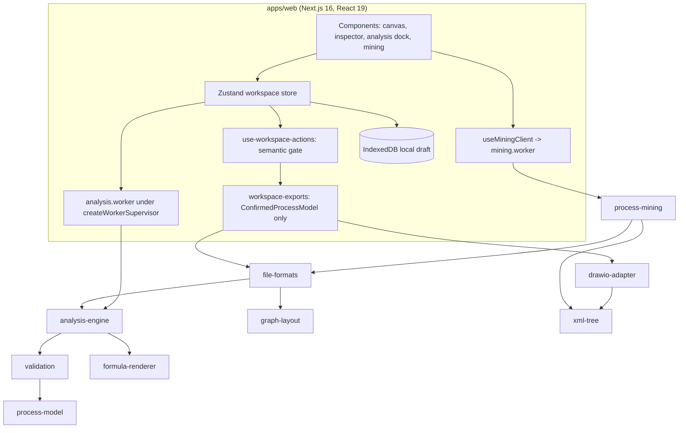
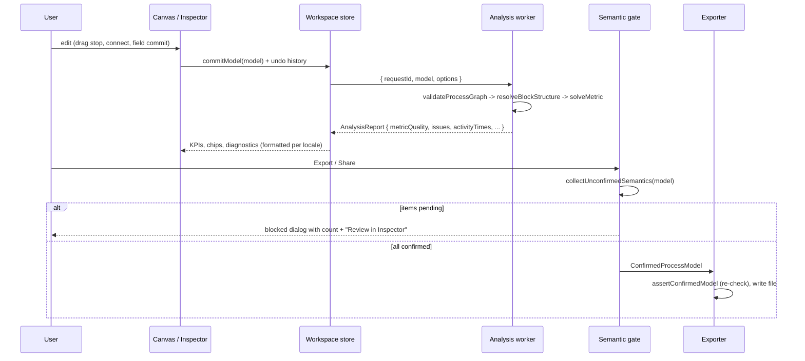

<p align="center">
  
</p>

<h1 align="center">Flowculus</h1>

<p align="center">
  <strong>Mô hình hoá quy trình (tập con BPMN), khai phá quy trình và phân tích thời gian chu trình ngay trong trình duyệt.</strong><br />
  <em>BPMN-subset process modelling, process mining and cycle-time analysis in the browser.</em>
</p>

<p align="center">
  Tiếng Việt trước, English ngay bên dưới mỗi phần · Vietnamese first, English follows each section.
</p>

---

## Mục lục · Contents

1. [Giới thiệu và phạm vi · Product and scope](#1-giới-thiệu-và-phạm-vi--product-and-scope)
2. [Tính năng và tập con BPMN · Features and BPMN subset](#2-tính-năng-và-tập-con-bpmn--features-and-bpmn-subset)
3. [Hình ảnh và sơ đồ · Screenshots and diagrams](#3-hình-ảnh-và-sơ-đồ--screenshots-and-diagrams)
4. [Kiến trúc và luồng dữ liệu · Architecture and data flow](#4-kiến-trúc-và-luồng-dữ-liệu--architecture-and-data-flow)
5. [Công thức, giả định, chất lượng và giới hạn · Formulas, assumptions, quality and limits](#5-công-thức-giả-định-chất-lượng-và-giới-hạn--formulas-assumptions-quality-and-limits)
6. [draw.io và xác nhận ngữ nghĩa · draw.io and semantic confirmation](#6-drawio-và-xác-nhận-ngữ-nghĩa--drawio-and-semantic-confirmation)
7. [Cấu trúc repository · Repository structure](#7-cấu-trúc-repository--repository-structure)
8. [Yêu cầu · Prerequisites](#8-yêu-cầu--prerequisites)
9. [Lệnh · Commands](#9-lệnh--commands)
10. [Biến môi trường · Environment variables](#10-biến-môi-trường--environment-variables)
11. [Worker, bản nháp cục bộ và hiệu năng · Workers, local draft and performance](#11-worker-bản-nháp-cục-bộ-và-hiệu-năng--workers-local-draft-and-performance)
12. [Responsive và trợ năng · Responsive and accessibility](#12-responsive-và-trợ-năng--responsive-and-accessibility)
13. [Triển khai Vercel · Vercel deployment](#13-triển-khai-vercel--vercel-deployment)
14. [Xử lý sự cố · Troubleshooting](#14-xử-lý-sự-cố--troubleshooting)
15. [Ma trận kiểm thử và giới hạn đã biết · Testing matrix and known limitations](#15-ma-trận-kiểm-thử-và-giới-hạn-đã-biết--testing-matrix-and-known-limitations)
16. [Bảo mật và quyền riêng tư · Security and privacy](#16-bảo-mật-và-quyền-riêng-tư--security-and-privacy)
17. [Changelog và ghi chú chuyển đổi · Changelog and migration notes](#17-changelog-và-ghi-chú-chuyển-đổi--changelog-and-migration-notes)

---

## 1. Giới thiệu và phạm vi · Product and scope

**Flowculus** là không gian làm việc chạy hoàn toàn trên trình duyệt, không có backend, để vẽ quy trình nghiệp vụ, khai phá quy trình từ nhật ký sự kiện và phân tích định lượng thời gian chu trình theo chương 7 của _Fundamentals of Business Process Management_ (Dumas và cộng sự, ấn bản 2). Có hai chế độ:

- **Model**: canvas BPMN gốc (React Flow). Mỗi chỉnh sửa được ghi vào mô hình ngữ nghĩa, rồi Web Worker tính lại phân tích.
- **Mining**: nạp nhật ký sự kiện (CSV, TSV, JSON, XES), xem đồ thị directly-follows, biến thể, điểm nghẽn, rồi chuyển mô hình đã khai phá sang canvas.

Mọi kết quả đều kèm mức chất lượng (`exact`, `assumption`, `simulation-required`) và các phát hiện giải thích lý do. Khi không thể tính giải tích, Flowculus **không đưa ra con số** thay vì đoán. Flowculus không phải công cụ mô phỏng và không hỗ trợ toàn bộ BPMN 2.0.

**English.** Flowculus is a browser-only, zero-backend workspace for drawing business processes, mining them from event logs and analysing cycle time quantitatively, following chapter 7 of _Fundamentals of Business Process Management_ (Dumas et al., 2nd ed.). **Model** mode is a native React Flow BPMN canvas whose edits update a semantic model that a Web Worker re-analyses; **Mining** mode loads CSV/TSV/JSON/XES event logs, shows the directly-follows graph, variants and bottlenecks, and sends the discovered model to the canvas. Every result carries a quality (`exact`, `assumption`, `simulation-required`) plus the findings behind it; when no analytic value exists, the number is withheld rather than guessed. Flowculus is not a simulator and does not implement full BPMN 2.0.

## 2. Tính năng và tập con BPMN · Features and BPMN subset

| Nhóm · Area                              | Tính năng · Feature                                                                                                                                                                                                                                                                                                              |
| :--------------------------------------- | :------------------------------------------------------------------------------------------------------------------------------------------------------------------------------------------------------------------------------------------------------------------------------------------------------------------------------- |
| Canvas                                   | Kéo/thả hoặc bấm để thêm hình, nối luồng, đổi tên tại chỗ, undo/redo (100 bước), thao tác nhanh, minimap, phím tắt · drag or click to add shapes, connect flows, inline rename, undo/redo (100 steps), quick actions, minimap, shortcuts                                                                                         |
| Dữ liệu trên sơ đồ · Data on the diagram | Chip `CT`/`T`/`Wq` kèm nguồn thời gian (tooltip), xác suất nhánh, rework, huy hiệu "cần xác nhận", chuỗi găng (nét liền = chính xác, nét đứt = ước lượng, có chú giải) · time chips with their source, branch probabilities, rework, "needs confirmation" badges, critical chain (solid = exact, dashed = estimate, with legend) |
| Phân tích · Analysis                     | CT, TCT, CTE (tỉ lệ), chi phí, CPM, chuỗi găng, đếm đường đi, công suất theo nhóm nguồn lực, hàng đợi M/M/c, định luật Little, chất lượng theo từng chỉ số · CT, TCT, CTE (ratio), cost, CPM, critical chain, path count, capacity per pool, M/M/c queues, Little's Law, per-metric quality                                      |
| Chẩn đoán · Diagnostics                  | Mã ổn định có mức độ, ảnh hưởng chất lượng và đường dẫn; bấm để nhảy tới phần tử · stable codes with severity, quality impact and path; click to focus the element                                                                                                                                                               |
| draw.io                                  | Nhập file thường, nén, nhiều trang; xuất bằng cách vá XML gốc (giữ ngữ nghĩa, không cam kết giống từng byte) · import plain, compressed and multi-page files; export patches the original XML (semantic-preserving, not byte-for-byte)                                                                                           |
| Xuất · Export                            | `.drawio`, `.flowculus.json`, CSV nút/cạnh, SVG, PNG, JPEG, báo cáo PDF và báo cáo ảnh · `.drawio`, `.flowculus.json`, nodes/edges CSV, SVG, PNG, JPEG, PDF and image reports                                                                                                                                                    |
| Khai phá · Mining                        | 4 log mẫu, ánh xạ cột (EN/VI/XES), bộ lọc, biến thể, điểm nghẽn, DFG → BPMN có đánh dấu suy luận · 4 sample logs, column mapping (EN/VI/XES headers), filters, variants, bottlenecks, DFG → BPMN with inference flags                                                                                                            |
| Giao diện · UI                           | Sáng/tối, Anh/Việt, 320 px → màn hình rộng, bàn phím, giảm chuyển động · light/dark, English/Vietnamese, 320 px to wide screens, keyboard, reduced motion                                                                                                                                                                        |

**Tập con BPMN được hỗ trợ · Supported BPMN subset**

| Phần tử · Element                                                                                               | Trạng thái · Status                                                                                          |
| :-------------------------------------------------------------------------------------------------------------- | :----------------------------------------------------------------------------------------------------------- |
| Start/end event, task, collapsed subprocess (xem như một hoạt động · treated as one activity)                   | Hỗ trợ · supported                                                                                           |
| Intermediate event có thời gian · timed intermediate event                                                      | Hỗ trợ như độ trễ · supported as a delay                                                                     |
| XOR, AND, OR gateway dạng khối (single-entry/single-exit)                                                       | Hỗ trợ; điểm hội tụ phải được chứng minh hoặc ghép rõ · supported; joins must be proven or explicitly paired |
| Vòng lặp/rework qua gateway · loops and rework                                                                  | Hỗ trợ qua điểm bất động kỳ vọng · supported via expected-visit fixed point                                  |
| Event-based, complex gateway khi tách nhánh · as splits                                                         | `simulation-required`                                                                                        |
| Nhiều start event, khối không cấu trúc, join không khớp · multiple starts, unstructured blocks, unmatched joins | `simulation-required` + chẩn đoán · diagnostic                                                               |
| Boundary event, terminate end event                                                                             | Giữ trong file, không mô hình hoá (`assumption`) · kept in the file, not modelled                            |
| Pool/lane, data object, annotation, message flow, association                                                   | Giữ khi xuất, bỏ qua khi phân tích · preserved on export, ignored by analysis                                |

## 3. Hình ảnh và sơ đồ · Screenshots and diagrams

Repository chỉ có logo trong `apps/web/public`; README không chèn ảnh chụp giả. Hãy chạy `pnpm dev` để xem giao diện thật. Các sơ đồ kiến trúc và luồng dữ liệu ở mục 4 được vẽ bằng Mermaid.

**English.** The repository only ships the logo in `apps/web/public`, so this README embeds no mock screenshots. Run `pnpm dev` to see the real UI; section 4 contains the Mermaid architecture and data-flow diagrams.

## 4. Kiến trúc và luồng dữ liệu · Architecture and data flow

Ứng dụng Next.js chỉ điều phối và hiển thị. Mọi công thức nằm trong `packages/analysis-engine`, mọi kiểm tra trong `packages/validation`, giao thức draw.io trong `packages/drawio-adapter`. Các package là TypeScript thuần nên chạy được trong Worker và Vitest.

**English.** The Next.js app only composes and presents. Formulas live in `packages/analysis-engine`, validation in `packages/validation`, the draw.io protocol in `packages/drawio-adapter`. Packages are pure TypeScript, so they run in Workers and in Vitest.





Chi tiết: [docs/architecture.md](docs/architecture.md), [ADR 0002](docs/adr/0002-native-canvas.md), [ADR 0003](docs/adr/0003-honest-analysis-and-semantic-gate.md), [ADR 0004](docs/adr/0004-webpack-for-module-workers.md).

## 5. Công thức, giả định, chất lượng và giới hạn · Formulas, assumptions, quality and limits

**Hợp đồng thời gian của hoạt động · Activity time contract** (một hàm duy nhất · one helper: `resolveActivityTime`)

| Dữ liệu nhập · Inputs               | CT của hoạt động · Activity CT | Nguồn · `cycleTimeSource` | Chất lượng · Quality                                                         |
| :---------------------------------- | :----------------------------- | :------------------------ | :--------------------------------------------------------------------------- |
| `D` (thời gian quan sát · observed) | `D`                            | `observed`                | exact; nếu `T + Wq < D` → cảnh báo `unexplained-wait` (assumption) · warning |
| `T` và/hoặc `Wq`, không có `D`      | `T + Wq`                       | `derived`                 | exact                                                                        |
| `T + Wq > D`                        | —                              | —                         | lỗi `time-components-exceed-cycle-time` · error                              |
| không có gì · nothing               | 0                              | `missing`                 | assumption (`missing-activity-time`)                                         |

Nguồn thời gian xử lý `T` (`processingSource`): `explicit`, `derived` (`D − Wq`), `cycle-time-estimate` (lấy `D` làm `T`, là giả định) hoặc `missing`. Cả hai nguồn được hiển thị trong Inspector, tooltip của chip, CSV (`cycle_time_source`, `effective_cycle_time_minutes`), báo cáo PDF và báo cáo ảnh.

**English.** Observed cycle time `D` wins; otherwise `CT = T + Wq`; `T + Wq > D` is an error and `T + Wq < D` raises an `unexplained-wait` assumption. Processing time `T` is `explicit`, `derived` (`D − Wq`), a `cycle-time-estimate` (an assumption) or `missing`. Both sources are shown in the Inspector, chip tooltips, CSV, PDF and image reports.

**Quy tắc khối · Block rules** (Dumas et al., ch. 7)

$$\text{Sequence: } CT=\sum_i CT_i \qquad \text{XOR: } CT=\sum_i p_i\,CT_i \qquad \text{AND: } CT=\max_i CT_i,\ \text{Cost}=\sum_i \text{Cost}_i$$

$$\text{Rework on one task: } CT=\frac{CT_{task}}{1-r}\ (0\le r<1) \qquad \text{Loops: expected visits as an absorbing Markov-chain fixed point}$$

- **OR**: trung bình kỳ vọng của `max` trên mọi tổ hợp nhánh khác rỗng, giả định các nhánh **độc lập** (luôn là `assumption`); quá 12 nhánh → `simulation-required` · expected `max` over every non-empty branch combination, assuming **independent** branches (always `assumption`); more than 12 branches → `simulation-required`.
- **Ghép split/join · Split/join pairing**: dùng `flowculus-join-id` nếu có (chọn trong Inspector), nếu không thì chứng minh bằng post-dominator + kiểm tra SESE + cùng loại gateway. Không chứng minh được → `simulation-required`, không bao giờ "chọn cái đầu tiên" · explicit `flowculus-join-id` first, otherwise post-dominators + SESE + matching kind; unproven → `simulation-required`, never "the first one".
- **TCT** dùng `T` thay cho CT của hoạt động · uses `T` instead of activity CT. **CTE = TCT / CT** là tỉ lệ trong `[0, 1]`; chỉ bộ định dạng mới nhân 100. `CT = 0` hoặc đầu vào không hợp lệ → `null` + chẩn đoán; `TCT > CT` → `cte-out-of-range` · CTE is a ratio in `[0, 1]`, only formatters multiply by 100; `CT = 0` or invalid inputs give `null` plus a diagnostic.
- **Cost** = Σ lượt thăm kỳ vọng × (`T`/60 × đơn giá giờ + chi phí khác) · expected visits × (`T`/60 × hourly rate + other cost).
- **CPM** (đường găng theo `T`): chỉ cho đồ thị không có quyết định và không có chu trình. Thiếu `T` thì dùng `D` như **giả định** và cảnh báo nêu tên các hoạt động (`cpm-duration-estimate`) · only for decision-free acyclic graphs; missing `T` falls back to `D` as an **assumption** that names the tasks.
- **Chuỗi găng · Critical chain** (theo CT kỳ vọng): `exact` khi không có quyết định; nếu có, đây là **heuristic thời gian kỳ vọng** (nhánh có xác suất × thời gian còn lại lớn nhất), không phải "nhánh khả dĩ nhất". Canvas vẽ nét đứt và có chú giải khi là ước lượng · `exact` when decision-free, otherwise an **expected-time heuristic** (largest probability × remaining expected time), not "the most likely branch"; dashed with a legend on the canvas.
- **Công suất · Capacity**: `ρ = λ × tải đơn vị / (60 × c)` (λ theo giờ, tải đơn vị = phút xử lý của nhóm trên mỗi ca · λ per hour, unit load = pool processing minutes per case); hàng đợi M/M/c bằng Erlang C với `μ = 60 / tải đơn vị`; `ρ ≥ 1` → không ổn định · Erlang C per pool, unstable when `ρ ≥ 1`. **Little's Law**: `WIP = λ × CT`.

**Mức chất lượng · Quality levels**

| Mức · Level           | Ý nghĩa · Meaning                                                                                                                                                |
| :-------------------- | :--------------------------------------------------------------------------------------------------------------------------------------------------------------- |
| `exact`               | Đúng theo công thức sách với dữ liệu đã cho · exact under the book's equations for the given inputs                                                              |
| `assumption`          | Có số, nhưng dựa trên giả định được liệt kê (thời gian ước lượng, OR độc lập, ngữ nghĩa suy luận, phần tử bỏ qua…) · a number that depends on listed assumptions |
| `simulation-required` | Không có giá trị giải tích; số bị ẩn (`null`) · no analytic value; the number is withheld                                                                        |

Mỗi chẩn đoán có `impact` và `scope` (`model`, `processing`, `efficiency`, `cost`, `capacity`, `queue`, `critical-path`); chất lượng từng chỉ số (`metricQuality`) là mức xấu nhất của các chẩn đoán liên quan. Mức tiêu đề = xấu nhất của CT và TCT.

**English.** Each diagnostic has an `impact` and a `scope`; each metric's quality (`metricQuality`) is the worst impact in its scope, and the headline is the worse of CT and TCT.

**Giới hạn · Limits**: không mô phỏng; không có phân phối thời gian (chỉ kỳ vọng); OR giả định độc lập; tài nguyên dùng chung giữa các nhánh song song không được mô hình hoá; hàng đợi là xấp xỉ theo từng nhóm nguồn lực (`pool-queue-approximation`). · No simulation, expected values only, independent-OR assumption, no shared-resource contention across parallel branches, per-pool queue approximation.

## 6. draw.io và xác nhận ngữ nghĩa · draw.io and semantic confirmation

- **Nhập · Import**: file thường, nén (deflate-raw + base64 + URI) và nhiều trang. Hình không có metadata `flowculus-*` được phân loại từ style và **gắn cờ suy luận** (`flowculus-inferred-*`): loại phần tử, loại gateway, loại luồng, xác suất đọc từ nhãn. Ảnh, chữ, pool/lane là phần trình bày. Nhập CSV và mô hình khai phá cũng gắn cờ tương tự · plain, compressed and multi-page files; shapes without Flowculus metadata are classified from their style and flagged as inferred; CSV import and mined models are flagged the same way.
- **Cổng xác nhận · Semantic gate**: còn mục chưa xác nhận thì mọi lệnh **Export** và **Share** bị chặn bởi một hộp thoại song ngữ có số lượng và nút "Review in Inspector". Inspector cho xác nhận từng mục, hoặc "Confirm all remaining…" qua bước xác nhận thứ hai. Xác nhận ghi `flowculus-confirmed`. Lớp xuất cấp thấp chỉ nhận `ConfirmedProcessModel` và kiểm tra lại. Chỉnh sửa, phân tích và bản nháp cục bộ vẫn hoạt động khi bị chặn · while anything is pending, Export and Share open a bilingual blocked dialog with the count and "Review in Inspector"; confirm per item or "Confirm all remaining…" behind a second step; confirmation records `flowculus-confirmed`; the low-level exporter accepts only a `ConfirmedProcessModel` and re-checks it; editing, analysis and the local draft keep working.
- **Xuất · Export (round-trip)**: vá XML gốc. Giữ nguyên ô không xác định, `UserObject`, style, nhãn HTML, waypoint của luồng không đổi và các trang khác (trang nén vẫn nén). Trang đang sửa được ghi **không nén**. Phỏng đoán chưa xác nhận **không** bao giờ được ghi lại như thuộc tính tường minh; ngữ nghĩa đã xác nhận và ghép join thì được ghi để lần nhập sau không cần xác nhận lại. Đây là **bảo toàn ngữ nghĩa**, không phải "lossless từng byte" · patches the original XML; keeps unknown cells, styles, HTML labels, waypoints of unchanged flows and other pages (still compressed); the edited page is written uncompressed; unconfirmed guesses are never written back as explicit attributes, confirmed ones are. This is **semantic preservation**, not byte-for-byte.

## 7. Cấu trúc repository · Repository structure

```text
Flowculus/
├── apps/web/                    Next.js 16 App Router app
│   ├── app/                     layout, error/loading pages, styles/ (canvas, dock, formula, mining CSS)
│   ├── components/
│   │   ├── analysis/            FormulaCard, IssueList, CriticalPathPanel
│   │   ├── canvas/              React Flow canvas, BPMN node views, legend
│   │   ├── inspector/           node/edge inspectors, time summary, join pairing
│   │   ├── mining/              source, filters, map, insights, column mapping
│   │   ├── scenario/            scenario fields, capacity table, queue summary
│   │   ├── semantics/           gate dialog, review panel, confirmed chip
│   │   └── ui/                  shared primitives (tooltip, quality badge, error boundary…)
│   ├── lib/                     store, hooks, exports, report content, i18n/, worker supervisor
│   ├── scripts/                 verify-worker-bundle.mjs (build guard)
│   └── workers/                 analysis.worker.ts, mining.worker.ts
├── packages/
│   ├── analysis-engine/         formulas, structure proofs, quality, CPM, chain, capacity, queues
│   ├── validation/              schema, diagnostics, graph checks, semantic confirmation
│   ├── process-model/           domain types and metadata keys
│   ├── drawio-adapter/          draw.io decode/classify/patch export
│   ├── file-formats/            .flowculus.json, CSV, SVG, auto layout
│   ├── process-mining/          log parsing, DFG, variants, bottlenecks, DFG → BPMN
│   ├── formula-renderer/        formula AST
│   ├── graph-layout/            layered layout, orthogonal routing
│   └── xml-tree/                dependency-free XML
├── docs/                        architecture.md, adr/
├── AGENTS.md                    contributor and agent rules (English)
└── .nvmrc, .env.example, turbo.json, vitest.config.mts
```

## 8. Yêu cầu · Prerequisites

- Node.js **22.x** (`.nvmrc`; tối thiểu · minimum 20.9 theo · per Next.js 16).
- pnpm **11.22.0** qua Corepack (`corepack enable`) · via Corepack.
- Trình duyệt hỗ trợ module Web Worker và IndexedDB (Chrome, Edge, Firefox, Safari bản hiện hành) · a browser with module workers and IndexedDB.

## 9. Lệnh · Commands

```bash
corepack enable
pnpm install            # cài đặt · install
pnpm dev                # máy chủ phát triển · dev server (http://localhost:3000)
pnpm test               # Vitest cho mọi package và app · all packages and the app
pnpm lint               # ESLint (0 cảnh báo · 0 warnings)
pnpm typecheck          # TypeScript cho mọi package · all packages
pnpm format             # Prettier ghi · write
pnpm format:check       # Prettier kiểm tra · check
pnpm build              # next build --webpack + kiểm tra worker · worker bundle check
pnpm start              # chạy bản build · serve the build
pnpm check              # test + format:check + lint + typecheck + build
```

Các biến thể `:dev`/`:pro` (`pnpm dev:pro`, `pnpm build:pro`…) chỉ nạp thêm `.env.dev`/`.env.pro` nếu bạn tạo. · The `:dev`/`:pro` variants only load an optional `.env.dev`/`.env.pro`.

## 10. Biến môi trường · Environment variables

Flowculus **không đọc biến môi trường nào**. `.env.example` chỉ có chú thích; mọi file `.env.*` khác bị git bỏ qua. Không bao giờ commit giá trị bí mật. Trên Vercel không cần cấu hình biến nào; `ENABLE_EXPERIMENTAL_COREPACK=1` là tuỳ chọn để Vercel dùng đúng pnpm trong `packageManager`.

**English.** Flowculus reads **no environment variables**. `.env.example` only contains comments, every other `.env.*` file is git-ignored, and secrets must never be committed. Vercel needs no variables; `ENABLE_EXPERIMENTAL_COREPACK=1` is optional to make Vercel use the exact pnpm from `packageManager`.

## 11. Worker, bản nháp cục bộ và hiệu năng · Workers, local draft and performance

- **Analysis worker** (`createWorkerSupervisor`): yêu cầu mới nhất thắng; yêu cầu cũ chạy quá 750 ms bị huỷ bằng cách khởi động lại worker; quá 20 s thì dừng và báo; worker lỗi được khởi động lại tối đa 2 lần liên tiếp rồi mới chuyển sang tính trên luồng chính · latest request wins, stale runs over 750 ms are cancelled by restarting the worker, 20 s timeout, at most 2 consecutive restarts before the main-thread fallback.
- **Mining worker** (`useMiningClient`): timeout 90 s, nút **Cancel** khi đang tải, khởi động lại có giới hạn. Worker giữ nhật ký nên khi huỷ/lỗi, phiên khai phá được xoá và cần nạp lại · 90 s timeout, a Cancel button while loading, bounded restart; aborts clear the session because the worker holds the log.
- Worker được webpack đóng gói thành `flowculus-analysis.*.js` và `flowculus-mining.*.js`; `scripts/verify-worker-bundle.mjs` làm build thất bại nếu worker bị xuất dưới dạng mã nguồn `.ts` (xem ADR 0004) · webpack bundles the workers; the build fails if a worker is emitted as raw `.ts` (ADR 0004).
- **Bản nháp · Draft**: một bản nháp trong IndexedDB (dự phòng localStorage), ghi có debounce · one debounced IndexedDB draft with a localStorage fallback.
- Kéo thả nằm trong React Flow; store chỉ nhận thay đổi đã commit. Nhật ký giới hạn 500.000 dòng; OR giới hạn 12 nhánh; đếm đường đi có giới hạn · drag frames stay inside React Flow; logs are capped at 500,000 rows, OR at 12 branches, path counting is bounded.
- Mỗi vùng chính (canvas, mining, phân tích, Inspector) có error boundary với nút thử lại; trạng thái offline hiện ở thanh trạng thái · each main region has an error boundary with retry; offline state shows in the status bar.

## 12. Responsive và trợ năng · Responsive and accessibility

- Đã kiểm tra ở 320, 390, 430, 768, 1024, 1440 và 1920 px: không tràn ngang, Export luôn truy cập được, hộp thoại vừa màn hình. Trên điện thoại Inspector là bottom sheet và thanh công cụ thu gọn · checked at 320–1920 px: no horizontal overflow, Export reachable, dialogs fit; on phones the Inspector is a bottom sheet with a compact toolbar.
- Menu Export hỗ trợ phím mũi tên, Home/End, Enter, Escape và trả focus; hộp thoại giữ focus; mọi nút có tên truy cập; chất lượng hiển thị bằng chấm + chữ + tooltip, không chỉ bằng màu · keyboard menus, focus-trapped dialogs, accessible names, quality shown by dot + text + tooltip, never colour alone.
- Sáng/tối, tương phản WCAG AA, tôn trọng `prefers-reduced-motion`, chỉ animate `transform`/`opacity` · light/dark, WCAG AA contrast, reduced motion respected.

## 13. Triển khai Vercel · Vercel deployment

1. Import repository vào Vercel, đặt **Root Directory = `apps/web`** (giữ bật "Include files outside the root directory"). Vercel đọc `apps/web/vercel.json`: framework `nextjs`, cài đặt `pnpm install --frozen-lockfile` (cài cả workspace), build `pnpm run build` · set **Root Directory = `apps/web`**; Vercel reads `apps/web/vercel.json`.
2. Node.js **22.x** (từ `engines` của `apps/web/package.json`) · Node 22.x from `engines`.
3. Không cần biến môi trường. Tuỳ chọn `ENABLE_EXPERIMENTAL_COREPACK=1` · no variables needed.
4. **Preview**: mỗi pull request/nhánh tạo một Preview Deployment; kiểm tra lại các luồng ở mục 15 trên URL preview · every branch/PR gets a preview; re-run the section 15 flows there.
5. **Production**: merge vào nhánh production, hoặc "Promote to Production" một preview đã kiểm tra · merge to the production branch or promote a verified preview.
6. **Rollback**: Vercel → Deployments → chọn bản trước → "Instant Rollback" (hoặc `vercel rollback`) · Instant Rollback to the previous deployment.

Lý do sửa cấu hình: `vercel.json` cũ ở thư mục gốc đặt `framework: nextjs` trong khi `package.json` gốc không có `next`, nên Vercel không nhận diện được Next.js nếu Root Directory là gốc, và bị bỏ qua nếu Root Directory là `apps/web`. Cấu hình nay nằm cạnh ứng dụng. Các header bảo mật được đặt trong `next.config.ts` để chạy ở mọi môi trường. Trang là static (`○`), không có API route.

**English.** The old root `vercel.json` declared `framework: nextjs` while the root `package.json` has no `next` dependency, so Next.js detection fails with Root Directory at the repo root and the file is ignored with Root Directory `apps/web`; the config now lives next to the app. Security headers are set in `next.config.ts` so they apply everywhere. All routes are static; there are no API routes. The Vercel CLI was not run from this environment, so verify the first preview deployment by hand.

## 14. Xử lý sự cố · Troubleshooting

| Triệu chứng · Symptom                                                   | Cách xử lý · Fix                                                                                                                        |
| :---------------------------------------------------------------------- | :-------------------------------------------------------------------------------------------------------------------------------------- |
| Vercel: "No Next.js version detected"                                   | Root Directory phải là `apps/web` · must be `apps/web`                                                                                  |
| Build báo "Worker bundling check failed" · build fails the worker check | Đừng build bằng Turbopack; dùng `pnpm build` (webpack) · build with webpack via `pnpm build` (ADR 0004)                                 |
| Thanh trạng thái: "calculating on the main thread"                      | Trình duyệt chặn module worker (CSP, extension); kết quả vẫn đúng nhưng chậm hơn · workers are blocked; results stay correct but slower |
| Export/Share mở hộp thoại "Confirm inferred semantics first"            | Bấm "Review in Inspector" và xác nhận hoặc sửa từng mục · review and confirm in the Inspector                                           |
| KPI hiện N/A với chấm đỏ · N/A with a red dot                           | Mô hình cần mô phỏng (nhiều start, khối không cấu trúc, join không khớp…); xem danh sách phát hiện · see the findings list              |
| Khai phá bị dừng/huỷ · mining stopped                                   | Log quá lớn hoặc bị huỷ; lọc bớt hoặc nạp lại · reload or filter the log                                                                |
| `pnpm install` lỗi phiên bản pnpm · pnpm version error                  | `corepack enable` rồi cài lại · then reinstall                                                                                          |

## 15. Ma trận kiểm thử và giới hạn đã biết · Testing matrix and known limitations

| Tầng · Layer                                          | Nội dung · Coverage                                                                                                                                                                                                                                                                              |
| :---------------------------------------------------- | :----------------------------------------------------------------------------------------------------------------------------------------------------------------------------------------------------------------------------------------------------------------------------------------------- |
| `analysis-engine`                                     | mọi nhóm công thức (sequence, XOR, AND, OR, rework, loop, TCT, CTE 0/1/giữa/không hợp lệ, cost, CPM, chain, capacity, M/M/c, Little) và cấu trúc (XOR/AND/OR lồng, join dùng chung, không cấu trúc, thiếu join, vòng lặp); số liệu ghim · every formula group and structure case; pinned numbers |
| `validation`                                          | chẩn đoán đồ thị, nhiều start, chính sách xác nhận · graph diagnostics, multiple starts, confirmation policy                                                                                                                                                                                     |
| `drawio-adapter`                                      | round-trip bảo toàn ngữ nghĩa (file gốc không metadata, trang nén, waypoint, UserObject, join-id) · semantic-preserving round trip                                                                                                                                                               |
| `file-formats`, `process-mining`                      | hợp đồng CSV/JSON, số liệu preset ghim · CSV/JSON contracts, pinned preset numbers                                                                                                                                                                                                               |
| `apps/web`                                            | lệnh chỉnh sửa, worker supervisor, nội dung báo cáo, chất lượng đi qua worker → store → UI → export, đủ bản dịch chẩn đoán · editing commands, worker supervisor, report content, quality pipeline, diagnostic translations                                                                      |
| Trình duyệt · Browser (Playwright, thủ công · manual) | palette, nhập draw.io gốc, bị chặn export/share, xác nhận, export thành công, chẩn đoán không cấu trúc, offline, mining, 320–1920 px · the main flows at 320–1920 px                                                                                                                             |

**Giới hạn đã biết · Known limitations**: chưa có CSP (cần nonce cho script của Next.js); chưa có test e2e tự động trong CI (kịch bản Playwright chạy thủ công); không có mô phỏng; pool/lane không được vẽ; boundary event không được mô hình hoá; xuất PDF dùng hộp thoại in của trình duyệt. · No CSP yet, no automated e2e in CI, no simulation, pools/lanes not drawn, boundary events not modelled, PDF uses the browser print dialog.

## 16. Bảo mật và quyền riêng tư · Security and privacy

- Không telemetry, không server lưu trữ: mô hình, nhật ký và kết quả ở lại trong trình duyệt · no telemetry, no server storage.
- Không iframe bên thứ ba; header `X-Content-Type-Options`, `Referrer-Policy`, `X-Frame-Options: DENY`, `Permissions-Policy` · no third-party iframe; baseline security headers.
- File nhập được xem là không tin cậy: parser XML/CSV tự viết có giới hạn, không `eval`, không chèn HTML từ file · imported files are untrusted: bounded parsers, no `eval`, no HTML injection.
- Không có secret trong repository; chỉ `.env.example` được theo dõi · no secrets in the repository.

## 17. Changelog và ghi chú chuyển đổi · Changelog and migration notes

**Production hardening**

- Chẩn đoán có cấu trúc thay cho chuỗi văn bản: `AnalysisReport.issues: Diagnostic[]` thay cho `assumptions`/`warnings`; thêm `metricQuality` và `activityTimes` · structured diagnostics replace string lists.
- Nhiều start event, khối không cấu trúc và join không chứng minh được giờ là `simulation-required` (trước đây có thể ra số "exact"). Ví dụ: XOR tách rồi AND hội tụ trước đây cho CT 18, nay không có số · unproven structures now return `simulation-required` instead of a number.
- CTE là tỉ lệ `[0, 1]` trong engine, snapshot và file (`units.cycleTimeEfficiency: "ratio"`) · CTE is a ratio everywhere.
- CSV thêm cột `effective_cycle_time_minutes` và `cycle_time_source` (sau `waiting_minutes`); bộ đọc CSV cũ vẫn đọc được vì cột được nhận theo tên · CSV gains two columns, read by name.
- Export/Share bị chặn cho tới khi xác nhận ngữ nghĩa suy luận · export/share require confirmation of inferred semantics.
- Build dùng webpack để đóng gói worker; cấu hình Vercel chuyển vào `apps/web/vercel.json` · webpack build for workers; Vercel config moved.
- Số liệu của mô hình mẫu và 4 preset khai phá giữ nguyên (đã ghim bằng test) · starter and mining preset numbers are unchanged and pinned.

## Tham khảo · References

- Dumas, La Rosa, Mendling & Reijers, _Fundamentals of Business Process Management_, 2nd ed., Springer.
- React Flow (`@xyflow/react`, MIT): https://reactflow.dev
- draw.io / diagrams.net file format: https://github.com/jgraph/drawio
- IEEE 1849-2016 XES.

Giấy phép · License: MIT.
